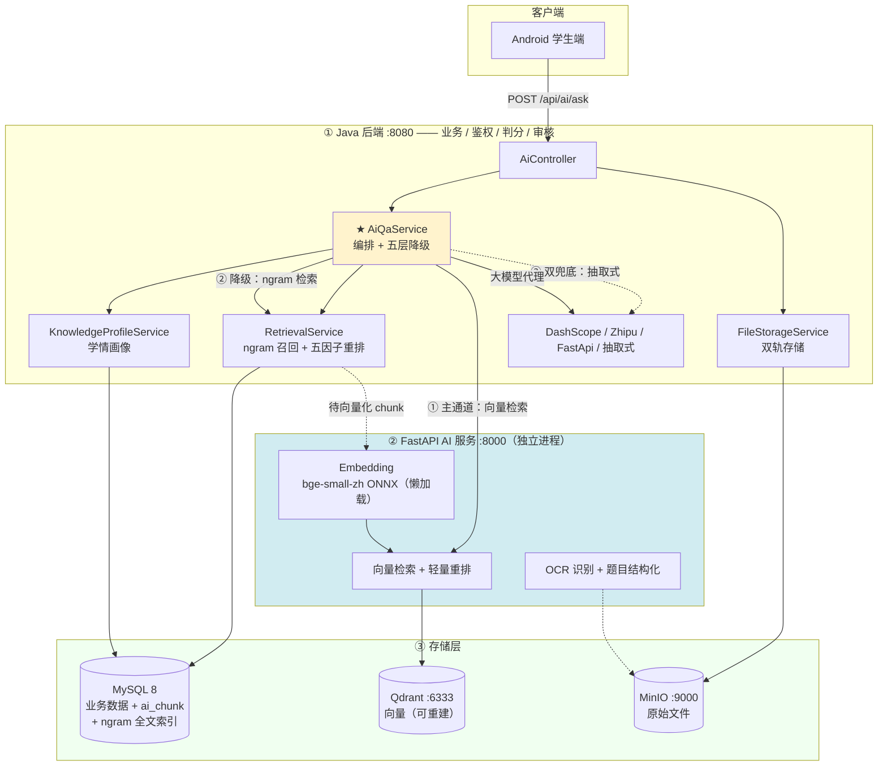

# 大学生多考试备考知识库与题库系统

> 面向高校学生的**资料治理 + 智能备考**平台。Android 学生端 + Web 管理端 + Spring Boot 后端三端架构，覆盖「资料上传—审核—预览—下载—举报—下架」治理闭环与「刷题—判分—错题—模考」学习闭环，内置**中南林业科技大学真实教学计划数据**。
>
> **AI 导学**为独立 FastAPI 微服务：本地 **Qwen2.5-7B（Ollama，GPU 推理 52 tok/s，无需联网与 API Key）** + bge-small-zh 向量检索 + **Router/Skill 架构**（8 个技能，三闸门判定）+ 抽取式五层降级。语料 **10,688 块**（行测真题 2,398 + 课件 8,255），课件来自 485 份文档（含 6 章操作系统 PPT），回答**强制带 `[n]` 引用并可跳转原文**。
>
> 软件工程课程设计 / 毕业设计。不商用、不上架。

---

## 一、项目状态（数据均为实测，非估算）

| 模块 | 状态 | 关键指标（2026-10 实测） |
|---|---|---|
| 后端 | ✅ 完成 | Spring Boot 3.5.3 + JDK 21，**195 个接口 / 32 个 Controller**，单测 **124/124** 通过（2026-10-23 实测） |
| 数据库 | ✅ 完成 | MySQL 8，**52 张表**，schema + data + 增量迁移均可重复执行 |
| Android 学生端 | ✅ 完成 | Java + XML 原生，**32 个页面**（28 个 Activity 页面 + 4 个 Fragment），`release/备考知识库学生端-v1.5-真机版.apk` 可直接安装 |
| Web 管理端 | ✅ 完成 | Vue3 + Element Plus 单页（CDN 本地化），由后端同源托管，零构建零跨域 |
| **AI 导学** | ✅ 完成 | **本地大模型**：Qwen2.5-7B（q3_k_m）经 Ollama 部署，**GPU 推理 52 tok/s**、显存 4.0 GB、热态首字 0.03–0.2 s、`keep_alive` 防卸载；**不依赖云端 API 与网络**；<br>**Router/Skill 架构**：bge 句向量意图分类（**平均 4–20 ms**，不是让大模型判断意图），8 个技能 + 三闸门（相似度 / 间隔 / 检索验证），事实类问题**检索无命中即拒答**；<br>**检索隔离**：课程题（QUESTION/KNOWLEDGE）与课件（COURSEWARE）按 `source_type` 硬分流，互不挤占 top-K；<br>**降级**：本地模型不可用时 **0.095 s** 落到抽取式，接口不中断 |
| **Agent 工程** | ✅ 完成 | Agent Harness（Python）+ SSE 轨迹可视化（Java→Vue）+ Redis Stream 异步队列 + 双层离线评估；<br>检索侧 Golden Set **Recall@5 93.1% / MRR 0.703**，Agent 侧 **通过率 98.3% / 工具成功率 100%** |
| **RSI 自改进** | ✅ 本轮新增 | 评测驱动的原型句自动扩充：41 条标注集（训练 33 / 留出 8）→ 失败样本 → 生成候选 → **四道回归闸门** → 落盘并在启动时加载；<br>实测训练集 **93.9% → 100%**、留出集 **8/8 不退化**、域外拒答 **6/6 不退化**、危险误判 **0**；学 2 条原型救回 **4 条未见过**的同义问法（sim 0.39→0.77），**非背题** |
| **LLM Wiki 双引擎** | 🟡 部分完成 | **已完成**：蒸馏器（含 grounding 校验 + 抽取式兜底）、`wiki_page` / `wiki_page_link` / `wiki_page_revision` 三表、Wiki 向量索引（sync/delete/search）、`WIKI_DISTILL` 异步处理器，**已发布 2 页**；<br>**未接线**：`/v1/ask` 尚**未查询 Wiki 热层**，异步 worker 默认关闭（依赖 Redis）→ 目前实际是**纯 RAG 链路**，详见「尚未实现」 |
| **产品闭环** | ✅ MVP 已落地 | **主观题 AI 判分**（得分点命中/遗漏 + 理由 + 保守得分率）、**学习计划**（目标设定 + 诊断 + 每日任务规则引擎） |
| 工程文档 | ✅ 完成 | **20 份文档**（需求/概要/详细/数据库/API/测试/用户手册/部署/总结/**功能大纲**/**软件状态总纲**/**AI判分灰度报告** + AI 设计 ×2 + 降级演练手册 + 环境准备清单 + 验收与注册验证报告） |
| 真实数据 | ✅ 已导入 | 中南林业科技大学 + **23 个学院** + 信息与计算科学专业 **90 门课程**（来自教务教学执行计划） |

### 尚未实现（诚实声明，路线图见第十节）

- ⚠️ **Wiki 热层未接入问答链路**：蒸馏器、三张表、向量索引、异步处理器都已就绪，但
  `/v1/ask` 目前**只走 RAG**，不会先查 Wiki 页；且 `JOB_WORKER_ENABLED` /
  `WIKI_WORKER_ENABLED` 默认 `false`（依赖 Redis），异步蒸馏不会自动运行。
  接入工作量约 0.5 人日（含命中回退逻辑），**未做就是未做，不按"已完成"陈述**
- ⚠️ **106 份课件是纯图片、未入库**：479 份可抽取文本的课件已入库（8,073 块），
  另有 106 份正文全在截图里（含《17 种 RAG 优化策略》《多智能体架构》等核心篇目），
  实测 PaddleOCR **15.7 秒/页**、全量需约 9.2 小时，当前**未做**
- ⚠️ **课件与课程题存在重复块**：同一主题在多篇文章中重复出现，检索时可能返回
  同源多条（如「Rerank 模型」返回两条同一 `source_id`），计划用概念合并去重解决
- ⚠️ **主观题 AI 判分的真实质量数据未取得**：灰度脚本与报告已就绪，但本机大模型 Key 返回
  `401 Unauthorized`，18 道简答全部走降级（详见 `docs/AI判分灰度报告.md`）。
  换有效 Key 后重跑即可得到单调性数据
- ⚠️ **多品类仍是骨架**：考研已补 1 类别 + 6 科目（0 题），四六级/考研题目入库依赖
  「解析器重做 + OCR 建题接入」；当前 2500 道已通过题目中 2470 道是国考行测
- ⚠️ **真机回归未做**：新页面（今日计划 / AI 判分结果）只做了编译与 aapt2 校验，
  还没在真机上跑 TalkBack 与全流程

- ✅ **AI 语料已扩到 10,506 个 chunk**：国考《行测》真题 2016–2026 经清洗后 **2,398 道可作答客观题**
  （题干+四选项+答案+解析）+ 30 个知识点 + 5 份资料；来源为 `D:\题库` 真题 PDF，经文字层解析入库（图形推理等图片题无法从文字层还原，已自动跳过）。
  入库脚本 `sql/data-guokao.sql` + 清洗脚本 `sql/migration-guokao-clean.sql`（均已应用，可重复执行）；
  扩充/重建只需调 `POST /api/admin/ai/reindex`，**不需改任何 Java 代码**
- ⚠️ 语料规模变化后，ngram 侧闸门已按实测**重标定**：`min-term-coverage` 0.25 → **0.5**
  （拒答 4/10 → 10/10；标定过程与数据见 `application.yml` 内注释）。**Recall@5 的评测集也已重构**：
  标答改用内容锚点（原来的关键词反查 `LIMIT 20` 会把高频词的真标答挤出窗口、把 HIT 误判成 MISS），
  指标拆成检索层 / 答案层 / 误拒答三层各自卡阈值（详见 `docs/软件状态总纲.md` §7.1）
- ✅ **OCR 试卷识别能力已就绪并实测可用**：PaddleOCR 3.7.0 + paddlepaddle 3.3.0 已装，
  `POST /v1/ocr` 实测返回「文本块 + 块级置信度」。
  已修复旧代码按 PaddleOCR **2.x** 传参（`show_log` 等）导致「装了却完全不可用」的问题，
  现按主版本自适应（见 `ai-service/app/ocr/paddle_ocr_engine.py`）。
  **尚未做**的是 Java 侧把 OCR 结果自动建题的**业务接入**（当前仅提供识别能力）
- ❌ **无积分体系**：社区激励以「审核贡献 + 收藏/下载记录」替代积分

---

## 二、目录结构

```
大学生多考试备考知识库与题库系统/
├── backend/            后端服务（Java 21 + Spring Boot 3.5.3，195 个接口，内嵌管理端页面）
├── admin-web/          管理端 Web 源码（Vue3 + Element Plus 单页应用）
├── student-app/        学生端 App（Android 原生：Java + XML，Gradle 工程）
├── ai-service/         AI 微服务（FastAPI：向量检索 / 本地 7B 代理 / OCR / Router+Skill）
├── release/            可分发产物：学生端 APK（v1.4 / v1.5，**构建产物不入库**，本地生成）
├── scripts/            运维脚本：上架前自检、备份恢复演练
├── sql/                数据库脚本（schema / data / 22 个脚本，均可重复执行）
├── docs/               20 份工程文档 + 6 个架构图 + 性能测试脚本
├── docker-compose.yml / docker-compose.ai.yml / docker-compose.redis.yml / nginx.conf   部署配置
├── 启动后端.bat / 放行8080端口(需管理员).bat / backup.bat / 同步管理端页面.bat   日常一键脚本
└── README.md
```

---

## 二·五、AI 导学架构（五层降级）

> 核心主张：**除了 MySQL，所有组件都可摘除。任一组件挂掉，问答与上传都仍然可用。**



### 数据流与降级路径

| 数据流 | 方向 | 挂了会怎样 |
|---|---|---|
| 用户提问 | App → Java → **向量通道** | 静默降级到 ngram 检索，**接口仍 200** |
| 用户提问 | App → Java → **大模型** | 超时后熔断 → 换下一个客户端 → 抽取式兜底 |
| 语料向量化 | Java → FastAPI → Qdrant | 熔断 60s；**向量通道跳过，不影响问答** |
| 文件上传 | App → Java → MinIO | **自动落本地磁盘，上传永不失败** |
| 题目/资料审核 | Java → MySQL → （异步）向量 | 索引同步失败只打日志，**不影响主业务** |
| 学情画像 | Java → MySQL | 超时则跳过加权，不影响问答 |

### 五层降级（最外层永远兜得住）

```
第 5 层  断网            → App 隐藏 AI 入口，题库练习等核心功能完全正常
第 4 层  大模型全挂      → 本地抽取式生成（纯进程内，零网络依赖）
第 3 层  向量通道挂      → ngram 全文检索（跑在 MySQL 内部，不需网络/进程/模型）
第 2 层  混合检索        → 向量 Top-20 + ngram Top-20 去重融合 + 五因子重排
第 1 层  拒答闸门        → 两路皆无相关语料 →「未找到相关资料」（反幻觉第一道）
```

**实测数字（可复现）**：

| 场景 | 结果 | 耗时 |
|---|---|---|
| 正常（向量 + 大模型） | `200` `mode=VECTOR_HYBRID` 带 sources | 3.0-3.8s |
| **杀 FastAPI** | `200` `mode=FULLTEXT_OR` 带 sources | 首次 6.6s → 熔断后 1.5s |
| **杀 MinIO** | `200` 上传成功落本地 | 0.13s |
| 无关问题 | `200` `refused=true`「未找到相关资料」 | 12-55ms |

> ⚠️ **如实说明**：首次降级 6.6 秒偏慢（需支付连接失败探测 + 熔断计数），
> 熔断触发后 1.5 秒。**首次有感知、之后无感**，不是「完全无感」。

#### ★ 两道闸门必须分工（核心设计，实测踩出来的）

混合检索最大的陷阱：**用同一道闸门同时卡两路，会把向量的价值一起吞掉**。

| 通道 | 判据 | 阈值 | 为什么 |
|---|---|---|---|
| ngram | **词项覆盖率** | `0.25` | 字面检索，没有词面重叠就不该命中 |
| 向量 | **相似度**（+相对阈值 `0.8×最高分`） | `0.55` | 语义检索，用词面重叠评判自相矛盾 |

**实测证据**（同一道题「函数传参有哪些方式」）：
- ngram 覆盖率 **0.125**（只共享 bigram「函数」）→ 被 0.25 闸门剔除 —— **字面确实该剔**
- 向量 score **0.5884**（语义上就是同一件事）→ **必须放行** —— 这就是向量通道存在的价值

**阈值标定过程**（本身就是亮点素材）：
1. 只拿简单样本「量子纠缠」（最高 0.4184）标定 → 得到 0.45
2. ❌ **0.45 < 0.5126** → 难题「量子力学波函数如何求解」漏过闸门，
   返回「根据《函数》：知识点：函数」这种**带来源的空壳答案**（比拒答危险得多）
3. 加上难题重新标定 → 无关最高 **0.5126** / 相关最低有效 **0.5802** → 取 **0.55**

> **教训：校准集必须包含最难的样本**，只看简单样本会标出看似合理、实则漏放的阈值。
> 这两个阈值已由 `VectorGateThresholdTest`（8 个用例）用真实实测分数固化，
> 任何人改错 CI 立刻红，并直接提示根因。

> 📌 **向量库是派生存储，不是数据源**：删掉整个 Qdrant volume，
> 跑一次 `POST /api/admin/ai/reindex` 即可从 MySQL `ai_chunk` 完全恢复。

> ⚠️ **阈值标定说明（诚实声明）**：语料已扩到 3092 块，相关问题的向量余弦分本轮实测约
> 0.60~0.72（高于 `min-vector-score` 0.55）。但**阈值余量仍需按新语料重跑一遍标定**——
> 无关问题的分布会随语料规模变化；相对阈值（`0.8×最高分`）是为此预留的保险层。

---

## 三、技术选型

| 端 | 技术栈 |
|---|---|
| 学生端 | Android 原生：Java + XML + ViewBinding + Retrofit/OkHttp/Gson + Glide + RecyclerView + Material 3（compileSdk 34 / minSdk 26，Gradle 8.7 + AGP 8.5.2） |
| 管理端 | Vue3 + Element Plus（CDN 本地化单页应用，后端同源托管） |
| 后端 | JDK 21 + Spring Boot 3.5.3 + Spring Security 6 + JWT（jjwt 0.12.6）+ MyBatis-Plus 3.5.7 + springdoc-openapi 2.8.6 + PDFBox 3.0.7 |
| 数据库 | MySQL 8.0（49 张表；主观题/复杂题答案以 MySQL JSON 承载） |
| 构建 | Maven（后端）/ Gradle 8.7 + AGP 8.5.2（学生端） |

---

## 四、快速开始

### 1. 初始化数据库（可重复执行）

```bash
mysql -u root -p < sql/schema.sql
mysql -u root -p < sql/data.sql
mysql -u root -p < sql/migration-p0b.sql
mysql -u root -p < sql/migration-p1.sql
mysql -u root -p < sql/migration-p1b.sql
mysql -u root -p < sql/migration-register.sql            # 学校 + 23 学院 + 自助注册
mysql -u root -p < sql/migration-info-computing-subjects.sql   # 90 门真实课程
mysql -u root -p < sql/migration-ai.sql                   # AI 导学表 + 语料字段
mysql -u root -p < sql/migration-ai-vector.sql            # 向量检索表（AI 微服务）
mysql -u root -p < sql/migration-perf.sql                 # 资料列表组合索引 + 热度分物化列
mysql -u root -p < sql/migration-srs.sql                  # 错题间隔重复（SRS）复习调度字段
mysql -u root -p < sql/migration-agent.sql                # Agent 轨迹 / 异步任务 / 离线评估表
mysql -u root -p < sql/migration-wiki.sql                 # LLM Wiki：主题页 / 草稿修订 / 导航图
```

> 可选语料（体积大、按需执行，不进容器初始化）：
> `mysql -u root -p exam_prep < sql/data-guokao.sql`（国考行测 2016–2026 真题 3027 道，可重复执行）

### 2. 配置本机口令

复制 `backend/src/main/resources/application-local.yml.example` 为 `application-local.yml`，填入本机 MySQL 密码（该文件已被 `.gitignore` 排除）。JWT 密钥同理在此配置，未配置时后端拒绝启动。

### 3. 启动后端

- Windows：双击 **`启动后端.bat`**（等价于 `java -jar ... --server.port=8080`）
- 或命令行：`cd backend && mvn spring-boot:run`

| 入口 | 地址 |
|---|---|
| 管理端 | <http://localhost:8080/api/admin/index.html> |
| 接口文档 | <http://localhost:8080/api/swagger-ui.html> |
| 健康检查 | <http://localhost:8080/api/home> |

> ⚠️ 手机真机联调：手机与电脑需同一局域网；首次可能需右键 `放行8080端口(需管理员).bat` 以管理员身份运行放行防火墙。

### 4. 学生端

- 真机：安装 `release/备考知识库学生端-v1.5-真机版.apk`（包内 `BASE_URL` 已指向打包时的局域网 IP）
  > APK 属构建产物，`.gitignore` 已忽略（`*.apk` / `release/`），不入库；需从源码 `student-app/` 重新打包
- 模拟器：把 `student-app/app/build.gradle` 的 `BASE_URL` 改回 `http://10.0.2.2:8080/api/` 后 `gradle assembleDebug`
- 换网络后需重打包（IP 变化），构建命令：`cd student-app && gradle assembleDebug`

### 5. Docker 部署（可选）

```bash
docker compose up -d --build   # MySQL + 后端 + Nginx
```

### 6. AI 微服务启动顺序（可选，不启动也能完整使用）

> **关键设计：除 MySQL 外，所有 AI 组件都是可摘除的。**
> 什么都不装 → 系统完整退化为「Java 单体 AI」，**功能不减、接口恒 200**。

```bash
# ① 启动 Qdrant + MinIO（Docker 引擎需已启动）
docker compose -p examprep -f docker-compose.ai.yml up -d

# ② 启动 FastAPI AI 服务
.\.venv-ai\Scripts\Activate.ps1
cd ai-service && uvicorn app.main:app --host 127.0.0.1 --port 8000
# 验证：http://localhost:8000/docs

# ③ 启动后端（打开向量通道）
cd backend && java -jar target/exam-prep-backend-1.0.0-SNAPSHOT.jar \
  --server.port=8080 --app.ai.fastapi.enabled=true --app.ai.vector.enabled=true

# ④ 对账（MySQL 状态位 ↔ Qdrant 点数）
curl -X POST http://localhost:8080/api/admin/ai/vector/reconcile -H "Authorization: Bearer $TOKEN"
```

**免 Docker 方案（本机无 Docker 时）**：`qdrant-client` 支持内置本地向量库，
把 `QDRANT_URL` 设为 `file:<目录>` 即在该目录持久化（`:memory:` 为纯内存），无需启动 Qdrant 容器：

```powershell
$env:QDRANT_URL='file:D:\qdrant_data'; $env:QDRANT_COLLECTION='exam_chunks'
cd ai-service && ..\.venv-ai\Scripts\python.exe -m uvicorn app.main:app --host 127.0.0.1 --port 8000
# 预热嵌入模型（懒加载；Java 侧闸门要求 embedding.ready=true，冷启动前先打一次 /v1/embed）
curl -X POST http://127.0.0.1:8000/v1/embed -H "Content-Type: application/json" -d '{"texts":["预热"]}'
```
> ★ 注意：`path=` 与 `location=` 语义不同——本地目录必须走 `path=`，否则会报 `Unknown scheme`。

完整步骤见 [`docs/环境准备清单.md`](docs/环境准备清单.md)。

### 7. Agent / 离线评估 / 异步队列（本轮新增）

**能力**
- **Agent Harness（Python）**：规划 → 只读工具 → 观察 → 回答；最多 6 步 / 4 次工具调用；LLM 不可用时自动切规则规划器（降级可用，不等价于 LLM）。
- **SSE + 轨迹可视化**：Java 汇聚转发 Python 事件流（`meta / thought / tool_call / tool_result / budget_truncated / final / done`），轨迹落 `ai_agent_run`，管理端「AI 运行观测」可实时看与回放。
- **异步队列**：Redis Stream，`exam:jobs`（业务）/ `exam:eval`（评估）/ `exam:wiki`（Wiki 蒸馏）三条独立流，各自独立 Redis 实例与连接池；Python `redis.asyncio` 消费；XAUTOCLAIM 循环 cursor 回收 + MINID 安全裁剪（不裁未 ACK 消息）。
- **离线评估**：检索侧 214 条人工 Golden Set（Recall@K / MRR）；Agent 侧 120 条合成任务（工具序列 + 禁止工具 + 必需内容 + 步数）。

**启动**
```bash
# ① Redis（目录名含中文时需显式 -p，否则 compose 项目名为空）
docker compose -p examprep -f docker-compose.redis.yml up -d

# ② AI 服务（带 worker）
JOB_WORKER_ENABLED=true EVAL_WORKER_ENABLED=true \
AI_INTERNAL_TOKEN=<token> AGENT_ENABLED=true \
JAVA_BASE_URL=http://127.0.0.1:8080/api \
uvicorn app.main:app --host 127.0.0.1 --port 8000

# ③ 后端（开启 Agent 与队列）
java -jar target/exam-prep-backend-1.0.0-SNAPSHOT.jar \
  --app.ai.agent.enabled=true --app.ai.jobs.enabled=true \
  --app.ai.internal-token=<token> \
  --app.ai.fastapi.enabled=true --app.ai.vector.enabled=true
```

**实测（2026-10-22，本机全链路）**

| 层 | 指标 | 结果 |
|---|---|---|
| 检索侧（214 条） | Recall@5 / MRR | **93.1% / 0.703** |
| 检索侧 | 拒答准确率 / 误拒率 | 90.9% / 4.9% |
| Agent 侧（120 条） | 通过率 / 工具成功率 | **98.3% / 100%** |
| Agent 侧 | 平均步数 / P95 | 2.25 / 726 ms |

HTML 报告：`ai-service/eval/reports/`。

**⚠️ 本轮评估暴露的已知问题（必须说明）**
- `app.ai.retrieval.min-vector-score=0.55` 是按 **42 块**小语料标定的；语料扩到 **2535 块**后实测：相关查询 top1 仅 **0.4706–0.4866**，无关查询 **0.4454–0.4534**，0.55 会把大量可用向量直接拦掉。本轮检索评估使用 `applyGate=false`（原始向量召回 + 关闭 ngram 覆盖率闸门）测**纯召回**；生产阈值需要重新标定，本次未擅自改动。
- Agent 侧 **2/120** 失败：`常识判断`、`数量关系` 的最终答案未包含知识点全名，属于判定严格，不是工具失败。
- 大模型 Key 当前不可用，Agent 走规则规划器；结构化答案由 `agent-rule` 生成，不伪造 LLM 结果。

**Golden Set 标注流程（脚本不决定标答）**
1. `python eval/build_candidates.py --export` 只导出候选 chunk；
2. 人工读正文 → 写学生口吻问题 → 填 `expected_chunk_ids`；
3. `--convert` 只做校验与格式转换；同正文重复块自动归并（并集，不决定标答）；
4. 214 条全部人工标注，分 3 批冻结；报告中保留逐条 HIT/MISS 便于复核。

**LLM Wiki 双引擎（本轮新增）**

> 目标：让「常见问题」走预编译主题页（快、结构可读），让「长尾问题」继续由 RAG 兜底。
> 两者共享同一份原始文档（`ai_chunk`），互不阻塞。

| 层 | 机制 | 实测 |
|---|---|---|
| RAG（即时） | 文档入库即分块索引，向量 + ngram 双路召回 | 原有链路，未改变 |
| Wiki 蒸馏（异步） | 每日 03:30 入队 `exam:wiki` → Python 拉取知识点聚类 → 本地/云端 LLM 生成 → 严格校验 → 回传 PENDING 草稿 | 2 页 **17.7s**（qwen2.5-7b） |
| 人工审核 | 管理端「LLM Wiki」查看草稿 → 通过/驳回；通过后复制为正式页、版本 +1、建链接、同步向量 | — |
| 问答热层 | 页面向量 + MySQL ngram + 1 跳链接图遍历；命中直接返回预编译正文 | **26–42ms**，`engine=WIKI` |
| 降级 | 热层未命中 → 原 RAG 链路，响应标记 `engine=RAG / fallbackFromWiki=true` | 无关问题实测走 RAG |

**质量闸门（本地 7B 实测踩坑后加的）**：严格 JSON → 解析失败修复重试 1 次 → 引用 ID 必须是输入块真子集 → 字符 bigram 接地率 < 0.10 判定编造 → 抽取式兜底。**LLM 草稿永远不直接发布**，人工审核是最后一道闸门。

**接口**：`GET /api/wiki/pages`、`GET /api/wiki/pages/{id}`、`GET /api/wiki/graph`（公开）；管理端 `/api/admin/wiki/*`（蒸馏、草稿审核、下架、向量重建）；内部 `/api/internal/wiki/input|revisions`、`/api/internal/agent/tools/wiki-*`。

**启动**
```bash
# Python：打开 Wiki worker（独立 stream，不和业务/评估抢连接）
WIKI_WORKER_ENABLED=true AI_INTERNAL_TOKEN=<token> uvicorn app.main:app --port 8000

# Java：打开向量通道与队列（Wiki 定时蒸馏需要 jobs.enabled=true）
java -jar target/exam-prep-backend-1.0.0-SNAPSHOT.jar \
  --app.ai.fastapi.enabled=true --app.ai.vector.enabled=true \
  --app.ai.jobs.enabled=true --app.ai.internal-token=<token>
```
管理端「LLM Wiki → 触发一次蒸馏」可手动跑；学生端「我的 → Wiki 知识库」浏览主题页与关联主题。

### 7. 生产化 / 上架前准备（清单）

> **一键自检**：`powershell -ExecutionPolicy Bypass -File .\scripts\上架前检查.ps1`
> 自动核对下表里可机器判定的项（后端产物 / JWT 密钥 / 发布签名 / release 明文收口 /
> HTTPS / 容器编排 / 安装包），输出 FAIL/WARN 汇总并以退出码反映结论；只读、不改动任何文件。

| 项 | 做法 | 现状 |
|---|---|---|
| 健康探活 | `GET /api/actuator/health`（Actuator 仅暴露 health/info，details 不对外） | ✅ 已接入 |
| 生产日志 | 启动加 `--spring.profiles.active=prod`（关 SQL 打印、日志降 info） | ✅ `application-prod.yml` 已提供 |
| 安全响应头 | `X-Frame-Options=DENY` / `nosniff` / `Referrer-Policy` / `Permissions-Policy`（防点击劫持与信息泄露） | ✅ 已接入并实测 |
| 内容安全策略 CSP | **暂不启用**：管理端为零构建 Vue，运行时编译器需 `script-src 'unsafe-eval'`；启用配方与验证步骤写在 `SecurityConfig` 类内注释 | ⚠️ 待真机浏览器复验后启用 |
| 跨域白名单 | `app.cors.allowed-origins`（默认仅本机），部署到域名后按需注入 | ✅ 已可配置并实测拦截 |
| 数据库口令 | 用 `DB_USERNAME`/`DB_PASSWORD` 或 `application-local.yml`（已 gitignore） | ⚠️ 默认值仍为 `root/root`，仅限本机 |
| 发布签名 | 在 `student-app/keystore.properties` 填 `storeFile/storePassword/keyAlias/keyPassword`；缺省时 release 回退 debug 签名以保证不阻断构建 | ✅ 配置就位，密钥待提供 |
| 混淆与资源压缩 | release 开 `minifyEnabled`/`shrinkResources`（规则见 `proguard-rules.pro`）：实测 APK **6.8MB → 2.2MB** | ✅ 已构建验证 |
| 隐私政策同意 | 首次启动强制隐私弹窗，同意才继续（`LoginActivity`）；文案可替换为正式版 | ✅ 已实现 |
| 个人信息可携带（数据导出） | `GET /api/me/export` 一次性导出本人账号资料、统计、错题、练习记录、收藏、下载、笔记（不含凭证）；学生端「账号设置」页已加入口（落盘 JSON + 系统分享） | ✅ 已接入并实测 |
| 账号注销（删除权） | `POST /api/me/deactivate` 需二次校验密码 + 确认语；注销即匿名化个人标识（学号 `deleted_<id>`、清除姓名、密码随机化）并逻辑删除，旧令牌立即失效；学生端「账号设置」页已加入口（二次确认弹窗） | ✅ 已接入并实测 |
| 无障碍（视障可用） | 图标控件补 `contentDescription`、文字尺寸统一用 sp（随系统字体缩放）、对错以「文字 + ✓/✗」冗余表达不单靠颜色，判分结果主动 `announceForAccessibility` | ✅ 已落地（TalkBack 真机复验待做） |
| 明文流量收口 | 按构建类型隔离：**release 默认禁止明文**（`base-config cleartextTrafficPermitted=false`，如需过渡可逐个放行域名）；debug 由 `src/debug/res/xml/` 覆盖为允许明文以支持局域网联调（已用 `aapt2` 实测两版产物策略相反） | ✅ 已收口 |
| HTTPS 反代 | 用 `nginx-https.conf.example` 替换 `nginx.conf`，配证书与 443 | ⚠️ 模板已提供，证书/域名待提供 |
| Docker 编排 | `docker compose -p examprep up -d --build`；**现在必须注入 `JWT_SECRET`**，且已补全全部 SQL 初始化脚本 | ✅ 配置已修复 |

---


## 五、示例账号与注册

| 角色 | 账号 | 密码 | 权限 |
|---|---|---|---|
| 超级管理员 | `admin` | `admin123` | 用户/角色、公告、基础数据、全局日志、统计、封禁 |
| 审核员 | `auditor` | `audit123` | 题目/资料审核、举报处理、申诉处理、审核日志 |
| 学生 | `2021001` | 见 `sql/data.sql`（种子账号，仅本地演示；首次登录后应改密） | 刷题、模考、上传、下载、收藏、笔记、错题本 |

**学生可自助注册**：App 登录页点「没有账号？立即注册」→ 选择学校（默认中南林业科技大学）→ 选择学院 → 填学号/昵称/密码。学号全局唯一，重复注册返回 409；新注册密码需 **≥8 位且含字母和数字**（预置示例账号为历史数据，不受该策略影响）。

---

## 六、核心模型

```
学校 → 学院 → 专业 → 考试类别 → 科目 → 知识点 → 题目 / 资料
```

- **题型**：22 类枚举，实际题库覆盖 11 类（单选 11、填空 6、简答 6、匹配 5、多选 2、排序 2、名解 2、判断 2、听力/编程/阅读各 1）
- **答案存储**：客观题答案存选项表 `is_answer`；主观与复杂题答案存答案表 MySQL JSON（填空 blanks / 匹配 pairs / 排序 order）
- **预览防盗版**：PDFBox 转逐页图片，游客仅前 3 页、逐页水印，登录用户整本带个人水印
- **下载防盗链**：短时效 HMAC 签名 URL（默认 10 分钟），篡改签名或过期时间直接 403
- **审核状态机**：DRAFT → PENDING → APPROVED/REJECTED → OFFLINE → APPEALING → 恢复/维持；审核员自我回避 + 乐观锁（CAS）防并发矛盾

---

## 七、两个核心闭环

| 闭环 | 流程 |
|---|---|
| 学习 | 题库（类别→科目→知识点）→ 六种模式选题 → 客观自动判分 / 主观自评 → 练习报告与趋势 → 错题本自动归集 → **间隔重复（SRS）复习队列** → 掌握度标记 |
| 治理 | 上传（App 图片 / 管理端文档）→ 审核（通过/驳回回填理由）→ 预览 → 签名下载 → 举报 → 核验下架 → 申诉 → 恢复/维持；全程操作日志可追溯 |

> **错题间隔重复（SRS）**：错题按 `1/2/4/7/15/30/60` 天的遗忘曲线排入复习队列（`GET /api/wrong-book/review`），
> 答对推进一阶段、答错回到第一阶段（`POST /api/wrong-book/review/{questionId}`），走完全部阶段即标记「已掌握」。
> 调度规则抽为纯逻辑类 `SrsScheduler`（单测覆盖），存量错题迁移后立即到期；
> 学生端「我的 → 错题本」顶部已加「复习」入口（回忆 → 对答案 → 自评对错 → 自动推进/重置）。

---

## 八、工程质量与安全（已落地并实测）

| 能力 | 实现要点 |
|---|---|
| 统一异常处理 | 全局 `GlobalExceptionHandler` 统一 `{code,message,data,traceId}`，业务码落在 400–599 时同步 HTTP 状态码 |
| 权限与鉴权 | 四级角色 + JWT；白名单集中于 `SecurityConfig`；接口逐个标注访问级别 |
| 暴力破解防护 | 登录 5 次/分钟、注册 3 次/分钟（按 IP，并优先取 X-Forwarded-For 兼容反向代理场景） |
| 文件安全 | 扩展名 + **文件魔数**双校验（jpg/png/gif/webf/pdf）；路径穿越防护 |
| 密码安全 | BCrypt 存储；注册/改密强制 ≥8 位含字母数字；JWT 密钥未配置即拒绝启动 |
| 数据一致性 | 科目题目数/资料数由 GROUP BY 实时统计，避免冗余字段失真；审核 CAS 乐观锁；唯一键冲突转 409 |
| 稳定性 | 异步回调空上下文保护（真机闪退已修）、分片代码判分幂等、模考超时自动交卷 |
| 测试 | 后端单测 **124/124**、AI 侧 **145/145**（`pytest --collect-only` 实测收集数）；端到端旅程实测（注册→刷题→交卷→错题→模考→上传→审核→通知→下载→改密）全通 |
| 文档 | 16 份工程文档，含需求/设计/数据库/API/测试/用户手册/部署/总结 + AI 设计 ×2 + 降级演练/环境清单/验收报告 |

---

## 九、接口概览（154 个，按控制器实测分布）

| 控制器 | 接口数 | 控制器 | 接口数 |
|---|---|---|---|
| AdminController | 27 | MockExamController | 5 |
| AdminDataController | 20 | FavoriteController | 5 |
| ResourceController | 11 | AiAdminController | 4 |
| PracticeController | 11 | AiController | 4 |
| QuestionAdminController | 6 | NoteController | 4 |
| NoticeController | 6 | ExamController | 4 |
| FileController | 6 | QuestionController | 3 |
| CourseController | 6 | MeController | 5 |
| CommentController | 6 | FollowController | 3 |
| AuthController | 6 | SearchController | 2 |
|  |  | AppealController | 2 |
|  |  | StorageAdminController | 2 |
|  |  | SchoolController / HomeController / CodeRunController | 各 1 |

按域整理的清单（含访问级别）见 **docs/API.md**；**完整 195 个接口以 Swagger UI 为准**（`/api/swagger-ui.html`，自动生成、不会失真）。

---

## 十、后续路线图

1. ~~**轻量 RAG 资料问答**~~ ✅ **已完成**：MySQL ngram 全文检索 + Qdrant 向量检索双通道融合 → 大模型生成 → **答案强制溯源 + 三层反幻觉**
2. ~~**学情画像与推送**~~ ✅ **已完成**：时间衰减 + 难度权重 + 错题加权的知识点画像，「错题 → 知识点 → 相关资料」自动推送（每条带推荐理由）
3. **校内真实试用与反馈闭环**：小规模内测、版本更新日志、满意度调研
4. **语料扩充**：已完成一轮（国考行测 2016–2026，3027 题 → 3092 chunk）；目标继续覆盖 90 门真实课程。扩充入口见 `sql/data-guokao.sql` / `sql/data-ai-seed.sql`，**补数据不需改代码**；语料规模变化后需按实测重标定闸门（ngram 侧 `min-term-coverage`；向量侧 `VectorGateThresholdTest`）
5. 工程增强：~~对象存储 MinIO 双轨~~ ✅ 已完成 / ~~OCR 跨版本兼容修复~~ ✅ 已完成（识别能力实测可用；Java 侧自动建题接入待做）

### AI 服务启动顺序

```powershell
docker compose -p examprep -f docker-compose.ai.yml up -d   # Qdrant + MinIO
cd ai-service; uvicorn app.main:app --port 8000             # FastAPI
python -m app.tools.warmup_embedding                         # ★必做：预热，避免首次查询超时
cd ..\backend; java -jar target\exam-prep-backend-1.0.0-SNAPSHOT.jar --server.port=8080 `
  --app.ai.fastapi.enabled=true --app.ai.vector.enabled=true
```

**最坏情况：以上全部不启动** → 系统完整退化为纯 Java 单体 AI 形态（ngram 检索 + 抽取式生成），
**功能不减，使用可继续**。

---

## 十一、文档索引

| 文档 | 说明 |
|---|---|
| docs/大纲-v2.md | 需求与设计大纲（原始基线，703 行） |
| **docs/功能大纲.md** | **现状功能全量清单**（三端 + AI 的功能边界、合规/无障碍专题、上架待办与未实现诚实清单） |
| docs/需求规格说明书.md | 功能与非功能需求、验收标准 |
| docs/概要设计说明书.md | 架构、模块划分、技术选型、关键决策 |
| docs/详细设计说明书.md | 判分/审核状态机/预览水印/签名下载/限流/推荐排序实现细节 |
| docs/数据库设计说明书.md | 43 表清单、ER 图、关键表结构、索引约束 |
| docs/API.md | 按域整理的接口清单与访问级别（完整 154 个以 Swagger UI 为准） |
| docs/测试报告.md | 单元/端到端/权限/安全测试结果（性能数据待本机压测回填） |
| docs/用户手册.md | 学生端与管理端使用说明（含隐私政策/版权/学术诚信声明） |
| docs/部署文档.md | 本机运行与 Docker Compose 部署、备份恢复 |
| docs/项目总结.md | 交付成果、技术亮点、问题与展望 |
| **docs/AI模块设计方案.md** | **AI 导学模块设计**（语料与检索方案 A / 降级链 B / 学情画像 C） |
| **docs/AI微服务扩展设计方案.md** | **微服务扩展设计**（FastAPI + 向量库 + MinIO + OCR 选型与任务分解） |
| **docs/AI降级演练手册.md** | **五个降级场景的可复制演练脚本**（含实测数字） |
| **docs/环境准备清单.md** | 环境依赖与启动顺序（用户可执行版） |
| docs/验收审计报告-2026-09-25.md | 对照大纲的逐条验收审计 |
| docs/注册功能验证报告-2026-10-02.md | 注册/学校/学院功能验证记录 |

---

## 十二、开发约定

1. **接口文档即代码**：Swagger 由 springdoc 自动生成，访问级别写在注解里
2. **权限后端校验**：前端限制不算数，后端逐接口校验，白名单集中管理
3. **统一响应**：`{code, message, data, traceId}`，traceId 用于定位日志
4. **敏感信息不入库**：数据库口令、JWT 密钥走 `application-local.yml`（已 `.gitignore`）
5. **脚本幂等**：`sql/*.sql` 均可重复执行
6. **不虚报**：文档与对外材料中的数字必须可复现（本文所有指标均来自实测命令）
