# 大学生多考试备考知识库与题库系统

> 面向高校学生的**资料治理 + 智能备考**平台。Android 学生端 + Web 管理端 + Spring Boot 后端三端架构，覆盖「资料上传—审核—预览—下载—举报—下架」治理闭环与「刷题—判分—错题—模考」学习闭环，内置**中南林业科技大学真实教学计划数据**。

软件工程课程设计 / 毕业设计。不商用、不上架。

---

## 一、项目状态（数据均为实测，非估算）

| 模块 | 状态 | 关键指标（2026-10 实测） |
|---|---|---|
| 后端 | ✅ 完成 | Spring Boot 3.5.3 + JDK 21，**137+ 个接口**，单测 40/40 通过 |
| 数据库 | ✅ 完成 | MySQL 8，**42 张表**，schema + data + 增量迁移均可重复执行 |
| Android 学生端 | ✅ 完成 | Java + XML 原生，**28 个页面**（24 Activity + 4 Fragment），`备考知识库学生端-v1.4-真机版.apk` 可直接安装 |
| Web 管理端 | ✅ 完成 | Vue3 + Element Plus 单页（CDN 本地化），由后端同源托管，零构建零跨域 |
| **AI 导学** | ✅ 完成 | **RAG 五层降级**：ngram 全文索引（MySQL 内置）+ 向量检索（Qdrant/FastAPI）+ 大模型 + 抽取式兜底；<br>**Recall@5 = 91.7%**、**拒答准确率 = 100%**、P95 = 13-30ms、单测 **48/48** 通过 |
| 工程文档 | ✅ 完成 | 16 份文档（需求/概要/详细/数据库/API/测试/用户手册/部署/总结 + AI 设计 ×2 + 降级演练手册 + 环境准备清单 + 验收与注册验证报告） |
| 真实数据 | ✅ 已导入 | 中南林业科技大学 + **23 个学院** + 信息与计算科学专业 **90 门课程**（来自教务教学执行计划） |

### 尚未实现（诚实声明，路线图见第十节）

- ⚠️ **语料量偏小**：AI 语料当前 **42 个 chunk / 约 1300 字**（13 道已审核题 + 5 份资料 + 24 个知识点）。
  架构上不影响扩展（语料一改索引自动重建，新增万份资料不需改代码），但**当前规模拉不开向量与字面检索的差距**
- ❌ **无 OCR 试卷识别**（设计已完成，见 `docs/AI微服务扩展设计方案.md` B.5；PaddleOCR 依赖约 500MB-1GB，未安装）
- ❌ **无积分体系**：社区激励以「审核贡献 + 收藏/下载记录」替代积分

---

## 二、目录结构

```
大学生多考试备考知识库与题库系统/
├── backend/            后端服务（Java 21 + Spring Boot 3.5.3，137 接口，内嵌管理端页面）
├── admin-web/          管理端 Web 源码（Vue3 + Element Plus 单页应用）
├── student-app/        学生端 App（Android 原生：Java + XML，Gradle 工程）
├── sql/                数据库脚本（schema / data / 4 个增量迁移，均可重复执行）
├── docs/               16 份工程文档 + 性能测试脚本
├── docker-compose.yml / nginx.conf / backup.bat     部署与运维
├── 启动后端.bat / 放行8080端口(需管理员).bat          Windows 一键脚本
├── 备考知识库学生端-v1.4-真机版.apk                   学生端安装包（Android 8+ 直接安装）
└── README.md
```

---

## 二·五、AI 导学架构（五层降级）

> 核心主张：**除了 MySQL，所有组件都可摘除。任一组件挂掉，问答与上传都仍然可用。**

```mermaid
flowchart TB
    subgraph L0["客户端"]
        APP["Android 学生端"]
    end

    subgraph L1["① Java 后端 :8080 —— 业务 / 鉴权 / 判分 / 审核"]
        JC["AiController"]
        ORCH["★ AiQaService<br/>编排 + 五层降级"]
        RET["RetrievalService<br/>ngram 召回 + 五因子重排"]
        PROF["KnowledgeProfileService<br/>学情画像"]
        STO["FileStorageService<br/>双轨存储"]
        LLM["DashScope / Zhipu / FastApi / 抽取式"]
    end

    subgraph L2["② FastAPI AI 服务 :8000（独立进程）"]
        EMB["Embedding<br/>bge-small-zh ONNX（懒加载）"]
        VEC["向量检索 + 轻量重排"]
        OCR["OCR 识别 + 题目结构化"]
    end

    subgraph L3["③ 存储层"]
        MYSQL[("MySQL 8<br/>业务数据 + ai_chunk<br/>+ ngram 全文索引")]
        QDR[("Qdrant :6333<br/>向量（可重建）")]
        MINIO[("MinIO :9000<br/>原始文件")]
    end

    APP -->|"POST /api/ai/ask"| JC --> ORCH
    ORCH --> RET --> MYSQL
    ORCH --> PROF --> MYSQL
    ORCH -->|"① 主通道：向量检索"| VEC
    ORCH -->|"② 降级：ngram 检索"| RET
    ORCH -.->|"③ 双兜底：抽取式"| LLM
    JC --> STO
    STO --> MINIO
    RET -.->|"待向量化 chunk"| EMB
    EMB --> VEC --> QDR
    ORCH -->|"大模型代理"| LLM
    OCR -.-> MINIO

    style ORCH fill:#fff3cd
    style L2 fill:#d1ecf1
    style L3 fill:#f0fff0
```



### 数据流与降级路径

| 数据流 | 方向 | 挂了会怎样 |
|---|---|---|
| 用户提问 | App → Java → **向量通道** | 静默降级到 ngram 检索，**接口仍 200** |
| 用户提问 | App → Java → **大模型** | 超时后熔断 → 换下一个客户端 → 抽取式兜底 |
| 语料向量化 | Java → FastAPI → Qdrant | 熔断 60s；**向量通道跳过，不影响问答** |
| 文件上传 | App → Java → MinIO | **自动落本地磁盘，上传永不失败** |
| 题目/资料审核 | Java → MySQL → （异步）向量 | 索引同步失败只打日志，**不影响主业务** |
| 学情画像 | Java → MySQL | 超时则跳过加权，不影响问答 |

### 五层降级（最外层永远兜得住）

```
第 5 层  断网            → App 隐藏 AI 入口，题库练习等核心功能完全正常
第 4 层  大模型全挂      → 本地抽取式生成（纯进程内，零网络依赖）
第 3 层  向量通道挂      → ngram 全文检索（跑在 MySQL 内部，不需网络/进程/模型）
第 2 层  混合检索        → 向量 Top-20 + ngram Top-20 去重融合 + 五因子重排
第 1 层  拒答闸门        → 两路皆无相关语料 →「未找到相关资料」（反幻觉第一道）
```

**实测数字（可复现）**：

| 场景 | 结果 | 耗时 |
|---|---|---|
| 正常（向量 + 大模型） | `200` `mode=VECTOR_HYBRID` 带 sources | 3.0-3.8s |
| **杀 FastAPI** | `200` `mode=FULLTEXT_OR` 带 sources | 首次 6.6s → 熔断后 1.5s |
| **杀 MinIO** | `200` 上传成功落本地 | 0.13s |
| 无关问题 | `200` `refused=true`「未找到相关资料」 | 12-55ms |

> ⚠️ **如实说明**：首次降级 6.6 秒偏慢（需支付连接失败探测 + 熔断计数），
> 熔断触发后 1.5 秒。**首次有感知、之后无感**，不是「完全无感」。

#### ★ 两道闸门必须分工（核心设计，实测踩出来的）

混合检索最大的陷阱：**用同一道闸门同时卡两路，会把向量的价值一起吞掉**。

| 通道 | 判据 | 阈值 | 为什么 |
|---|---|---|---|
| ngram | **词项覆盖率** | `0.25` | 字面检索，没有词面重叠就不该命中 |
| 向量 | **相似度**（+相对阈值 `0.8×最高分`） | `0.55` | 语义检索，用词面重叠评判自相矛盾 |

**实测证据**（同一道题「函数传参有哪些方式」）：
- ngram 覆盖率 **0.125**（只共享 bigram「函数」）→ 被 0.25 闸门剔除 —— **字面确实该剔**
- 向量 score **0.5884**（语义上就是同一件事）→ **必须放行** —— 这就是向量通道存在的价值

**阈值标定过程**（本身就是亮点素材）：
1. 只拿简单样本「量子纠缠」（最高 0.4184）标定 → 得到 0.45
2. ❌ **0.45 < 0.5126** → 难题「量子力学波函数如何求解」漏过闸门，
   返回「根据《函数》：知识点：函数」这种**带来源的空壳答案**（比拒答危险得多）
3. 加上难题重新标定 → 无关最高 **0.5126** / 相关最低有效 **0.5802** → 取 **0.55**

> **教训：校准集必须包含最难的样本**，只看简单样本会标出看似合理、实则漏放的阈值。
> 这两个阈值已由 `VectorGateThresholdTest`（8 个用例）用真实实测分数固化，
> 任何人改错 CI 立刻红，并直接提示根因。

> 📌 **向量库是派生存储，不是数据源**：删掉整个 Qdrant volume，
> 跑一次 `POST /api/admin/ai/reindex` 即可从 MySQL `ai_chunk` 完全恢复。

> ⚠️ **当前局限（诚实声明）**：语料仅 42 chunk，余弦分被压在 0.47~0.72 的窄带，
> 阈值两侧余量仅约 0.03，**偏脆**。语料扩充后必须重跑标定表；
> 相对阈值（`0.8×最高分`）正是为此预留的保险层，届时会自动接管。

---

## 三、技术选型

| 端 | 技术栈 |
|---|---|
| 学生端 | Android 原生：Java + XML + ViewBinding + Retrofit/OkHttp/Gson + Glide + RecyclerView + Material 3（compileSdk 34 / minSdk 26，Gradle 8.7 + AGP 8.5.2） |
| 管理端 | Vue3 + Element Plus（CDN 本地化单页应用，后端同源托管） |
| 后端 | JDK 21 + Spring Boot 3.5.3 + Spring Security 6 + JWT（jjwt 0.12.6）+ MyBatis-Plus 3.5.7 + springdoc-openapi 2.8.6 + PDFBox 3.0.7 |
| 数据库 | MySQL 8.0（41 张表；主观题/复杂题答案以 MySQL JSON 承载） |
| 构建 | Maven（后端）/ Gradle 8.7 + AGP 8.5.2（学生端） |

---

## 四、快速开始

### 1. 初始化数据库（可重复执行）

```bash
mysql -u root -p < sql/schema.sql
mysql -u root -p < sql/data.sql
mysql -u root -p < sql/migration-p0b.sql
mysql -u root -p < sql/migration-p1.sql
mysql -u root -p < sql/migration-p1b.sql
mysql -u root -p < sql/migration-register.sql            # 学校 + 23 学院 + 自助注册
mysql -u root -p < sql/migration-info-computing-subjects.sql   # 90 门真实课程
```

### 2. 配置本机口令

复制 `backend/src/main/resources/application-local.yml.example` 为 `application-local.yml`，填入本机 MySQL 密码（该文件已被 `.gitignore` 排除）。JWT 密钥同理在此配置，未配置时后端拒绝启动。

### 3. 启动后端

- Windows：双击 **`启动后端.bat`**（等价于 `java -jar ... --server.port=8080`）
- 或命令行：`cd backend && mvn spring-boot:run`

| 入口 | 地址 |
|---|---|
| 管理端 | <http://localhost:8080/api/admin/index.html> |
| 接口文档 | <http://localhost:8080/api/swagger-ui.html> |
| 健康检查 | <http://localhost:8080/api/home> |

> ⚠️ 手机真机联调：手机与电脑需同一局域网；首次可能需右键 `放行8080端口(需管理员).bat` 以管理员身份运行放行防火墙。

### 4. 学生端

- 真机：安装 `备考知识库学生端-v1.4-真机版.apk`（包内 `BASE_URL` 已指向打包时的局域网 IP）
- 模拟器：把 `student-app/app/build.gradle` 的 `BASE_URL` 改回 `http://10.0.2.2:8080/api/` 后 `gradle assembleDebug`
- 换网络后需重打包（IP 变化），构建命令：`cd student-app && gradle assembleDebug`

### 5. Docker 部署（可选）

```bash
docker compose up -d --build   # MySQL + 后端 + Nginx
```

### 6. AI 微服务启动顺序（可选，不启动也能完整使用）

> **关键设计：除 MySQL 外，所有 AI 组件都是可摘除的。**
> 什么都不装 → 系统完整退化为「Java 单体 AI」，**功能不减、接口恒 200**。

```bash
# ① 启动 Qdrant + MinIO（Docker 引擎需已启动）
docker compose -p examprep -f docker-compose.ai.yml up -d

# ② 启动 FastAPI AI 服务
.\.venv-ai\Scripts\Activate.ps1
cd ai-service && uvicorn app.main:app --host 0.0.0.0 --port 8000
# 验证：http://localhost:8000/docs

# ③ 启动后端（打开向量通道）
cd backend && java -jar target/exam-prep-backend-1.0.0-SNAPSHOT.jar \
  --server.port=8080 --app.ai.fastapi.enabled=true --app.ai.vector.enabled=true

# ④ 对账（MySQL 状态位 ↔ Qdrant 点数）
curl -X POST http://localhost:8080/api/admin/ai/vector/reconcile -H "Authorization: Bearer $TOKEN"
```

完整步骤见 [`docs/环境准备清单.md`](docs/环境准备清单.md)。

---


## 五、示例账号与注册

| 角色 | 账号 | 密码 | 权限 |
|---|---|---|---|
| 超级管理员 | `admin` | `admin123` | 用户/角色、公告、基础数据、全局日志、统计、封禁 |
| 审核员 | `auditor` | `audit123` | 题目/资料审核、举报处理、申诉处理、审核日志 |
| 学生 | `2021001` | `123456` | 刷题、模考、上传、下载、收藏、笔记、错题本 |

**学生可自助注册**：App 登录页点「没有账号？立即注册」→ 选择学校（默认中南林业科技大学）→ 选择学院 → 填学号/昵称/密码。学号全局唯一，重复注册返回 409；新注册密码需 **≥8 位且含字母和数字**（预置示例账号为历史数据，不受该策略影响）。

---

## 六、核心模型

```
学校 → 学院 → 专业 → 考试类别 → 科目 → 知识点 → 题目 / 资料
```

- **题型**：22 类枚举，实际题库覆盖 11 类（单选 11、填空 6、简答 6、匹配 5、多选 2、排序 2、名解 2、判断 2、听力/编程/阅读各 1）
- **答案存储**：客观题答案存选项表 `is_answer`；主观与复杂题答案存答案表 MySQL JSON（填空 blanks / 匹配 pairs / 排序 order）
- **预览防盗版**：PDFBox 转逐页图片，游客仅前 3 页、逐页水印，登录用户整本带个人水印
- **下载防盗链**：短时效 HMAC 签名 URL（默认 10 分钟），篡改签名或过期时间直接 403
- **审核状态机**：DRAFT → PENDING → APPROVED/REJECTED → OFFLINE → APPEALING → 恢复/维持；审核员自我回避 + 乐观锁（CAS）防并发矛盾

---

## 七、两个核心闭环

| 闭环 | 流程 |
|---|---|
| 学习 | 题库（类别→科目→知识点）→ 六种模式选题 → 客观自动判分 / 主观自评 → 练习报告与趋势 → 错题本自动归集 → 掌握度标记 |
| 治理 | 上传（App 图片 / 管理端文档）→ 审核（通过/驳回回填理由）→ 预览 → 签名下载 → 举报 → 核验下架 → 申诉 → 恢复/维持；全程操作日志可追溯 |

---

## 八、工程质量与安全（已落地并实测）

| 能力 | 实现要点 |
|---|---|
| 统一异常处理 | 全局 `GlobalExceptionHandler` 统一 `{code,message,data,traceId}`，业务码落在 400–599 时同步 HTTP 状态码 |
| 权限与鉴权 | 四级角色 + JWT；白名单集中于 `SecurityConfig`；接口逐个标注访问级别 |
| 暴力破解防护 | 登录 5 次/分钟、注册 3 次/分钟（按 IP，并优先取 X-Forwarded-For 兼容反向代理场景） |
| 文件安全 | 扩展名 + **文件魔数**双校验（jpg/png/gif/webf/pdf）；路径穿越防护 |
| 密码安全 | BCrypt 存储；注册/改密强制 ≥8 位含字母数字；JWT 密钥未配置即拒绝启动 |
| 数据一致性 | 科目题目数/资料数由 GROUP BY 实时统计，避免冗余字段失真；审核 CAS 乐观锁；唯一键冲突转 409 |
| 稳定性 | 异步回调空上下文保护（真机闪退已修）、分片代码判分幂等、模考超时自动交卷 |
| 测试 | 判分引擎单测 12 例；端到端旅程实测（注册→刷题→交卷→错题→模考→上传→审核→通知→下载→改密）全通 |
| 文档 | 12 份工程文档，含需求/设计/数据库/API/测试/用户手册/部署/总结 |

---

## 九、接口概览（137 个，按控制器实测分布）

| 控制器 | 接口数 | 控制器 | 接口数 |
|---|---|---|---|
| AdminController | 27 | MockExamController | 5 |
| AdminDataController | 20 | FavoriteController | 5 |
| ResourceController | 11 | NoteController | 4 |
| PracticeController | 9 | ExamController | 4 |
| QuestionAdminController | 6 | QuestionController | 3 |
| NoticeController | 6 | MeController | 3 |
| FileController | 6 | FollowController | 3 |
| CourseController | 6 | SearchController | 2 |
| CommentController | 6 | AppealController | 2 |
| AuthController | 6 | SchoolController / HomeController / CodeRunController | 各 1 |

完整清单（含访问级别）见 **docs/API.md**；在线交互版见 Swagger UI。

---

## 十、后续路线图

1. ~~**轻量 RAG 资料问答**~~ ✅ **已完成**：MySQL ngram 全文检索 + Qdrant 向量检索双通道融合 → 大模型生成 → **答案强制溯源 + 三层反幻觉**
2. ~~**学情画像与推送**~~ ✅ **已完成**：时间衰减 + 难度权重 + 错题加权的知识点画像，「错题 → 知识点 → 相关资料」自动推送（每条带推荐理由）
3. **校内真实试用与反馈闭环**：小规模内测、版本更新日志、满意度调研
4. **语料扩充**（当前最大短板）：42 chunk / 1300 字 → 目标覆盖 90 门真实课程。**架构已就绪，补数据不需改代码**
5. 工程增强：~~对象存储 MinIO 双轨~~ ✅ 已完成 / 题目 OCR 结构化（设计完成，依赖约 500MB-1GB）

### AI 服务启动顺序

```powershell
docker compose -p examprep -f docker-compose.ai.yml up -d   # Qdrant + MinIO
cd ai-service; uvicorn app.main:app --port 8000             # FastAPI
python -m app.tools.warmup_embedding                         # ★必做：预热，避免首次查询超时
cd ..\backend; java -jar target\exam-prep-backend-1.0.0-SNAPSHOT.jar --server.port=8080 `
  --app.ai.fastapi.enabled=true --app.ai.vector.enabled=true
```

**最坏情况：以上全部不启动** → 系统完整退化为纯 Java 单体 AI 形态（ngram 检索 + 抽取式生成），
**功能不减，使用可继续**。

---

## 十一、文档索引

| 文档 | 说明 |
|---|---|
| docs/大纲-v2.md | 需求与设计大纲（原始基线，703 行） |
| docs/需求规格说明书.md | 功能与非功能需求、验收标准 |
| docs/概要设计说明书.md | 架构、模块划分、技术选型、关键决策 |
| docs/详细设计说明书.md | 判分/审核状态机/预览水印/签名下载/限流/推荐排序实现细节 |
| docs/数据库设计说明书.md | 41 表清单、ER 图、关键表结构、索引约束 |
| docs/API.md | 137 个接口清单与访问级别 |
| docs/测试报告.md | 单元/端到端/权限/安全测试结果（性能数据待本机压测回填） |
| docs/用户手册.md | 学生端与管理端使用说明（含隐私政策/版权/学术诚信声明） |
| docs/部署文档.md | 本机运行与 Docker Compose 部署、备份恢复 |
| docs/项目总结.md | 交付成果、技术亮点、问题与展望 |
| **docs/AI模块设计方案.md** | **AI 导学模块设计**（语料与检索方案 A / 降级链 B / 学情画像 C） |
| **docs/AI微服务扩展设计方案.md** | **微服务扩展设计**（FastAPI + 向量库 + MinIO + OCR 选型与任务分解） |
| **docs/AI降级演练手册.md** | **五个降级场景的可复制演练脚本**（含实测数字） |
| **docs/环境准备清单.md** | 环境依赖与启动顺序（用户可执行版） |
| docs/验收审计报告-2026-09-25.md | 对照大纲的逐条验收审计 |
| docs/注册功能验证报告-2026-10-02.md | 注册/学校/学院功能验证记录 |

---

## 十二、开发约定

1. **接口文档即代码**：Swagger 由 springdoc 自动生成，访问级别写在注解里
2. **权限后端校验**：前端限制不算数，后端逐接口校验，白名单集中管理
3. **统一响应**：`{code, message, data, traceId}`，traceId 用于定位日志
4. **敏感信息不入库**：数据库口令、JWT 密钥走 `application-local.yml`（已 `.gitignore`）
5. **脚本幂等**：`sql/*.sql` 均可重复执行
6. **不虚报**：文档与对外材料中的数字必须可复现（本文所有指标均来自实测命令）
