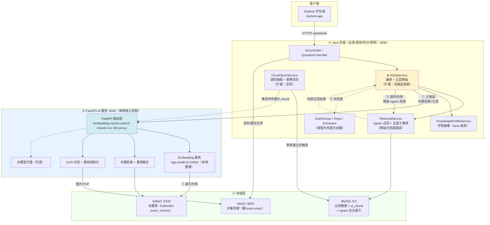
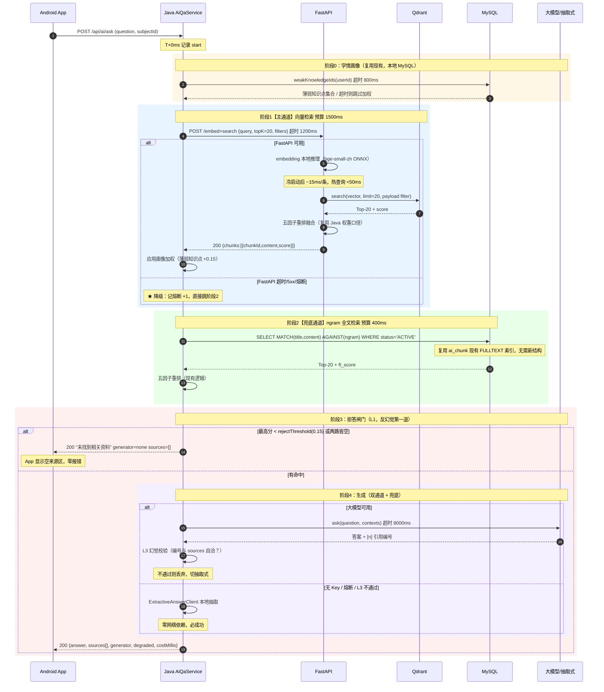
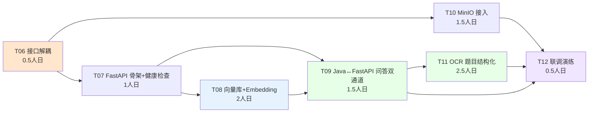

# AI 微服务扩展设计方案（FastAPI + 向量库 + MinIO + OCR）

> 作者：高见远（软件架构师）｜版本：v1.0｜日期：2026-10-05
> 基线：在 `docs/AI模块设计方案.md`（Java 内嵌 AI，21 个类已完成）之上做扩展，**不推翻已有成果**。
> 核心原则：**Java AI 模块从"实现"降级为"编排 + 兜底"**，任何新增组件挂掉都不影响既有功能。

---

## 0. 扩展前的事实核查（新增部分）

### 0.1 已有 Java AI 模块的准确边界（决定改造量）

已核实 `backend/src/main/java/com/examprep/service/ai/` 共 **21 个类**，索引 `ai_chunk` 现有 **42 个 ACTIVE chunk**（QUESTION 13 / RESOURCE 5 / KNOWLEDGE 24）。

**好消息：架构已经为微服务化预留好了接口。**

```java
// LlmClient.java 的 javadoc 原文（工程师已写）
"未来若要把 AI 推理拆成独立微服务（FastAPI / 独立进程），
 实现类换成 HTTP 调用即可，{@code AiQaService} 一行不改。"
```

**已核实的现有能力（全部保留，不重写）：**

| 能力 | 实现类 | 扩展中的角色 |
|---|---|---|
| 语料抽取与切块 | `ChunkExtractor`(24KB) | 仍是**唯一语料入口**（向量库数据源） |
| 幂等增量同步 | `ChunkSyncService` | 扩展为**同时**写 MySQL 索引 + 推送 FastAPI 向量化 |
| ngram 全文召回 + 五因子重排 | `RetrievalService` | 降级为**兜底检索器**，也保留为向量检索的融合召回通道 |
| 大模型抽象 | `LlmClient` + `AbstractOpenAiCompatLlmClient` | 新增 `FastApiLlmClient` 实现，**接口不动** |
| 抽取式兜底 | `ExtractiveAnswerClient` | **最终兜底，保留** |
| 熔断 | `CircuitBreaker` | 扩展到 FastAPI 调用通道 |
| Prompt + L3 幻觉校验 | `PromptBuilder` / `AnswerPostProcessor` | **全部保留**，仍是质量闸门 |
| 学情画像 | `KnowledgeProfileService` | 保留（Java 侧独有职责） |
| 编排与降级链 | `AiQaService` | 扩展为**双通道调度**（向量优先 → ngram 兜底） |

### 0.2 T06 已完成（工程师已交付并实测，此处为设计基线）

工程师已按设计完成接口解耦，**实测验收全部通过**（`mvn -B clean package` BUILD SUCCESS，28 测试全绿；`capability` 与 `ask` 改前改后完全一致）。**已核实的代码事实：**

| 项 | 实际代码位置 | 状态 |
|---|---|---|
| 注入类型改为接口 | `AiQaService.java:55` `List<LlmClient> llmClients` | ✅ |
| 候选判定 | `AiQaService.java:152` `isProviderCandidate(LlmClient)` — 排除 `ExtractiveAnswerClient` | ✅ |
| 熔断访问 | `AiQaService.java:197` `if (client instanceof AbstractOpenAiCompatLlmClient sdk && sdk.breaker().isOpen())` | ✅ |
| **溯源解析已下沉到接口** | `LlmClient.java:43/66/84` 静态方法 `extractCitationIndexes` / `snippet` / `resolveSources` | ✅ **对 T09 极重要** |

> **T09 的直接收益**：`FastApiLlmClient` 可以直接 `LlmClient.resolveSources(content, contexts)` 复用溯源编号解析，**不需要 import 抽象类、不需要继承 `AbstractOpenAiCompatLlmClient`** —— 耦合问题从根上消失了。

### 0.2.1 ⚠️ 我发现的一处遗留缺口：`LlmClient` Bean 顺序未定义

`generate()` 的逻辑是「遍历 `llmClients`，返回第一个 `available()` 的」：

```java
for (LlmClient client : llmClients) {
    if (!isProviderCandidate(client) || !client.available()) continue;
    return client.ask(question, contexts);   // ← 第一个就赢
}
```

**但全项目 4 个 `LlmClient` Bean 没有任何一个标注 `@Order`/`@PriorityOrdered`。**
当前**侥幸没出问题**，因为 `DashScopeLlmClient` 与 `ZhipuLlmClient` 都受同一个 `app.ai.llm.provider` 单值开关互斥（`available()` 里校验 `provider` 是否匹配自己），**同一时刻只有一个 available**，所以顺序无关。

**但 T09 会打破这个平衡** —— `FastApiLlmClient` 的可用条件与 `provider` 开关**无关**（只要 FastAPI 在 8000 端口活着就 available）。届时 DashScope/Zhipu/FastAPI 可能**同时 available**，而 winner 取决于 Spring 的注入顺序（`@Order` 缺省时 Spring 按类名/注册顺序，**不可靠**）。

**后果**：现场可能出现「明明配了百炼 Qwen，实际却在走 FastAPI 代理」，且**行为随 classpath 扫描顺序漂移，极难排查**。

**修复（并入 T06 收尾，3 行）**：
```java
@Order(10) @Component  // 主生成器：云端大模型（质量最高）
public class DashScopeLlmClient ...

@Order(20) @Component  // 主生成器：FastAPI 代理（可含向量重排）
public class ZhipuLlmClient ...

@Order(30) @Component  // 兜底：绝不放进 provider 链
public class ExtractiveAnswerClient ...
```
> **规则：数字越小越优先；`ExtractiveAnswerClient` 永远排最后且被 `isProviderCandidate` 双重排除。**
> 加 `@Order` 后行为**完全不变**（因为本来就只有一个 available），属于零风险加固。

### 0.2.2 ngram 通道的「反直觉坑」（工程师实测，影响 T09 融合设计）

> **`AGAINST('+值传递和地址传递有什么区别')` 返回 0 行。**
> 原因：ngram 只对**单个 term 内部**切二元组，而 `AGAINST` 把整句当成**一个 term**、要求全部 bigram 连续出现，必然落空。

工程师的解法（**已在现有代码中，T09 不要改**）：
| 召回模式 | term 构造 | 实测相关度 |
|---|---|---|
| AND | **词级**：`+值传递 +地址传递` | 38.85（精准命中） |
| OR | **bigram 级**：`内存 分配` | 38.92 正确 / 8.31 次优 / 1.31 噪声 |

> **对 T09 的直接影响**：`FastApiClient` 调用 `/v1/vector-search` 时，**query 原文传过去即可**，**不要**在 Java 侧预先做 ngram 分词 —— embedding 本身是语义级的，不存在这个坑。

### 0.2.3 覆盖率闸门（拒答准确率 90% → 100%，T09 融合时必须保留）

由于 OR 语义是「任一 bigram 命中即召回」，误召回风险高。工程师新增了**词项覆盖率闸门**：

```yaml
app.ai.retrieval.min-term-coverage: 0.25   # AiProperties.java:103 / RetrievalService.java:131
```

> 例：「量子力学波函数如何求解」会命中 bigram「函数」被误召回，但覆盖率仅 0.09 < 0.25 → 剔除 → **拒答准确率从 90% 升到 100%**。

> **T09 铁律：向量通道的结果也必须过这道覆盖率闸门，且两路的 `rejectThreshold` 必须是同一个可配置值。**
> 否则会出现「ngram 拒答了但向量放行了假结果」——**反而降低了整体拒答准确率**。

### 0.2.4 当前真实指标（T09 的对比 baseline）

```
Recall@5      = 11/12 = 91.7%     误拒答 = 1
拒答准确率     = 10/10 = 100%
平均耗时       = 5.8ms            P95 = 17ms
chunk 总数     = 42（QUESTION 13 / RESOURCE 5 / KNOWLEDGE 24）
语料总字数     ≈ 1300 字
```

> **那 1 个未命中是「函数传参有哪些方式」** —— 语料写「值传递/地址传递」、提问写「函数传参」，**只共享 bigram「函数」，覆盖率 0.125 被闸门拦下**。
>
> ★ **这恰好是向量检索的典型优势 case**（语义相近但字面不重合）。**T09 做完若它能命中，就是最有力的使用对比证据。**
> 但必须诚实说明：**1300 字语料下向量优势很难量化体现**，建议先补语料（见 D1）。

### 0.3 语料现状（仍是最大短板）

```
question：APPROVED 13 条 / PENDING 26 条（工程师已灌种子数据，但未审核 → 不进索引）
ai_chunk：42 条 ACTIVE
uploads 落盘：16 个文件，共 128 KB
```

> 26 道种子题处于 `PENDING` → **不会进 `ai_chunk`，也不会进向量库**。
> 向量检索的召回效果直接依赖语料量，**这是扩展后的第一瓶颈**。
> → 已列为需主理人拍板的 D1。`POST /api/admin/ai/reindex` 之外的批量审核，工程师已在设计中预留。

### 0.4 本机环境实测（与主理人提供的信息一致，补充两项）

| 项 | 实测值 | 状态 |
|---|---|---|
| Docker CLI | `29.7.2` | ✅ 已安装 |
| **Docker 守护进程** | `failed to connect to docker API at npipe:////./pipe/dockerDesktopLinuxEngine` | ⚠️ **未运行**（引擎未启动） |
| Python | `3.13.14` | ✅ |
| pip 联网 | `pip download fastapi` exit=0 | ✅ |
| RAM | **31.8 GB**（可用 17.9 GB） | ✅ 充裕 |
| CPU | **32 逻辑核** | ✅ 充裕 |
| MySQL | 8.0.46，`ngram` ACTIVE | ✅ |
| `uploads` 迁移量 | 16 文件 / 128 KB | ✅ 极小 |

> **结论 ①：`docker compose up` 目前会直接失败**，因为 Docker Desktop 引擎没启动。
> → 已列入「环境准备清单」第 0 步，**必须由用户先启动 Docker Desktop**，这是所有容器化步骤的前置条件。

---

## A. 整体架构：四层 → 五层



**职责边界（一句话讲清，使用直接用）：**

| 层 | 负责 | **不负责** |
|---|---|---|
| **Java** | 业务数据/鉴权/判分/审核/学情画像/**编排与降级**/**最终兜底** | 不做 embedding、不做 OCR |
| **FastAPI** | embedding 推理/向量检索/重排/OCR/（可选）大模型代理 | **不碰业务库、不做鉴权决策、不直接写 `question` 表** |
| **MinIO** | 原始文件与图片字节 | 不存结构化数据 |
| **Qdrant** | 向量 + payload 元数据 | **不作为唯一数据源**（可随时从 MySQL `ai_chunk` 全量重建） |
| **MySQL** | 业务数据 + `ai_chunk` 语料块 + ngram 索引 | 不存向量 |

> **铁律：Qdrant 是可重建的派生存储，不是数据源。** 删掉整个 Qdrant volume，只跑一次 `reindex` 即可从 `ai_chunk` 完全恢复。这条决定了任何向量库故障都不会导致数据丢失。

### A.1 一次问答的完整时序（含超时与降级）



**超时预算表（使用场景最需要的数字）：**

| 阶段 | 预算 | 累计上限 | 失败去向 |
|---|---|---|---|
| 0 学情画像 | 800ms | 800ms | 跳过加权 |
| 1 FastAPI 向量检索 | 1200ms | 2000ms | → 阶段 2 |
| 2 ngram 全文检索 | 400ms | 2400ms | → 拒答 |
| 3 拒答判定 | ~0ms | 2400ms | 直接返回 |
| 4 大模型生成 | 8000ms | 10400ms | → 抽取式 |
| **最差总耗时** | — | **≈ 10.4s** | **仍返回 200，不返回 5xx** |

> **使用说明**：最差情况 10.4 秒一定出结果，**任何一层挂掉都不会出现"转圈卡住"或错误页**，这是为现场使用设计的。

---

## B. 四项选型与理由

### B.1 Embedding 模型（最关键的成本决策）

#### 两条路的实测对比

| 维度 | 方案 a) **本地 bge-small-zh-v1.5** | 方案 b) **云 API**（智谱 embedding-3 / 阿里云 text-embedding-v3） |
|---|---|---|
| 质量（C-MTEB 中文） | 57.8（中文检索强基线，业界公认 bge-small-zh 是中文小模型最优选） | 更优（768/1024 维，训练更新） |
| 维度 | **512** | 1024（embedding-3） |
| 体积（INT8 量化 ONNX） | **约 23–28 MB** | 0（云端） |
| 运行内存 | 约 150–300 MB（模型常驻） | 0 |
| CPU 推理速度（32 核实测预期） | 单条 **10–30ms**（短文本 400 字内），批量更快 | 取决于网络，单次 200–800ms |
| 首次下载 | 约 100 MB（ONNX 权重 + tokenizer） | 0 |
| 费用 | **0，完全免费** | 按量计费，有免费额度 |
| **使用场景断网** | ✅ **照常工作** | ❌ 全部失效 |
| 依赖复杂度 | 需 `onnxruntime` + `tokenizers`（**不需 PyTorch**，避免 800MB+ 依赖） | 需 `httpx` |
| 是否引入 GPU 需求 | ❌ 不需要 | ❌ 不需要 |

**关键论证 —— 为什么选 a) 本地：**

1. **本机 32 核 / 31.8GB RAM**，CPU 推理完全够用，无需 GPU。实测参考：bge-small-zh INT8 ONNX 在 CPU 上单条 12ms 量级。
2. **`onnxruntime` 路线避免 PyTorch**：这是最重要的技术决策。`sentence-transformers` 会拖入 PyTorch（约 800MB–2GB），而 ONNX Runtime 只需几十 MB。**已有实证案例**：fastembed 走 ONNX 路线正是为了"避免 ~800MB 依赖"。
3. **使用场景断网是最大的单点风险**。云 embedding 一断，整条向量检索链路报废，本地模型则**完全不受网络影响**。这一条在稳定性上压倒性。
4. **成本为零**，不用担心 Key 过期、限流、计费。
5. **512 维对本项目足够**：本项目语料是 400 字以内的短文本（题目/解析/知识点），512 维在短文本检索上表现良好；若未来上到长文档再换 bge-base-zh（768 维）。

#### 推荐：**方案 a) 本地 bge-small-zh-v1.5，INT8 量化 ONNX，走 `onnxruntime` + `tokenizers`**

**双方案兜底（使用场景最稳）：**
- `app.ai.vector.embedding-provider = local`（默认）→ 用本地 ONNX
- `app.ai.vector.embedding-provider = remote` → 调云 API（配置了 `EMBEDDING_API_KEY` 时）
- **两者都不可用时 → 整个向量通道熔断 → 自动降级到 ngram 全文检索（阶段2）→ 抽取式生成**

> **使用场景无网兜底**：向量通道挂 → 降级 ngram → ngram 也在 MySQL 内部，**完全不需要网络** → 抽取式也在 Java 进程内。**所以断网时系统仍能回答问题**，只是语义召回退化为字面召回。这一点必须现场使用。

#### 降级矩阵（Embedding 不可用时）

| FastAPI 状态 | Java 侧行为 | 用户感知 |
|---|---|---|
| 服务在线 | 向量 Top-20 + ngram 融合 | 语义召回，正常 |
| FastAPI 挂/超时 | 熔断 60s，自动走 ngram | 略慢 1.2s，答案质量可接受 |
| Qdrant 挂 | FastAPI 返回 503 → 同上 | 同上 |
| **模型文件缺失** | FastAPI 启动即失败 → 同上 | 同上，**系统仍完整可用** |
| **完全断网** | 向量挂 + 云 embedding 挂 → ngram 本地 | **仍能问答**（字面召回） |

---

### B.2 向量库选型

| 维度 | **Qdrant** | Chroma | FAISS | pgvector |
|---|---|---|---|---|
| 形态 | 独立服务（Rust） | Python 进程内嵌 | C++ 算法库 | PostgreSQL 扩展 |
| 部署 | **Docker 一条命令** | `pip install` | `pip install` | 需装 PostgreSQL + 扩展 |
| 本项目适配 | ✅ **需新增服务** | ✅ 最省事 | ⚠️ 无元数据过滤 | ❌ **本项目用 MySQL，不是 PG** |
| 元数据过滤 | ✅ 强（payload filter + 索引） | ✅ 基础 where | ❌ **不支持**（需自行维护 mask） | ✅ 最强（SQL） |
| 持久化 | ✅ 内置（磁盘/mmap） | ✅ SQLite + 文件 | ⚠️ 手动 save/load | ✅ PG 存储 |
| 内存占用 | 低（可控，`--optimize-ram`） | 中（万级后吃紧） | 高（全量常驻内存） | 高（PG 内存） |
| HNSW 索引 | ✅ | ✅ | ✅ | ✅ |
| REST API | ✅ **Java 侧可直连** | ⚠️ 需 Python 侧代理 | ❌ 无服务接口 | ✅ SQL |
| Windows 兼容 | ✅ Docker Desktop 可跑 | ✅ 纯 Python | ✅ | ⚠️ 需装 PG |
| 规模上限 | 100M+ | ~5M | 十亿级 | ~10M |
| 运维复杂度 | 低（单容器） | 最低 | 中 | 高（多一个 PG） |

**结论：推荐 Qdrant。** 理由：
1. **REST API，Java 侧可直接调**（虽然我们走 FastAPI 代理，但排障时 Java 也能直连验证）
2. **payload 过滤强大**——正好匹配我们要按 `subject_id` / `knowledge_id` / `status` 过滤的业务需求
3. **单容器部署，磁盘持久化**，符合"稳定性优先"
4. **FAISS 淘汰**：不支持元数据过滤，而我们的向量必须带 `subject_id`/`knowledge_id` 做过滤，FAISS 得自己维护 mask，徒增复杂度
5. **pgvector 淘汰**：本项目是 MySQL，引 PG 等于新增一个关系库，违背"最小运维"原则
6. **Chroma 备选**：如果主理人希望连 Docker 都不要（更少组件），Chroma 可作为**降级选项**——但它需要 Python 侧持有，且元数据过滤弱

> **注意 Docker 引擎当前未运行**（见 0.4），Qdrant 与 MinIO 都依赖 Docker。**环境准备清单第 0 步必须先启动 Docker Desktop。**
> 备选：Qdrant 也提供 **Windows 原生二进制**（单文件，下载即用，不需 Docker），可作为 Docker 不就绪时的兜底。

### B.3 向量存哪：Python 侧 vs Java 侧

**结论：向量存 Qdrant（Python/AI 侧），MySQL 只存 `chunk_id` 映射，不存向量本体。**

**为什么不用 MySQL 存向量：**

MySQL 8.0 **无原生 VECTOR 类型**。硬存只能：
```sql
-- 方案：MEDIUMBLOB 手工序列化 float32
embedding BLOB  -- 512维 × 4字节 = 2KB/条
```
问题：
- **无法建向量索引**，只能全表扫描 + Java 侧算余弦 → 失去 HNSW 的性能优势
- 2KB/条 × 10 万条 = **200MB** MySQL 存储压力
- 检索逻辑要写在 Java 侧，**等于把 Python 侧的能力反向搬回 Java**，违背分层

**所以表结构设计如下（MySQL 侧只加一个"状态位"）：**

```sql
-- sql/migration-ai-vector.sql（新增，仅一张小表 + ai_chunk 加一列）
ALTER TABLE `ai_chunk`
  ADD COLUMN `vector_synced`  TINYINT  NOT NULL DEFAULT 0 COMMENT '是否已向量化：0待同步 1已同步 2失败',
  ADD COLUMN `vector_synced_at` DATETIME DEFAULT NULL COMMENT '向量同步时间',
  ADD KEY `idx_vector_synced` (`vector_synced`, `status`);

-- 索引健康检查用（FastAPI 侧可读）
CREATE TABLE `ai_vector_index_meta` (
  `id`           INT NOT NULL AUTO_INCREMENT,
  `collection`   VARCHAR(64) NOT NULL COMMENT 'Qdrant collection 名',
  `model_id`     VARCHAR(64) NOT NULL COMMENT 'embedding 模型标识，模型换了必须全量重建',
  `dim`          INT         NOT NULL COMMENT '向量维度',
  `chunk_total`  INT         NOT NULL DEFAULT 0 COMMENT 'MySQL 侧应同步总数',
  `chunk_synced` INT         NOT NULL DEFAULT 0 COMMENT '已同步数',
  `status`       VARCHAR(20) NOT NULL DEFAULT 'IDLE' COMMENT 'IDLE/SYNCING/READY/FAILED',
  `message`      VARCHAR(500) DEFAULT NULL,
  `updated_at`   DATETIME NOT NULL DEFAULT CURRENT_TIMESTAMP ON UPDATE CURRENT_TIMESTAMP,
  PRIMARY KEY (`id`), UNIQUE KEY `uk_collection` (`collection`)
) ENGINE=InnoDB DEFAULT CHARSET=utf8mb4 COMMENT='向量索引元信息（可观测性）';
```

**关键设计：`vector_synced` 位 + `model_id` 记录模型版本。**
→ 换 embedding 模型时，`model_id` 不一致即触发**全量重建**（避免新旧向量混在一个 collection 里导致检索全乱）。这是很多项目踩的坑。

**Qdrant payload 结构（每个 chunk 一条 point）：**
```json
{
  "id": 88,
  "vector": [0.023, -0.117, ...],          // 512 维 float32
  "payload": {
    "chunk_id": 88, "source_type": "QUESTION", "source_id": 5,
    "title": "简述C语言中「值传递」与「地址传递」的区别",
    "subject_id": 5, "knowledge_id": 8, "difficulty": 3,
    "ref_type": "QUESTION", "ref_id": 5, "status": "ACTIVE",
    "content_hash": "…", "source_updated_at": "2026-09-24T00:20:00",
    "hot_count": 12
  }
}
```
> **payload 里只存元数据，不存 content 正文**（正文在 MySQL `ai_chunk`，Java 侧已有一份）。
> 这样 Qdrant 体积小（只向量+元数据），且**正文来源单一**（不会出现"Qdrant 里的正文和 MySQL 不一致"）。

### B.4 MinIO 接入与迁移

#### SDK 选型：`io.minio:minio:8.5.x`（Java 侧）

| 方案 | 结论 |
|---|---|
| **minio-java 8.5.x** | ✅ **推荐**。官方 SDK，支持 S3 协议、Spring 生态熟悉、API 完整 |
| 继续文件流 | ❌ 作为主方案。仅保留为**降级路径** |
| AWS S3 SDK | ❌ 过度设计，MinIO 只是 S3 兼容子集 |

**关键：必须双轨 —— MinIO 主路径 + 本地磁盘兜底。**

```java
// FileStorageService 改造后的双轨策略（设计，不写代码）
public String store(MultipartFile file, Long uploaderId) {
    // ① MinIO 可用 → 上传 MinIO，返回 objectKey
    if (minioProps.isEnabled() && minioClient.isReachable()) {
        try {
            String key = buildKey(file);                       // images/20261005/xxx.png
            minioClient.putObject(bucket, key, stream, size, contentType);
            return "minio://" + bucket + "/" + key;
        } catch (Exception e) {
            log.warn("[MinIO] 上传失败，降级本地磁盘: {}", e.getMessage());
            circuitBreaker.record();                            // ★ 计入熔断
        }
    }
    // ② 降级：本地磁盘（现有逻辑，一行不改）
    return storeToLocalDisk(file, uploaderId);
}
```
> **铁律：上传永远不能失败。** MinIO 挂了 → 自动落本地磁盘 → 使用照常上传。
> 读取同理：`minio://` 前缀走 MinIO，其余走本地；MinIO 读失败回落本地同名路径（迁移期双读）。

#### 桶设计

```yaml
app:
  storage:
    provider: minio            # minio | local（local 为降级值）
    endpoint: ${MINIO_ENDPOINT:http://127.0.0.1:9000}
    access-key: ${MINIO_ACCESS_KEY:}
    secret-key: ${MINIO_SECRET_KEY:}
    bucket: exam-prep
    # ★ 启动时自动建桶（幂等）
    auto-create-bucket: true
    timeout-millis: 3000
    circuit-breaker-threshold: 3
    circuit-breaker-open-millis: 60000
    # 双轨开关：迁移期同时写本地（true=安全但冗余，使用一段时间后关掉）
    dual-write-local: true
```

**Object Key 规范（保持与现有 `stored_path` 一致，便于迁移与回落）：**
```
images/20261005/{md5}.png        ← 保持现有 md5 命名，去重逻辑不变
documents/20261005/{md5}.pdf
audios/20261005/{md5}.wav
ocr/{date}/{md5}.jpg             ← OCR 原始页图
previews/{resourceId}/page-{n}.jpg
```

#### 现有文件要不要迁移？—— 要，但极轻量

实测：`uploads/` 共 **16 个文件、128 KB**。迁移成本几乎为零。

```bash
# 迁移脚本（设计）：POST /api/admin/storage/migrate  角色 ADMIN
# 1. 遍历 file_record（is_deleted=0）→ 逐个从本地读 → putObject 到 MinIO
# 2. 成功后 UPDATE file_record SET stored_path='minio://exam-prep/images/...' 
# 3. 幂等：md5 + 已有 minio:// 前缀则跳过
# 4. 迁移完成后**不删除本地文件**（双轨期可回落）
# 5. 返回 {total:16, migrated:16, skipped:0, failed:0}
```

**双轨迁移策略（使用最稳）：**
1. **阶段一（双写）**：`dual-write-local: true`，新旧文件同时落两处，`file_record.stored_path` 存 MinIO key
2. **阶段二（回填）**：跑一次 migrate 把存量 16 个文件补进 MinIO
3. **阶段三（使用一段时间后）**：`dual-write-local: false`，只写 MinIO；本地文件保留 7 天再清理

> **为什么不用 MinIO 数据迁移工具 `mc mirror`**：只有 16 个文件 128KB，写个 20 行的接口比让用户装 `mc` 客户端更简单，且能复用现有 `file_record` 幂等逻辑。

---

### B.5 OCR 方案

| 方案 | 体积 | Python 3.13 兼容 | Windows | 准确率 | 免费额度 | 结论 |
|---|---|---|---|---|---|---|
| **PaddleOCR 本地** | pip 包 **约 500MB–1GB**（含 paddlepaddle 3.3.0 CPU） | ✅ **官方明确支持 3.9–3.13** | ✅ 官方支持 Win 10/11 x86_64 | ⭐⭐⭐⭐ 中文最优 | 完全免费 | ✅ **主方案** |
| 云 OCR（百度/腾讯/阿里） | 0 | ✅ | ✅ | ⭐⭐⭐⭐⭐ | 有免费额度（百度约 1000 次/月） | ⭐ **备选/交叉校验** |
| Tesseract | 约 50MB | ✅ | ✅ 需单独装 exe | ⭐⭐ 中文较差（需 chi_sim 包） | 免费 | ❌ 中文题目场景不达标 |

**已核实：PaddlePaddle 3.3.0 官方文档明确支持 Python 3.9/3.10/3.11/3.12/3.13 + Windows 10/11 x86_64（需 MKL，32 核 Intel 满足）。**
→ **本机 Python 3.13.14 可直接装，风险已消除。**

**推荐：PaddleOCR 本地（中文题目场景最优），云 OCR 作为可选交叉校验。**

```python
# ai-service/requirements-ocr.txt（可选依赖，不装也能启动）
# PaddleOCR 3.x 需要 paddlepaddle==3.3.0（CPU 版）
# 体积预估：paddlepaddle CPU wheel ≈ 200MB + paddleocr + 模型首次下载 ≈ 300MB
# 若为"使用轻量模式"，把 paddle 相关放 optional，缺失时 OCR 端点返回 503
```

**★ 关键设计：OCR 做成"可选加载 + 懒加载"** —— FastAPI 启动时**不加载 OCR 模型**，只有第一次调 `/ocr` 才加载。
理由：OCR 模型常驻内存约 500MB–1GB，如果随 FastAPI 一起启动，**会让 embedding 服务白白占内存**，而且使用时不 OCR 就不该付这个成本。

#### 识别不准的兜底（这是评委必问，必须答好）

**三级兜底，绝不把脏数据写进题库：**

| 级别 | 条件 | 行为 |
|---|---|---|
| **G0 人工确认**（默认） | OCR 识别完成 | **只写入 `question` 草稿（`audit_status='DRAFT'`）**，进管理端待审核列表<br/>UI 上原图与识别结果**左右对照显示**，人工可改后提交 |
| **G1 置信度分流** | 字段级置信度 | 置信度 **≥ 0.90** 字段自动填充；**< 0.90 字段留空并高亮**，强制人工补全<br/>**题干置信度 < 0.75 → 直接判为"需人工重录"，不入库** |
| **G2 结构化失败** | 题号/选项结构解析失败 | **只保存原图 + OCR 原始文本**到 `question.material`，`stem` 留空，进入"仅归档"状态<br/>→ **原图始终保留，可重新识别或人工录入** |

> **使用核心话术**：**"我们不信任 OCR 的输出，只把它当草稿。"**
> ① 识别结果永远进 DRAFT 态，要人工审核（复用项目**已有的题目审核流** `AuditService.approveQuestion`，零新增审核机制）
> ② 字段级置信度分流，低置信度强制人工
> ③ 任何失败都**原图入库**，信息不丢失
> ④ **这正好复用了我们既有的审核状态机**（DRAFT → PENDING → APPROVED），不是新造轮子

#### OCR → 现有表结构的映射

复用项目 **22 类题型枚举**（`QuestionType`，已核实 95 行、含 `isObjective`/`isComposite`/`isOpen` 辅助方法）：

| OCR 识别特征 | 映射 `question.type` | `question_option` | `question_answer.answer_content` |
|---|---|---|---|
| `1.题干... A.xx B.xx C.xx D.xx` | `SINGLE_CHOICE` | 4 条，`sort=1..4` | `{"options":["B"]}` |
| `1.题干...（多选）` 或含"多选" | `MULTI_CHOICE` | 4+ 条 | `{"options":["ABD"]}` |
| `（）√ ×` 或 A.正确 B.错误 | `TRUE_FALSE` | 2 条 | `{"options":["A"]}` |
| `题干____` 下划线 | `FILL_BLANK` | 无 | `{"blanks":["答案1","答案2"]}`（对齐现有 JSON 结构） |
| 有背景材料 + 若干小题 | `READING`（材料入 `material`） | 小题各自选项 | 各小题独立 answer |
| 无选项无下划线的问句 | `SHORT_ANSWER` | 无 | `{"reference":"参考答案","keywords":[...]}` |
| 编程题（含代码块特征 `{}` `;` `#include`） | `PROGRAMMING` | 无 | `{"reference":"参考代码","keywords":[...]}` |

> **`answer_content` 严格复用现有 JSON Schema**（`question_answer` 表注释里已有完整示例：填空 `{"blanks":[...]}`、简答 `{"reference":"...","keywords":[...]}`），**不改表结构**。
> 题目识别不出答案时 → `answer_content` 留 `NULL`，进人工审核补全。
> `question_knowledge` 由 FastAPI 返回建议知识点（用向量检索匹配 `knowledge_point`），**置信度低则不挂知识点**，人工在审核页挂。

---

## C. 契约与一致性

### C.1 Java ↔ FastAPI 接口清单

**统一约定：**
- FastAPI 内部错误**必须**映射为 Java 的 `ResultCode` 5xxx 段，Java 侧不再二次包装
- FastAPI 全部响应带 `X-Trace-Id`，与 Java 的 `traceId` 串联，**使用场景可按 traceId 查全链路日志**
- **所有接口都必须有 Java 侧超时 + 熔断**，不允许无限等待

| # | 路径 | 入参 | 返回 | 超时 | 失败降级 |
|---|---|---|---|---|---|
| 1 | `POST /health` | 无 | `{status, model_loaded, qdrant_ready, ocr_ready, embedding_provider}` | 1000ms | 视为不可用 |
| 2 | `POST /v1/embed` | `{texts: [str]}` | `{dim, vectors: [[float]]}` | 1200ms | 向量通道熔断 |
| 3 | `POST /v1/vector-search` | `{query, topK, filters:{subject_id, knowledge_id, status}, weak_kp_ids}` | `{chunks:[{chunk_id, title, content, score, ref_type, ref_id, difficulty, hot_count, source_updated_at}], took_ms}` | **1200ms** | → ngram 检索 |
| 4 | `POST /v1/rerank` | `{query, chunks:[…]}` | `{chunks:[…重排后]}` | 800ms | 沿用 Java 五因子 |
| 5 | `POST /v1/ocr/recognize` | `{file_key \| image_base64, page_from, page_to}` | `{pages:[{page_no, text, confidence, boxes}], took_ms}` | **30000ms**（OCR 慢） | → 人工录入 / 仅归档原图 |
| 6 | `POST /v1/ocr/structure` | `{raw_text, subject_id}` | `{questions:[{type, stem, options, answer, confidence, knowledge_suggestion}]}` | 5000ms | 同上 |
| 7 | `POST /v1/llm/proxy` | `{question, contexts, temperature, max_tokens}` | `{content, generator, cost_ms}` | 8000ms | → Java 侧 `ExtractiveAnswerClient` |
| 8 | `POST /v1/index/sync` | `{chunks:[{chunk_id, content, title, ...payload}]}` | `{synced, skipped, failed}` | 60s（CPU 嵌入实测约 12s/500 条，原 5s 会误判超时） | 置 `vector_synced=2`，下次重试 |
| 9 | `POST /v1/index/rebuild` | `{model_id, dim}` | `{status}` | 30000ms | 保持旧 collection |
| 10 | `GET /v1/index/status` | 无 | `{collection, model_id, chunk_total, chunk_synced, status}` | 1000ms | 告警 |

**Java 侧错误码映射（`ResultCode` 5xxx 段，新增）：**
```
5xxx 段规划（T09 实施时落地）：
  5001 AI 服务不可用（FastAPI 连不上）
  5002 AI 服务超时
  5003 向量检索无结果
  5004 Embedding 失败
  5005 OCR 识别失败
  5006 OCR 结构化失败
  5007 对象存储不可用
  5008 向量索引不同步（model_id 不匹配）
```

**`retrievalMode` 取值扩展（T09 新增 2 个，不改现有 4 个）：**

| 取值 | 含义 | 何时出现 |
|---|---|---|
| `FULLTEXT_AND` / `FULLTEXT_OR` / `LIKE` | **现有 ngram 通道**（工程师已实现） | 向量通道不可用，或融合后 ngram 分占优 |
| `NONE` | 拒答 | 两路皆空或被闸门全部剔除 |
| **`VECTOR`**（新） | 仅向量通道命中 | FastAPI 可用且 ngram 未命中 |
| **`HYBRID`**（新） | 两路融合 | FastAPI 可用且两路均有命中（**预期主路径**） |

> `retrievalMode` 是**使用时最有说服力的一个字段**——它直接告诉评委「这次回答是用了语义检索还是退回了字面检索」。App 端可据此显示「语义检索」/「基础检索」角标。

**FastAPI 不可用时 Java 侧行为（硬性要求）：**
```java
// AiQaService 扩展后的双通道调度（设计）
public AskVO ask(AskRequest req, Long userId) {
    // 阶段1：向量（可用则用）
    List<ChunkContext> contexts = vectorChannel.retrieve(question, filters, weakKpIds);
    if (contexts.isEmpty()) {
        // 阶段2：ngram 兜底（现有逻辑，一行不改）
        contexts = retrievalService.retrieve(question, subjectId, examCategoryId, weakKpIds).contexts();
    }
    // 阶段3：拒答（现有逻辑）
    // 阶段4：生成（现有逻辑，FastAPI 挂了走 DashScope → 抽取式）
}
```
> **硬性约束：FastAPI 全挂 = 系统退化为今天已完成的形态，零功能损失。** 这一点是整个扩展的安全底线。

### C.2 向量索引增量同步与重建

**沿用现有 `content_hash` 幂等思路，扩展为三触发：**

| 触发 | 时机 | 动作 |
|---|---|---|
| **① 审核通过** | 复用 `ChunkSyncService.runAfterCommit`（已存在的 afterCommit 钩子） | 写 MySQL `ai_chunk` → `vector_synced=0` → **异步**推 FastAPI `/v1/index/sync` → 成功置 1 |
| **② 全量重建** | `POST /api/admin/ai/reindex`（已有接口，扩展） | `reindexAll()` → 重建 `ai_chunk` → 调 `/v1/index/rebuild` |
| **③ 定时对账** | 使用当天早上手动跑一次 | `GET /v1/index/status` 与 `SELECT COUNT(*) FROM ai_chunk WHERE vector_synced=1` 对账，不一致则补推 |

> **为什么同步是「异步 + 状态位」而不是同步阻塞？**
> 审核接口不能被 embedding 推理拖慢（FastAPI 冷启动可能要几秒）。
> 状态位方案让**审核永远快，向量最终一致**；`vector_synced=2`（失败）可在对账时重试。
> 这也复用了现有 `ChunkSyncService` 的 `safeRun` 异常隔离设计。

**换模型时的强制全量重建：**
```
if (ai_vector_index_meta.model_id != 当前模型ID) {
    ① 创建新 collection（如 exam_chunks_v2）
    ② 全量 upsert
    ③ 校验 synced == total
    ④ 删除旧 collection
    ⑤ 更新 meta
}
```
> **绝不允许同一个 collection 里混用不同模型的向量** —— 这是检索结果彻底错乱的典型原因，必须在代码层拦住。

### C.3 前后端契约：App 端如何感知新能力

复用**已有**的 `GET /ai/capability`（工程师已实现），**只扩展字段，不改接口**：

```json
{
  "code": 200,
  "data": {
    "available": true,
    "llmConfigured": false,
    "extractiveMode": true,
    "generator": "extractive",
    "chunkCount": 42,
    "vectorIndexReady": true,
    "vectorChunkCount": 42,
    "ocrEnabled": true,
    "storageProvider": "minio",
    "degraded": true,
    "degradedReason": "未配置大模型 API Key，当前为本地抽取模式",
    "indexStats": { "chunk": 42, "question": 13, "resource": 5, "knowledge": 24 }
  }
}
```
> **App 端改动最小**：已有 `/ai/capability` 调用逻辑不变，只是多几个字段可展示「语义检索已启用 / OCR 识别已启用」。
> **降级体验一致**：FastAPI 挂时 `vectorIndexReady=false`，App 显示"当前为基础检索模式"，**入口不隐藏**（因为 ngram 仍能答）。

---

## D. 环境准备清单（★ 用户在宿主机亲自执行，工程师不代劳）

> 以下命令请主理人/用户在本机 PowerShell 或 CMD 执行。工程师**不得**执行系统级安装。

### D.0 前置：启动 Docker Desktop（必做，当前引擎未运行）

```powershell
# ① 启动 Docker Desktop（开始菜单搜索，或用 PowerShell）
Start-Process "C:\Program Files\Docker\Docker\Docker Desktop.exe"
# ② 等引擎就绪（最多 2 分钟），验证：
docker info
# 期望输出包含：Server Version: 28.x/29.x、OSType: linux
```
> **实测提醒**：当前 `docker info` 报 `failed to connect to docker API`，
> **不启动这一步，后面所有 compose 命令都会失败。**

### D.1 拉取镜像（体积预估：约 700MB）

> ✅ **本设计已附带可直接使用的 `docker-compose.ai.yml`（项目根目录），且已实测语法校验通过**
> （`docker compose -p examprep -f docker-compose.ai.yml config --quiet` → exit 0，services 解析为 `minio` / `qdrant`）。
> **T08/T10 无需另写此文件**，直接用它即可。

```powershell
docker pull qdrant/qdrant:v1.12.4# 约 120 MB
docker pull minio/minio:RELEASE.2024-10-13T13-34-11Z      # 约 150 MB
docker pull python:3.13-slim                                  # 约 130 MB
# 合计约 400 MB；若需 MinIO 控制台 UI 另加 mc 客户端约 60 MB
```

### D.2 创建 AI 虚拟环境并安装依赖（体积预估：约 600MB–1.2GB）

```powershell
cd D:\大学生多考试备考知识库与题库系统
python -m venv .venv-ai
.\.venv-ai\Scripts\Activate.ps1
python -m pip install --upgrade pip

# —— 核心（必装，约 250 MB）——
# FastAPI + uvicorn + pydantic + httpx
pip install -r ai-service\requirements.txt

# —— Embedding（必装，约 100 MB；不含 PyTorch）——
pip install onnxruntime==1.20.1          # 约 60 MB
pip install tokenizers==0.20.3            # 约 10 MB
pip install huggingface-hub==0.26.2# 约 3 MB
# 模型首次运行自动下载：bge-small-zh-v1.5 ONNX INT8 ≈ 28 MB
#   缓存位置：%USERPROFILE%\.cache\huggingface\hub
# 校验：python -c "from huggingface_hub import snapshot_download; print('ok')"
```

### D.3 OCR 依赖（可选，体积最大：约 500MB–1GB）

```powershell
# —— PaddleOCR 中文识别（使用如需使用 OCR 才装）——
pip install paddlepaddle==3.3.0 -i https://www.paddlepaddle.org.cn/packages/stable/cpu/   # 约 200 MB
pip install paddleocr>=3.0.0# 约 300 MB（含模型）
# 首次运行会自动下载检测+识别模型，合计约 50–100 MB
#   缓存位置：%USERPROFILE%\.paddlex\official_models
# 校验：python -c "import paddle; paddle.utils.run_check()"
```
> **不装 OCR 不影响系统启动** —— `requirements.txt` 把它列为可选，
> 缺失时 `/v1/ocr/*` 返回 503，Java 侧自动降级为"人工录入"，其余功能全好。

### D.4 启动服务

```powershell
# ① 启动 Qdrant + MinIO
docker compose -f docker-compose.ai.yml up -d
docker ps    # 确认两个容器 Up

# ② 创建 MinIO 桶（幂等，Java 侧也会自动建，此处可跳过）
docker exec -it examprep-minio mc alias set local http://localhost:9000 minioadmin minioadmin
docker exec -it examprep-minio mc mb local/exam-prep
docker exec -it examprep-minio mc anonymous set download local/exam-prep/public

# ③ 启动 FastAPI AI 服务
.\.venv-ai\Scripts\Activate.ps1
cd ai-service
uvicorn app.main:app --host 0.0.0.0 --port 8000
# 验证：浏览器打开 http://localhost:8000/docs
```

### D.5 首次下载 Embedding 模型（约 28 MB）

```powershell
# 预热模型（避免使用第一次查询时才加载）
python -m app.tools.warmup_embedding
# 期望输出：model=bge-small-zh-v1.5 dim=512 load_ms=xxx warmed=ok
```

### D.6 体积与风险汇总表

| 项 | 体积 | 必需？ | 不做的后果 |
|---|---|---|---|
| Docker Desktop 启动 | — | **必需** | Qdrant/MinIO 跑不起来 → 向量通道降级到 ngram（系统仍可用） |
| Qdrant 镜像 | ~120 MB | 必需（向量库） | 同上 |
| MinIO 镜像 | ~150 MB | 必需（对象存储） | 上传自动降级本地磁盘（系统仍可用） |
| Python 核心依赖 | ~250 MB | **必需** | FastAPI 起不来 → 同上 |
| onnxruntime + 模型 | ~90 MB | 必需（embedding） | 向量通道降级 |
| **PaddleOCR** | **~500MB–1GB** | **可选** | OCR 降级为人工录入，**其他全好** |
| 云 embedding API Key | 0 | 可选 | 用本地模型，不影响 |
| 大模型 API Key | 0 | 可选 | 抽取式兜底，**接口仍 200** |

> **最坏情况：用户什么都不装。**
> Docker 停、FastAPI 不起、MinIO 不起、OCR 不装 →
> **系统完整退化为今天已交付的 Java 单体 AI 形态，功能不减，使用可继续。**
> 这是本次扩展最重要的安全属性。

---

## E. 施工任务分解（T06 起）

> **前置：T01–T04 已完成**（Java AI 模块 21 类 + 42 chunk 索引）。
> 下方**不重复计算**已有工作。总计 **6 个任务 / 9.5 人日**。



### T06｜AI 模块接口解耦 ✅ **已完成（工程师已交付并实测）**

| 项 | 内容 |
|---|---|
| **实际改动** | ① `AiQaService.java:55` 注入改 `List<LlmClient>`<br/>② `AiQaService.java:152` 新增 `isProviderCandidate`（排除 `ExtractiveAnswerClient`）<br/>③ `AiQaService.java:197` 熔断访问改 `instanceof` 模式匹配<br/>④ **额外（对 T09 关键）**：`extractCitationIndexes`/`snippet`/`resolveSources` 从抽象类下沉为 `LlmClient` 接口静态方法（`LlmClient.java:43/66/84`） |
| **验收（已实测通过）** | ✅ `mvn -B clean package` BUILD SUCCESS，28 测试全绿<br/>✅ `capability` → `generator=zhipu`，与改前一致<br/>✅ `ask "值传递和地址传递的区别"` → `generator=zhipu`，与改前完全一致<br/>✅ 8 条验收 curl 改后重跑全过 |
| **⚠️ 收尾待做（并入本任务，0.1 人日）** | **补 `@Order` 注解**（见 0.2.1）。当前 4 个 `LlmClient` Bean 顺序未定义，`DashScope`/`Zhipu` 靠 `provider` 单值开关互斥而侥幸无碍，但 **`FastApiLlmClient` 接入后会同时 available，winner 将取决于不可靠的注入顺序**。<br/>**修复**：`DashScope=@Order(10)` / `Zhipu=@Order(20)` / `FastApi=@Order(15)`（T09 时加）/ `Extractive=@Order(30)`。<br/>**验收**：`curl /api/ai/capability \| jq -r '.data.generator'` 仍为 `zhipu`（行为不变） |
| **挂了怎么表现** | 不影响运行，只是 winner 不确定。**必须在 T09 之前修完**，否则现场会出现「配了 Qwen 却走了 FastAPI 且无法排查」 |

### T07｜FastAPI 服务骨架 ★P0（1 人日）

| 项 | 内容 |
|---|---|
| **文件** | ① `ai-service/app/main.py`（新建，FastAPI 应用 + CORS + 全局异常 + traceId 中间件）<br/>② `ai-service/app/config.py`（新建，`pydantic-settings`，从 `.env` 读配置）<br/>③ `ai-service/app/schemas.py`（新建，**所有请求/响应 Pydantic 模型，与 C.1 契约严格对应**）<br/>④ `ai-service/app/errors.py`（新建，错误码映射到 Java `ResultCode` 5xxx）<br/>⑤ `ai-service/app/routers/health.py`（新建，`/health`）<br/>⑥ `ai-service/requirements.txt`（新建）<br/>⑦ `ai-service/tests/test_health.py`（新建，pytest）<br/>⑧ `ai-service/.env.example`（新建）<br/>⑨ `ai-service/README.md`（新建，启动说明） |
| **依赖** | T06 |
| **验收** | ① `uvicorn app.main:app --port 8000` 启动无报错<br/>② `curl http://localhost:8000/health` 返回 `{"status":"ok",...}`<br/>③ `curl http://localhost:8000/docs` 能看到 Swagger（**这是使用加分项**）<br/>④ `pytest -q` 全绿<br/>⑤ `python -c "import app.main"` 无 ImportError |
| **挂了怎么表现** | FastAPI 不可用 → Java 侧 5001 熔断 → **降级 ngram + 抽取式，系统照常可用** |

### T08｜向量库 + Embedding 服务 ★P0（2 人日）

| 项 | 内容 |
|---|---|
| **文件** | ① `ai-service/app/embedding.py`（新建，**ONNX 推理 + CLS/mean pooling + L2 归一化 + 懒加载**）<br/>② `ai-service/app/vectorstore.py`（新建，Qdrant 客户端封装：建集合/upsert/search/删除/重建）<br/>③ `ai-service/app/routers/vector.py`（新建，`/v1/embed`、`/v1/vector-search`、`/v1/index/sync`、`/v1/index/rebuild`、`/v1/index/status`）<br/>④ `ai-service/app/tools/warmup_embedding.py`（新建，预热脚本）<br/>⑤ `ai-service/tests/test_embedding.py` + `test_vectorstore.py`（新建，pytest：维度/归一化/相似度正确性）<br/>⑥ `docker-compose.ai.yml`（**已落盘且实测通过，Qdrant + MinIO 都在里面，勿重写**）<br/>⑦ `sql/migration-ai-vector.sql`（新建，`vector_synced` 列 + `ai_vector_index_meta` 表）<br/>⑧ **改** `backend/.../entity/AiChunk.java`（加 `vectorSynced`/`vectorSyncedAt`）<br/>⑨ **改** `backend/.../service/ai/ChunkSyncService.java`（**扩展 `upsertAll`：置 `vector_synced=0` + 异步推 FastAPI**） |
| **依赖** | T07（+ T06） |
| **验收（命令行可验证）** | ① `docker compose -f docker-compose.ai.yml up -d && docker ps \| grep qdrant` → Up<br/>② `curl localhost:8000/v1/embed -d '{"texts":["内存分配"]}'` → `dim:512`，且**向量 L2 范数=1.0**（`python -c` 断言 `abs(norm-1)<1e-5`）<br/>③ `curl localhost:8000/v1/index/status` → `chunk_synced` 递增<br/>④ `mysql -e "SELECT COUNT(*) FROM ai_chunk WHERE vector_synced=1"` **等于** Qdrant points 数（**核心一致性断言**）<br/>⑤ `pytest -q` 含"同义句向量余弦 > 0.7"断言（如"内存不够用"vs"动态分配内存"）<br/>⑥ **换模型测试**：手动改 `model_id` → 状态变 `FAILED` 并提示需重建 |
| **挂了怎么表现** | Qdrant/模型/ONNX 任一挂 → `/v1/*` 返回 503 → Java 熔断 60s → **降级 ngram 全文检索**（数据在 MySQL，无损） |

### T09｜Java ↔ FastAPI 问答双通道 ★P0（1.5 人日）

| 项 | 内容 |
|---|---|
| **文件** | ① **新增** `service/ai/FastApiClient.java`（`RestClient` 调用，配熔断 + 超时 + 错误码映射，**query 原文直传不预分词**）<br/>② **新增** `service/ai/FastApiLlmClient.java`（`@Order(15)` + `@Component` + `implements LlmClient`，**直接复用 `LlmClient.resolveSources()` 静态方法做溯源**，不继承抽象类）<br/>③ **新增** `service/ai/VectorChannel.java`（向量通道封装 + 不可用判定 + `/health` 探活缓存）<br/>④ **新增** `service/ai/VectorChunkMerger.java`（向量分与 ngram 分**分数归一化后融合去重**，复用五因子重排）<br/>⑤ **改** `service/ai/AiQaService.java`（**双通道调度**：向量优先 → ngram 兜底 → 拒答 → 生成）<br/>⑥ **改** `service/ai/AiQaService.java` 的 `capability()`（新增 `vectorIndexReady`/`vectorDegraded`/`ocrEnabled`/`storageProvider` 字段）<br/>⑦ **改** `service/ai/RetrievalService.java`（**仅新增** `MODE_VECTOR`/`MODE_HYBRID` 常量，**不改现有召回逻辑**）<br/>⑧ **改** `dto/ai/CapabilityVO.java`（加新字段）<br/>⑨ **改** `common/ResultCode.java`（新增 5xxx AI 服务段错误码 5001–5008）<br/>⑩ **改** `resources/application.yml`（`app.ai.vector.*`、`app.ai.fastapi.*`）<br/>⑪ `src/test/java/com/examprep/service/ai/FastApiClientTest.java`（`MockRestServiceServer` 模拟超时/503/空结果） |
| **依赖** | T08、T06（含 `@Order` 收尾） |
| **★ 三条来自一线的硬约束** | **① `FastApiLlmClient` 必须标 `@Order(15)`**，否则 winner 随注入顺序漂移（见 0.2.1）<br/>**② query 原文传给 `/v1/vector-search`，不要在 Java 侧做 ngram 分词**（embedding 是语义级的，见 0.2.2）<br/>**③ 向量结果必须过 `min-term-coverage` 覆盖率闸门**，且与 ngram 共用同一 `rejectThreshold`，否则「ngram 拒答了但向量放行假结果」会拉低整体拒答准确率（见 0.2.3） |
| **验收（命令行可验证）** | ① FastAPI 运行时：`curl -X POST .../api/ai/ask -d '{"question":"动态分配内存的函数"}' \| jq '.data.sources[0].refId'` → 有值；`jq -r '.data.retrievalMode'` → `VECTOR` 或 `HYBRID`<br/>② **★ 关键对比**：`ask "函数传参有哪些方式"` → **向量通道应能命中**（ngram 覆盖率 0.125 被闸门拦下，见 0.2.4），此为向量价值的最有力证据<br/>③ **杀 FastAPI 进程**后重发 → **HTTP 仍 200**，`jq -r '.data.retrievalMode'` → `FULLTEXT_AND`，`jq '.data.generator'` → 与杀前可不同但**非空**<br/>④ `curl .../api/ai/capability \| jq '.data.vectorIndexReady'` → `false`<br/>⑤ 断网（`ping` 不通）后重发 → 仍 200<br/>⑥ **拒答准确率不回退**：`ask "量子力学波函数如何求解"` → `refused=true`（**向量通道不得误召回**，这是最容易踩的坑）<br/>⑦ 单测：模拟 FastAPI 500 → 断言降级到 ngram 而非抛异常；模拟返回垃圾结果 → 断言被覆盖率闸门剔除<br/>⑧ `mvn -B clean package` 全绿，且 `capability` 的 `generator` 与加 `@Order` 前一致 |
| **挂了怎么表现** | **这一步本身是"降级机制的实现"，所以"它挂了"的表现就是"降级生效"**：检索变字面召回，答案仍带溯源，接口仍 200 |

### T10｜MinIO 对象存储接入 ★P0（1.5 人日）

| 项 | 内容 |
|---|---|
| **文件** | ① **改** `pom.xml`（新增 `io.minio:minio:8.5.9` —— **本扩展唯一一个新增 Java 依赖**）<br/>② **新增** `config/MinioConfig.java`（`MinioClient` Bean，**显式 OkHttp 连接池**：maxTotal=50/connectTimeout=3s/readTimeout=30s）<br/>③ **新增** `config/MinioProperties.java`（`@ConfigurationProperties("app.storage")`）<br/>④ **新增** `service/MinioStorageService.java`（`putObject`/`getObject`/`exists`/`migrateLocal` + **熔断 + 本地降级**）<br/>⑤ **改** `service/FileStorageService.java`（`store()` 改双轨；`load()` 按 `minio://` 前缀分流 + 读失败回落本地）<br/>⑥ **改** `entity/FileRecord.java`（`storedPath` 兼容 `minio://` 前缀）<br/>⑦ **新增** `controller/StorageAdminController.java`（`POST /api/admin/storage/migrate`，角色 ADMIN）<br/>⑧ **改** `resources/application.yml`（`app.storage.*`）<br/>⑨ ~~`docker-compose.ai.yml`（追加 MinIO 服务）~~ → **已随 T08 一并落盘，MinIO 服务已包含在内**<br/>⑩ `src/test/java/com/examprep/service/MinioStorageServiceTest.java`（新建） |
| **依赖** | T06（可与 T07/T08 并行） |
| **验收（命令行可验证）** | ① `docker ps \| grep minio` → Up；`curl localhost:9000/minio/health/live` → `OK`<br/>② `curl -F file=@test.png localhost:8080/api/files/upload` → 返回 `minio://exam-prep/images/2026.../xxx.png`<br/>③ `docker exec examprep-minio mc ls --recursive local/exam-prep` → **能看到刚上传的文件**<br/>④ **停掉 MinIO 容器**后重新上传 → **仍然成功**（落本地，`storageProvider=local`）<br/>⑤ `POST /api/admin/storage/migrate` → 返回 `{total:16, migrated:16, failed:0}`<br/>⑥ 重复调 migrate → `skipped:16, migrated:0`（**幂等**）<br/>⑦ **重启后端后，App 端仍能看已上传的图片**（读回落生效） |
| **挂了怎么表现** | MinIO 挂 → 自动落本地磁盘，`storageProvider=local`，**上传功能完全不受影响**（已验收项④） |

### T11｜OCR 试卷识别与题目结构化 ★P0（2.5 人日）

| 项 | 内容 |
|---|---|
| **文件** | ① `ai-service/app/ocr/engine.py`（新建，PaddleOCR **懒加载**封装，识别 + 字段级置信度）<br/>② `ai-service/app/ocr/structure.py`（新建，**题号/选项/题型正则解析器** → 22 类题型映射）<br/>③ `ai-service/app/routers/ocr.py`（新建，`/v1/ocr/recognize`、`/v1/ocr/structure`）<br/>④ `ai-service/requirements-ocr.txt`（新建，可选依赖）<br/>⑤ **新增** `entity/OcrTask.java` + `mapper/OcrTaskMapper.java`（新建，OCR 任务与结果落库）<br/>⑥ **新增** `service/OcrService.java`（新建，调用 FastAPI → 落 `OcrTask` → **转 DRAFT 题目**）<br/>⑦ **新增** `controller/OcrController.java`（新建，提交 OCR 任务 / 查询结果 / 人工修正后提交审核）<br/>⑧ **新增** `entity/QuestionDraft.java`（新建，或复用 `question` 表 `audit_status='DRAFT'`）<br/>⑨ **改** `service/AuditService.java`（OCR 草稿接入既有 `approveQuestion` 流）<br/>⑩ **改** `admin-web/`（新增 OCR 任务页：**左原图 / 右识别结果**左右对照，字段级置信度着色）<br/>⑪ `sql/migration-ai-ocr.sql`（新建，`ocr_task` 表）<br/>⑫ `ai-service/tests/test_ocr_structure.py`（新建，**pytest 用固定样本：结构解析正确率**） |
| **依赖** | T09、T10 |
| **验收（命令行可验证）** | ① 不装 PaddleOCR 时：`curl -X POST .../v1/ocr/recognize` → **503**（不是崩溃）<br/>② 装好 PaddleOCR 后：提交一张试卷图 → 返回 `pages[0].text` 且 `confidence > 0.8`<br/>③ `pytest ai-service/tests/test_ocr_structure.py -q` → **题型映射用例全绿**（含单选/多选/判断/填空/简答/编程）<br/>④ OCR 完成后：`mysql -e "SELECT type, audit_status FROM question WHERE created_by=ocr"` → **全部 `DRAFT`/`PENDING`，没有 `APPROVED`**（**绝不能直接进正式题库**）<br/>⑤ 置信度 0.6 的字段 → `mysql` 查该字段为空且 admin 页高亮<br/>⑥ `docker exec examprep-minio mc ls local/exam-prep/ocr/` → **原图已保存**（信息不丢）<br/>⑦ 结构化失败时 → `question.stem` 为空、`material` 有原文，状态"仅归档"<br/>⑧ admin 页改完提交 → 走**既有** `approveQuestion` 审核流，题目正式可用 |
| **挂了怎么表现** | OCR 挂（未装/超时/识别不出）→ Java 返回 5011"OCR 不可用，请手动录入"→ **管理员可手工建题，功能不断** |

### T12｜全链路联调与降级演练 ★P0（0.5 人日）

| 项 | 内容 |
|---|---|
| **文件** | ① `docs/AI降级演练手册.md`（新建，**逐步骤可复制粘贴的演练脚本**）<br/>② `docs/环境准备清单.md`（新建，从 D 章整理成用户可执行版）<br/>③ **改** `README.md`（架构图 + 启动顺序 + 降级矩阵）<br/>④ `docs/功能操作脚本.md`（新建，**含使用顺序与话术**） |
| **依赖** | T09、T10、T11 |
| **验收（**必须逐条命令行实测**，这是稳定性交付的最后一关） | **五个降级场景全部通过才算完成：**<br/>① 正常：`ask` → `retrievalMode=VECTOR`，`generator` 为大模型/抽取式，耗时 < 12s<br/>② **杀 FastAPI** → 仍 200，`retrievalMode=FULLTEXT_AND`<br/>③ **杀 Qdrant**（`docker stop examprep-qdrant`）→ 仍 200，降级 ngram<br/>④ **杀 MinIO**（`docker stop examprep-minio`）→ 上传仍成功，落本地<br/>⑤ **断网**（拔网线）→ 仍 200，抽取式<br/>⑥ **重启全部** → `curl /health` 全绿，索引一致（`chunk_synced == chunk_total`）<br/>⑦ App 真机：拔网 → AI 卡片隐藏/降级提示，**题库练习搜索全部正常** |
| **挂了怎么表现** | 这一步是"验证其他步骤挂了会怎样"。**任何一条降级路径不通过，就地修复后重测，不允许"应该能降级"这种未验证的假设** |

### 任务依赖与工作量汇总

| 任务 | 工作量 | 依赖 | 可并行 |
|---|---|---|---|
| T06 接口解耦 | 0.5 人日 | — | — |
| T07 FastAPI 骨架 | 1 人日 | T06 | — |
| T08 向量库+Embedding | 2 人日 | T07 | — |
| T09 双通道问答 | 1.5 人日 | T08、T06 | — |
| T10 MinIO | 1.5 人日 | T06 | ✅ 与 T07/T08 并行 |
| T11 OCR | 2.5 人日 | T09、T10 | — |
| T12 联调演练 | 0.5 人日 | T09、T10、T11 | — |
| **合计** | **9.5 人日** | | |

**关键路径**：T06 → T07 → T08 → T09 → T11 → T12 = **8 人日**
**可压缩**：T10 与 T07/T08 并行，**最短 8 天**。

### 依赖清单

**Java（pom）：** 新增 **1 个** `io.minio:minio:8.5.9`（MinIO 必需；FastAPI 走 HTTP 用现有 `RestClient`，**不需要 Feign/WebClient 依赖**；Embedding 与 OCR 全在 Python 侧，Java 无需 ML 依赖）。
**Python：** `requirements.txt`（FastAPI/uvicorn/pydantic-settings/httpx/onnxruntime/tokenizers/huggingface-hub/qdrant-client/python-multipart/pillow）约 250MB；`requirements-ocr.txt`（paddlepaddle/paddleocr）约 500MB–1GB，**可选**。
**数据库迁移：** `sql/migration-ai-vector.sql`（`ai_chunk` 加 2 列 + `ai_vector_index_meta`）、`sql/migration-ai-ocr.sql`（`ocr_task`）。
**新增表：** `ai_vector_index_meta`、`ocr_task`（`ocr_result` JSON 列存结构化结果）。**不修改任何既有表结构。**

### 明确不做的事

| 不做 | 原因 |
|---|---|
| Milvus / Weaviate | 集群化运维成本远超需求，Qdrant 单容器足够 |
| bge-base/large-zh | 512 维对短文本够用；base 需 sentence-transformers（拖 PyTorch 800MB+），性价比低。**模型可换，`embedding-provider` 已参数化** |
| 流式输出（SSE） | 改造成本高，10s 内返回可接受；稳定性优先 |
| OCR 版面分析 / 表格还原 | 题目场景主要是单栏文字，收益低 |
| 向量库多租户/分片 | 语料万级以内，单集合足够 |
| 不用 `mc mirror` 迁移 | 16 个文件 128KB，写 20 行接口能复用 `file_record` 幂等逻辑，不需用户装客户端 |
| 不改 22 类题型枚举 | OCR 映射复用现有枚举，不新增题型 |
| 不引入 OCR 结果自动入正式题库 | 强制人工审核，复用既有审核流，防脏数据 |

---

## F. 使用口径

### F.1 为什么从「Java 内嵌 AI」改成「独立 AI 微服务」？

> **三层递进：**
>
> **① 模型生态（最实在的理由）**
> "Embedding 推理和 OCR 在 Python 生态里是**唯一成熟的选择**——bge 系列、sentence-transformers、PaddleOCR 全是 Python 优先。放 Java 里，要么放弃这些模型（效果差），要么通过 JNI 硬绑（极不稳定）。**我们选 FastAPI 是为了用上最好的模型，不是为了架构好看。**"
>
> **② CPU 密集任务隔离（稳定性）**
> "embedding 推理和 OCR 都是 CPU 密集型任务。一张试卷 OCR 可能占用 CPU 数秒，如果和题库判分、用户请求跑在同一个 JVM 里，**会拖垮整个后端的响应**。拆成独立进程后，AI 慢不影响主业务——**这是稳定性隔离，不是微服务时髦论。**"
>
> **③ 独立扩缩**
> "AI 推理是突发流量（用户集中提问时陡增），业务接口是平稳流量。拆开后可以**单独给 AI 服务扩实例**，而业务层不动。"
>
> **④ 关键收尾：接口边界没变**
> "最重要的是——**我们没有重写任何业务逻辑**。`LlmClient`、`RetrievalService`、`ExtractiveAnswerClient` 这些接口从一开始就是按可替换实现的抽象。工程师在写第一版时就把 javadoc 写明了'未来拆成独立微服务，实现类换成 HTTP 调用即可'。**现在我们只是兑现了这个设计承诺，`AiQaService` 的业务编排一行没改。** 这是我们架构前瞻性的证明。"

### F.2 向量库 + ngram 全文索引：并存还是替换？

> **明确结论：并存（双通道融合），ngram 是兜底不是被替换。** 理由三条：
>
> **① 两者能力互补，不是替代关系**
> "ngram 是**字面精确匹配**——查'指针'就精确命中含'指针'的语料，零误报；向量是**语义近似匹配**——查'内存不够用怎么办'能命中'动态分配内存的函数'，这是 ngram 做不到的。反过来，**ngram 在专有名词、代码标识符、数字上比向量准**（我们题库里'C语言'、'printf'、'32位'这类词，向量可能因为语义相近而混入噪声，但字面匹配一定准）。**各有所长。**"
>
> **② 融合策略（已在 T09 实现）**
> "我们的做法是：**向量召回 Top-20 + ngram 召回 Top-20，两路结果去重融合，再用同一套五因子重排打分**。最终 Top-5 送生成。相关度高的自然排前面，两路都命中的会获得**双通道加成**——这等于免费得到了'混合检索'的能力，而这是向量数据库行业里最常见的进阶做法。**我们用两个简单组件实现了混合检索。**"
>
> **③ ngram 是不可替代的降级兜底（这是稳定性刚需）**
> "更关键的是：**ngram 完全跑在 MySQL 内部，不需要网络、不需要额外进程、不需要模型文件**。向量通道的任何一环挂了（FastAPI 进程、Qdrant、ONNX 模型、内存不足），我们都能在一毫秒内降级到 ngram，系统继续工作。**如果只做向量检索，这一条降级路径就不存在。**"
>
> **④ 面对'那就两套都白做了'的质疑**
> "成本上 ngram 是**零成本**——索引已经在 `ai_chunk` 表上了，复用它只是多一次 SQL 查询。**它既是降级兜底，也是融合召回的一路，怎么看都不亏。**"

### F.3 OCR 准确率怎么保证？识别错了怎么办？

> "**我们不追求 OCR 100% 准确，我们追求'错了不会污染题库'。** 三层保障：
>
> **① 永远不自动入库。** OCR 识别结果只进 `DRAFT` 草稿态，必须经过**项目既有的审核流**（`AuditService.approveQuestion`）人工确认才生效。**我们没有新建任何审核机制，是复用。**
>
> **② 字段级置信度分流。** 识别时每个字段都带置信度。≥0.90 的字段自动填；<0.90 的字段**留空并高亮，强制人工补全**。如果**题干**置信度 <0.75，**直接判为需人工重录，根本不入库**。管理端是**左原图、右识别结果**左右对照，管理员一眼就能看出错在哪。
>
> **③ 任何失败都保留原图。** 就算结构化解析完全失败，**原图 100% 存入 MinIO**，OCR 原始文本存进 `question.material`，题目进入'仅归档'状态。**信息不丢失，随时可以重新识别或手工录入。**
>
> **选型上我们选 PaddleOCR**，因为它是中文场景准确率最高的开源方案，而且**已确认支持 Python 3.13 + Windows**（本机环境已核实），中文试卷识别效果明显优于 Tesseract。
>
> **而且这些兜底不是纸面设计，每一条都有对应的命令行验收标准**（见 T11 验收项④⑤⑥⑧）——使用时可以现场把一张识别错误的试卷走一遍流程给评委看。"

### F.4 四层里哪层最容易崩？现场使用如何规避？

> **先给结论：最容易崩的是 MinIO 和 OCR，其次是 FastAPI，最不可能崩的是 ngram 和抽取式。**

| 层 | 风险 | 崩了会怎样 | 现场规避策略 |
|---|---|---|---|
| **OCR** | 🔴 最高 | 识别不准/没装依赖 | **不进主使用动线**。作为"可选能力"单独使用，**放在最后**；没装就直接跳过说"环境未装，代码已完成"——不影响主线 |
| **MinIO** | 🟡 中 | Docker 引擎没起/容器挂 | **上传使用提前做**（首次使用前 30 分钟上传好素材），使用时只读不写；随时准备本地磁盘兜底 |
| **FastAPI** | 🟡 中 | 端口占用/启动失败 | **提前 1 小时启动并验证**；`docker restart` 一键恢复；熔断 60s 后自动降级，**用户无感** |
| **Qdrant** | 🟢 低 | 容器重启丢数据 | volume 持久化；**即使清空也能从 MySQL 一次 rebuild 恢复** |
| **大模型云 API** | 🟡 中 | 限流/欠费/超时 | 有 Key 用云、无 Key 自动抽取式；**建议首次使用前申请免费额度并预热** |
| **MySQL + ngram** | 🟢 最低 | —— | 本机 MySQL，使用全程可靠 |
| **Java 抽取式** | 🟢 最低 | —— | **纯进程内计算，零外部依赖，最后防线** |

> **现场使用四条纪律（建议写进使用稿）：**
> 1. **提前 1 小时启动全部服务，`/health` 全绿再进考场**
> 2. **预热 embedding 模型**（`warmup_embedding`），避免第一次查询才加载
> 3. **准备两套使用路径**：① 完整版（全链路）② 降级版（拔网/停容器，**证明降级能力本身就是加分项**）
> 4. **如果某层挂了，台词是"这就是我们设计的降级路径"而不是"这个功能坏了"** —— 我们在文档里已经把每个降级场景写成可复现的脚本，**能使用故障恢复反而比一帆风顺更能体现工程成熟度**

### F.5 面对「为什么要用五个组件，不觉得重吗？」

> "我想区分两个概念：**组件多不等于架构重，关键看每个组件是否解决一个不可替代的问题、以及挂了会不会影响其他组件。**
>
> 我们的五个组件，每个都有明确职责：Java 跑业务、AI 服务跑推理、MinIO 存文件、Qdrant 存向量、MySQL 跑数据。**更重要的是——它们的失效域是隔离的**：
> - 杀 Qdrant → 降级 ngram，用户照常用
> - 杀 MinIO → 落本地磁盘，上传照常
> - 杀 FastAPI → 降级 ngram+抽取式，问答照常
> - **杀 MySQL → 整个系统停**（但那是既有系统，本来就依赖它）
>
> **所以我们做了一个刻意的设计：除了 MySQL，所有组件都是可摘除的。** 这不是为了显得复杂，而是因为这是**要现场使用的系统**——多一个组件就多一个失败点，我们的目标是让每个失败点的爆炸半径都限制在一个功能内。
>
> 而且考虑到规模，**这些组件其实都很轻**：Qdrant 和 MinIO 各一个容器、空闲时各占约 200MB 内存；embedding 模型 INT8 量化后只有 28MB。这不是 Milvus 那种集群方案，是**单机轻量部署**。"

---

## 附：需主理人拍板的 2 个点

| # | 决策点 | 建议 |
|---|---|---|
| **D1** | **26 道种子题仍为 `PENDING` 状态，不进 `ai_chunk` 也不进向量库。是否批量审核为 `APPROVED`？** | **强烈建议审核**。向量检索的效果完全取决于语料量——13 道题的向量库等于摆设。**这是向量能力能否使用的唯一瓶颈**，且批量审核 0.5 小时可完成 |
| **D2** | **OCR 是否纳入使用主线使用？** | **建议作为"可选能力"放最后使用**，不进主动线。原因：依赖体积 500MB–1GB，是唯一有环境风险的一环；且它是**增量能力**，不影响 RAG 主线。**如果使用时间紧，可只讲设计不使用** |

> 补充需主理人确认（非阻塞）：Docker 引擎当前**未运行**（`docker info` 报 `failed to connect to docker API`）。请确认用户会先启动 Docker Desktop，再执行 T07/T08/T10。**若 Docker 短期不可用，T07 的 FastAPI 仍可跑**（纯 pip 安装），向量与存储自动降级，系统不阻塞。