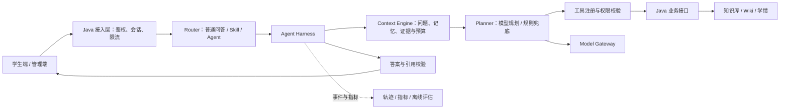

# Agent 架构建设规划

> 适用项目：大学生多考试备考知识库与题库系统  
> 编写日期：2026-10-30  
> 用途：指导现有 AI 导学 Agent 的迭代与验收

## 1. 建设目标与范围

在现有 Java 后端、Python FastAPI AI 服务、知识库和学生端的基础上，把 Agent 建设成可解释、可追踪、具备数据隔离与降级能力的 ExamPilot。优先完成真实学生场景：课程与资料问答、题目讲解、错题复习和学习计划查询。

建设遵循四条原则：

1. 优先补齐已有模块的实际调用链，再增加新框架。
2. 回答以已审核知识和明确来源为依据，证据不足时允许拒答。
3. 用户数据按身份隔离；当前 Agent 工具保持只读。写入能力必须单独设计权限、确认和幂等机制。
4. 以真实任务完成率、安全性与可维护性决定是否扩展 MCP、多 Agent 和长期记忆。

本规划是实施建议；现状来自当前源码和项目文档的静态梳理，文中的已有能力不等于本次已经重新实测。

## 2. 现状与缺口

| 模块 | 当前基础 | 主要缺口与决策 |
|---|---|---|
| LLM / Model Gateway | Java 侧已有模型代理、多个通道及降级 | 统一请求配置和调用结果，记录模型、耗时、失败与降级；避免将规则回答标记为模型回答 |
| Planner / Router | Python 有 LLM 规划器、规则兜底；另有 Router/Skill | 明确普通问答、Skill 与 Agent 的入口及路由规则，量化误路由 |
| Context Engine | 已有上下文组装、字符预算、估算 Token 和裁剪事件 | 检查关键证据和问题是否被裁掉；按模型改进预算与截断策略 |
| Tools / Function Calling | 7 个只读工具通过 Java 内部接口访问业务数据 | 统一参数校验、权限、超时和错误格式；写操作另行设计 |
| Knowledge / Retrieval | 知识库、Wiki、向量与全文检索、引用校验已有基础 | 对现有语料重新标定生产阈值，评估召回、拒答与引用准确性 |
| Memory | 上下文定义了会话 ID、历史和摘要 | Python Agent 路由 `_context()` 当前未填入这些字段；先核实端到端链路并修复，避免多轮记忆形同虚设 |
| Runtime / Harness | 已有规划、工具、观察、回答循环和步数限制 | 完善取消、超时、异常终态和预算耗尽后的行为 |
| Security / Guardrails | 内部 Token、只读工具、提示词约束与引用校验已有基础 | 核实每个工具的用户身份和数据归属校验，验证提示注入、越权和敏感数据泄露 |
| State / Checkpoint | 有运行轨迹与异步任务状态 | 轨迹回放不等于断点恢复；短问答暂不要求检查点，长任务需要时建设 |
| MCP / Connectors | Agent 通过 Java 内部接口访问系统数据 | 暂不引入 MCP；外部系统接入形成明确需求后再设计连接器 |
| Skills / Subagents | 已注册 9 个 Skill，已有单 Agent 执行器 | 明确 Skill 选择与边界；多 Agent 暂缓，先以单 Agent 实测瓶颈为依据 |
| Observability | 已有 SSE 事件、轨迹落库及管理端查看 | 贯通请求、模型、工具、检索和降级信息，并限定敏感数据记录范围 |
| Evaluation | 已有检索 Golden Set 与 Agent 合成任务评估 | 增加真实匿名化问题、多轮、安全和回归样本；区分离线指标与线上体验 |

主要现状依据：[Agent Harness](../ai-service/app/agent/harness.py)、[规划器](../ai-service/app/agent/planner.py)、[工具注册](../ai-service/app/agent/tools.py)、[上下文管理](../ai-service/app/agent/context_manager.py)、[Agent 路由](../ai-service/app/routers/agent.py)、[Skill 注册](../ai-service/app/skills/registry.py) 和 [项目 README](../README.md)。

## 3. 目标架构

Agent 单次运行应具有统一的 `traceId`、`sessionId`、用户身份、执行预算、最终状态和来源信息。内部工具返回的文档、历史和用户输入均视为数据；权限由服务端校验，不由模型判断。

## 4. 分阶段实施

### 阶段一：打通核心链路和建立基线（P0）

**目标**：先确认现有系统真实能做什么，让多轮问答和检索结果可验证。

| 工作项 | 实施内容 | 交付物与验收 |
|---|---|---|
| 会话与记忆链路 | 从客户端、Java 请求到 Python `AgentRequest` / `_context()` 追踪 `sessionId`、历史、摘要和用户身份；只补齐实际缺失的字段 | 多轮追问能引用正确的上一轮上下文；不同用户、不同会话的数据不能混用；记录空会话、过期和截断行为 |
| 路由边界 | 梳理普通问答、Router/Skill 和 Agent 的实际入口、配置开关、失败回退与响应格式 | 一张调用链和一组典型问题映射；路由失败或关闭时有明确反馈 |
| 检索基线 | 固定语料版本和评估集，分别测原始召回与启用生产闸门后的结果；按当前语料标定阈值 | 输出 Recall@K、MRR、误拒答率、无关放行率和引用有效性；配置调整有依据和回滚值 |
| 真实任务集 | 从授权的匿名化场景中整理课程问答、错题、计划、无答案、多轮问题 | 样本记录预期工具、答案依据、禁止行为；按训练/调参和最终验收分集 |
| 配置基线 | 核实实际启用的模型、路由、Agent、向量检索与降级配置 | 配置清单标注默认值、环境覆盖、依赖及关闭后的行为，不记录密钥 |

阶段结束条件：完成以上链路与评估报告，明确当前基线和阻塞问题；评估数字必须注明模型、配置、语料版本、日期和样本数量。

### 阶段二：安全与运行可靠性（P0/P1）

**目标**：让 Agent 的访问边界、失败和降级可控。

| 工作项 | 实施内容 | 交付物与验收 |
|---|---|---|
| 工具权限 | 逐工具列出输入、返回数据、角色要求和用户归属；Java 服务端独立校验 | 无法通过伪造 `userId` 读取其他学生的错题、计划、画像或会话；未授权请求返回明确错误 |
| 参数与资源预算 | 统一工具参数 schema、允许范围、超时、并发与步数/调用数上限 | 非法参数被拒绝；超时和预算耗尽产生明确终态；工具错误不被当成有效证据 |
| 提示注入与引用 | 对检索文本、用户输入、历史消息建立信任边界；校验引用属于本次可访问证据 | 覆盖要求越权、伪造系统指令、伪造引用等样本；无依据时拒答而不编造引用 |
| 模型网关 | 统一模型标识、超时、重试条件、失败分类和降级来源 | 管理端或日志可区分模型、规则和抽取式输出；避免无限重试与重复调用 |
| 运行终态 | 定义完成、拒答、取消、超时、失败、预算耗尽的状态与 SSE 协议 | 断连后停止上游调用；客户端不会无限等待；终态和轨迹一致 |

阶段结束条件：安全与异常场景通过约定的验收集；任何可写工具必须另立设计并通过权限、确认、幂等与审计评审后接入。

### 阶段三：可观测性与持续评估（P1）

**目标**：让问题可以定位，让改动可以比较。

| 工作项 | 实施内容 | 交付物与验收 |
|---|---|---|
| 端到端追踪 | 将 `traceId` 贯通 Java、Python、模型代理、检索和工具 | 一个请求可以查看各步骤耗时、状态、模型/工具版本、降级原因和最终结果 |
| 数据最小化 | 对问题、工具结果和轨迹设定脱敏、访问权限与保留期限 | 个人资料与密钥不进入普通日志；删除/导出规则与账号功能一致 |
| 评估流水线 | 固定数据集版本，比较路由、工具、答案、引用、时延及安全项 | 每次变更生成可比较报告；分别展示规则规划和模型规划，不合并为同一指标 |
| 运行指标 | 汇总失败率、超时率、拒答率、降级率、工具调用成功率与延迟 | 管理端展示统计口径、时间范围和样本量；无数据时显示空状态 |

阶段结束条件：能够根据 trace 找到一次失败发生的步骤；核心评估集能重复执行并定位回归。

### 阶段四：按需求扩展（P2）

仅在对应业务需求成立后启动：

- **Checkpoint**：面向长时任务，保存运行状态、步骤结果和版本；定义恢复、重复执行、过期、取消与幂等。先做只读任务的中断恢复，再考虑写操作。
- **Connector / MCP**：明确要接入的系统、数据授权和维护责任；设计身份传递、权限映射、超时、隔离和审计，再决定是否使用 MCP 协议。
- **长期记忆**：先定义学生可见、可修改、可删除的记忆范围与保留期限；不将模型推断直接当作可靠个人事实。
- **Subagent**：选择单 Agent 确实处理不好的复杂任务，用同一评估集比较准确率、时延和成本；通过收益评审后再拆分角色与协作协议。

## 5. 建议的验收指标

阈值先由阶段一基线和产品目标共同确定，不直接套用旧报告中的数字。每项指标至少注明样本量、数据来源、运行模式、模型和语料版本。

| 类别 | 指标或检查 | 验收口径 |
|---|---|---|
| 多轮 | 指代消解、会话隔离 | 能回答有证据的追问；跨用户和跨会话读取失败 |
| 检索 | Recall@K、MRR、误拒率、无关放行率 | 分别记录关闭闸门与生产配置结果；有可复现阈值选择过程 |
| 工具 | 参数校验、成功率、超时与权限 | 真实工具失败不伪装为成功；越权样本全部拒绝 |
| 回答 | 有依据正确率、引用有效率、无依据拒答 | 引用指向本次用户可访问的真实资料；缺少证据时明确说明 |
| 安全 | 提示注入、越权、敏感信息 | 使用单独安全集记录失败案例，严重越权和凭据泄露不得通过 |
| 运行 | 成功/失败/取消终态、P50/P95 延迟 | 记录完整链路，终态一致；超时和客户端断开可恢复服务资源 |
| 回归 | 不同模型、规划器、语料与配置对比 | 失败案例可复现，结果和报告版本可追溯 |

## 6. 依赖与风险

1. **模型与运行模式变化**：旧报告的规则规划数据不能代表当前模型规划效果；必须分别评估。
2. **语料和检索阈值漂移**：扩充课件或题库后需要重跑评估，不能直接沿用旧阈值。
3. **记忆质量与隐私**：摘要可能遗漏或误记；重要个人信息需可追溯、受用户控制，并支持清除。
4. **身份传递**：内部 Token 只能证明服务身份，不能代替对最终用户及其资源归属的校验。
5. **外部依赖**：模型、向量库、Redis 或 AI 服务不可用时，分别说明用户看到的功能变化和降级能力。
6. **状态恢复复杂度**：检查点、重试和写操作组合会产生重复执行风险，必须在支持写入前确定幂等规则。

## 7. 下一步任务清单

1. 逐层追踪 Java → Python 的 Agent 请求，确认 `sessionId`、历史和摘要在哪里丢失，补齐并验证多轮与隔离。
2. 固定当前语料、模型和生产配置，执行一次检索与 Agent 基线评估，单独记录规则兜底结果。
3. 按 7 个工具制作权限与数据归属表，补足服务端校验及越权验证。
4. 梳理现有 Router/Skill 与 Agent 入口，确定用户问题的分流与降级规则。
5. 统一轨迹中的模型、检索、工具耗时与终态，补充脱敏与保留规则。

以上任务的具体负责人和时间应依据团队人数、部署环境及阶段一基线确定；完成每阶段验收后再安排下一阶段的扩展工作。
