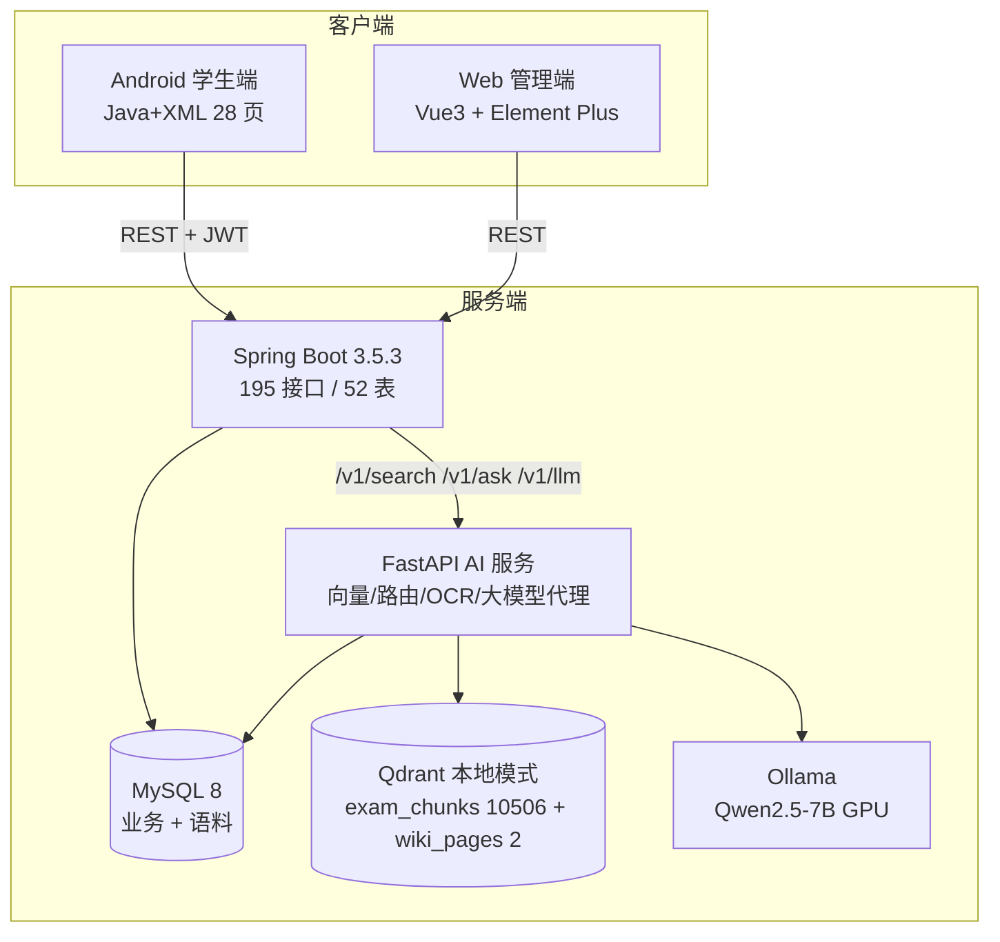

# 大学生多考试备考知识库与题库系统 · 完整大纲 v3（当前实现）

> **文档定位**：v2（`docs/大纲-v2.md`，703 行）是**设计与验收基线**；本文件是 **v3，按当前代码的实际状态重写**——
> 凡是 v2 写过但没实现的，这里标 ❌ 或被移除；凡是实现超出 v2 的，这里补全。
>
> **数据时点**：2026-10-25 实测（接口/表/语料/测试数均为机器核对，非估算）。此后仅目录整理与文档修订，无功能变更。
>
> **文档约定**：
> - ✅ 已实现且实测通过　🟡 部分实现（已注明缺口）　❌ 未实现（不粉饰）
> - 所有数字后标注来源（SQL / 命令 / 文件路径），便于复核
> - **"完成"的定义**：代码在、测试过、能跑通；仅"代码在"不算完成

---

## 修订记录（v2 → v3）

| 项 | v2 状态 | v3 现状 |
|---|---|---|
| 大模型 | 智谱 GLM-4-Flash（云端 Key） | **本地 Qwen2.5-7B / Ollama**，GPU 52 tok/s，无 Key、无联网（云端 Key 已 401 弃用） |
| AI 架构 | 单链 RAG + 抽取式兜底 | **Router/Skill 八技能 + 三闸门**，检索按 `source_type` 硬分流 |
| 语料 | 2,535 块（行测真题 + 知识点 + 资料） | **10,688 块**（新增 8,255 块课件，来自 485 份文档；其中 6 章操作系统 PPT 182 块） |
| 自我改进 | 无 | **RSI 评测驱动自改进**（41 条标注集 + 四道回归闸门） |
| Wiki | 设计为"完成，热层优先" | **热层已接线**（0.05–0.30s）；蒸馏侧仅 2 页，worker 默认关 |
| 部署 | Docker Compose（Qdrant 容器） | **向量库改本地目录模式**，不再强依赖 Docker |
| 目录 | 根目录散放 APK 与脚本 | `release/`（APK）、`scripts/`（运维脚本） |
| 接口 | 192 | **195 / 32 个 Controller** |
| 数据表 | 49 | **52** |

---

## 零、项目定位声明

### 0.1 性质

软件工程课程设计 + 毕业设计作品，同步备战全国大学生软件创新大赛（随身 AI 互动导学赛道）。
**不商用、不上架**；数据来自公开真题与本人课程资料。

### 0.2 目标

做一个**能在局域网内真实跑起来、可溯源、可演示**的备考平台：学生端能刷题看资料问 AI，管理端能治理内容，AI 回答必须带引用、答不出要敢拒答。

### 0.3 边界（明确不做）

| 不做 | 原因 |
|---|---|
| 云端大模型 API | 无稳定 Key；本地 7B 已够用且可离线演示 |
| 微调 7B | 语料量级不足，RAG 已能解决；周期不允许 |
| 多轮对话记忆 | 需会话存储 + 上下文压缩，收益低于复杂度 |
| 积分/付费体系 | 主动移除，社区激励改为审核贡献与收藏记录 |
| OCR 自动建题（业务接入） | 识别能力已具备，业务链路未接（明确列为缺口） |

### 0.4 原则

1. **可验证优先**：任何"已完成"必须能被命令复现，不接受"应该可以"
2. **降级不中断**：任一路径挂掉，接口仍返回可用内容（最差是抽取式）
3. **诚实优先于好看**：未实现的写"未实现"，不写"规划中"
4. **本地优先**：能离线就跑离线，减少演示故障点

---

## 一、项目概述

### 1.1 基本信息

| 项 | 内容 |
|---|---|
| 名称 | 大学生多考试备考知识库与题库系统 |
| 仓库 | `gitee.com/ZHCNDEV/software`（private，main 分支） |
| 形态 | Android 学生端 + Web 管理端 + Spring Boot 后端 + Python AI 服务 |
| 规模 | 后端 195 接口 / 52 表；AI 服务 66 个 Python 文件；Android 28 Activity + 4 Fragment |
| 数据 | 23 个学院、114 门科目、2,500 道题、10,688 条语料块 |

### 1.2 背景与痛点

- 备考资料散落在群文件、网盘、打印店，**找不到、对不上、过期了不知道**
- 刷题工具只给答案不给解析，**错了不知道为什么错**
- 通用大模型会**编答案**，教学场景下"答错"比"不答"危害更大

### 1.3 核心特色

1. **资料治理闭环**：上传 → 审核 → 预览 → 下载 → 举报 → 下架（含孤儿向量清理）
2. **本地大模型导学**：7B 在本机 GPU 上 52 tok/s，**无需联网、无需 API Key**
3. **Router/Skill 架构**：先判意图再检索，9 个技能各管一段，事实类问题**检索无命中即拒答**
4. **双引擎**：Wiki 热层（预编译页，0.05–0.30s）+ RAG 冷层（向量+字面，~5s）分层降级
5. **可溯源自改进**：回答带 `[n]` 引用可跳原文；RSI 用评测集驱动策略优化，有回归闸门

### 1.4 用户角色

| 角色 | 权限要点 |
|---|---|
| 学生（STUDENT） | 刷题、看资料、AI 问答、错题本、学习计划、上传资料（待审） |
| 教师（TEACHER） | 学生权限 + 组卷、查看班级学情 |
| 管理员（ADMIN） | 审核资料、题库维护、用户管理、AI 索引运维 |
| 超级管理员（SUPER_ADMIN） | 全部 + 系统配置 |

---

## 二、可行性分析

### 2.1 技术可行性

| 环节 | 结论 | 依据 |
|---|---|---|
| 本地 7B 推理 | ✅ 可行 | RTX 4060 8GB，Qwen2.5-7B q3_k_m 占 4.0GB 显存，52 tok/s |
| 中文向量检索 | ✅ 可行 | bge-small-zh-v1.5 ONNX，512 维，25ms/块 |
| 万级语料 | ✅ 可行 | 10,506 块全量向量化 261.6s，检索 <50ms |
| 免 Docker | ✅ 可行 | Qdrant 本地目录模式（`local:./data/qdrant`） |

### 2.2 经济可行性

全部本地：模型 3.6GB（免费）、向量库本地文件、无 API 费用。**运行成本为 0**。

### 2.3 操作可行性

Windows 双击 `启动后端.bat` 即起服务；AI 服务 `ai-service/run.bat`；学生装 APK。
**不需要命令行、不需要 Docker**（这是相较 v2 的关键简化）。

### 2.4 法律与合规

题库来源为公开发布的行测真题与本人课程资料；不上架、不商用、无付费。

### 2.5 进度可行性

| 阶段 | 状态 |
|---|---|
| 后端全量（P0-A/P0-B/P1） | ✅ 封板 |
| 管理端 / 学生端 | ✅ 可用（APK v1.5） |
| AI 导学（RAG → Router/Skill → RSI） | ✅ 完成 |
| Wiki 双引擎 | 🟡 热层通、蒸馏侧未规模化 |
| 论文/答辩材料 | 🟡 文档 21 份，答辩稿待写 |

---

## 三、需求分析

### 3.1 功能范围总表

| # | 模块 | 状态 | 关键能力 |
|---|---|---|---|
| F1 | 认证与权限 | ✅ | 注册（选学校/学院）、登录、JWT 四角色、BCrypt |
| F2 | 题库与练习 | ✅ | 单选/多选/判断/填空/简答/编程/听力；随机练习、章节练习 |
| F3 | 考试与模考 | ✅ | 组卷、限时、交卷、自动判分、成绩单 |
| F4 | 错题与学情 | ✅ | 错题本、知识点掌握度、薄弱点统计 |
| F5 | 资料治理 | ✅ | 上传、审核、PDF 逐页预览、下载、举报、下架 |
| F6 | 通知与互动 | ✅ | 站内通知、收藏、下载记录、反馈 |
| F7 | 管理端 | ✅ | 题库/资料/用户/公告/统计/索引运维 |
| F8 | AI 导学 | ✅ | 八技能问答、引用溯源、拒答、降级 |
| F9 | Wiki 双引擎 | 🟡 | 热层查询通；蒸馏仅 2 页、worker 默认关 |
| F10 | 学习计划 / AI 判分 | ✅ MVP | 规则引擎生成计划；判分走得分点匹配（质量数据待取） |

### 3.2 角色权限矩阵（节选）

| 功能 | 学生 | 教师 | 管理员 | 超管 |
|---|---|---|---|---|
| 刷题/看资料 | ✅ | ✅ | ✅ | ✅ |
| 上传资料 | ✅（待审） | ✅ | ✅ | ✅ |
| 审核资料 | ❌ | ❌ | ✅ | ✅ |
| 题库增删改 | ❌ | ✅ | ✅ | ✅ |
| AI 索引重推 | ❌ | ❌ | ✅ | ✅ |
| 用户管理 | ❌ | ❌ | ✅ | ✅ |

### 3.3 核心业务流程

**资料治理**
```
上传(学生/教师) → 待审 → 管理员审核 ─┬─ 通过 → 可预览/下载 → 参与 AI 检索
                                    └─ 驳回 → 附理由 → 作者修改再提
下架 → ai_chunk 置 INVALID → 清理 Qdrant 孤儿向量（失败不影响下架）
```

**AI 问答（当前实现）**
```
问题 → [热层] Wiki 页检索（≥0.62 命中即返回，0.05–0.30s）
        ↓ 未命中
      [路由] bge 意图分类（8 skill，4–20ms）→ 三闸门
        ├─ sim<0.60 → 拒答
        ├─ margin<0.05 → 反问澄清
        └─ 命中 skill → [检索] 按 source_types 取块 → [生成] 7B 带 [n] 引用
                          └─ 无命中且属事实类 → 拒答（不编造）
```

### 3.4 状态机

**资料**：`DRAFT → PENDING → APPROVED / REJECTED → OFFLINE`
**题目**：`DRAFT → PENDING → APPROVED → PUBLISHED`（`audit_status`）
**AI 语料块**：`ACTIVE ⇄ INVALID`（可逆，用于下架与图片题隔离）

### 3.5 非功能需求

| 维度 | 指标 | 实测 |
|---|---|---|
| 问答延迟（RAG） | ≤10s | 5.2–9.5s |
| 问答延迟（热层） | ≤2s | **0.05–0.30s** |
| 降级切换 | ≤1s | **0.095s**（Ollama 未启动时） |
| 并发 | 局域网小规模 | 单机 Spring Boot + uvicorn |
| 可用性 | 单点故障不中断 | 五层降级链 |

---

## 四、系统总体设计

### 4.1 架构



**关键设计**：Java 是**唯一业务入口**（鉴权、事务、审计），Python 只做"AI 能力"，不碰业务写操作；
所有降级决策权在 Java 侧（它持有 prompt 与溯源上下文），Python 失败就返回 503，由 Java 决定退到哪一层。

### 4.2 多端策略

| 端 | 技术 | 说明 |
|---|---|---|
| 学生端 | 原生 Android（Java + XML） | 选原生而非跨端：控包体、控权限、真机稳 |
| 管理端 | Vue3 + Element Plus 单页 | CDN 本地化，由后端同源托管，零构建零跨域 |
| 后端 | Spring Boot 3.5.3 + JDK 21 + MyBatis-Plus | 保守选型，生态成熟 |
| AI 服务 | FastAPI + onnxruntime + qdrant-client | 与 Java 解耦，可独立重启 |

### 4.3 技术选型与理由

| 项 | 选择 | 理由 |
|---|---|---|
| 大模型 | Qwen2.5-7B q3_k_m | 中文强、8GB 显存可跑、52 tok/s |
| 推理框架 | Ollama | 一条命令起服务，OpenAI 兼容端点 |
| Embedding | bge-small-zh-v1.5（ONNX） | 512 维、CPU 25ms、无 Python 依赖冲突 |
| 向量库 | Qdrant（本地目录模式） | 万级语料够用；免 Docker 降低部署门槛 |
| 全文检索 | MySQL ngram | 与业务同库，无需额外组件；作为字面通道 |
| 意图路由 | bge 句向量 + 原型句 | 4–20ms、确定性、可回归；**不用 7B 判意图** |

### 4.4 模块划分

```
backend/ (Java)
├── controller  32 个，195 接口
├── service     auth/question/exam/resource/ai/...
├── mapper      MyBatis-Plus + 自定义 SQL（ngram 检索、批量统计）
└── security    JWT 过滤器、角色校验

ai-service/ (Python)
├── router/     意图路由（原型句 + 三闸门）
├── skills/     9 个技能定义（检索范围 + 提示词骨架）
├── clients/    embedding / qdrant / llm / java_bridge
├── wiki/       蒸馏器（grounding 校验 + 抽取兜底）
├── agent/      Harness + planner + tools（多步编排）
├── worker/     Redis Stream 作业（WIKI_DISTILL 等，默认关）
├── ocr/        PaddleOCR 引擎
├── eval/       评测集与脚本
└── tools/      灌库、向量化、RSI 调优脚本
```

### 4.5 关键机制

1. **五层降级**：热层 → 向量 → ngram → 7B → 抽取式
2. **source_type 硬分流**：课程题 / 课件 / 资料各查各的，互不挤占 top-K
3. **拒答三闸门**：相似度、意图间隔、检索验证
4. **可逆数据变更**：语料失效只改 `status`，不删数据

---

## 五、数据库设计大纲（54 张表）

### 5.1 分组

| 域 | 表（代表） | 数量 |
|---|---|---|
| 组织与用户 | college / major / subject / exam_category / user / user_profile | 6 |
| 题库 | question / question_option / question_tag / knowledge_point | 4 |
| 练习与考试 | practice_session / practice_detail / exam_paper / exam_question / exam_record / answer_detail | 6 |
| 错题与学情 | wrong_book / knowledge_mastery / study_plan / study_task | 4 |
| 资料 | resource / resource_page / file_record / download_log / favorite / report / feedback | 7 |
| 通知与审计 | notification / audit_log / operation_log | 3 |
| **AI 语料** | ai_chunk / ai_vector_index_meta / courseware / wiki_page / wiki_page_link / wiki_page_revision / rsi_run | 7 |
| AI 运行 | ai_agent_session / ai_agent_run / ai_eval_run | 3 |
| 其它 | 字典、配置、统计等 | 12 |

### 5.2 AI 核心表字段要点

**ai_chunk**（语料块，检索的基本单位）
```sql
id, source_type(QUESTION/RESOURCE/KNOWLEDGE/COURSEWARE), source_id, chunk_no,
title, content(mediumtext), exam_category_id, subject_id, knowledge_id,
difficulty, ref_type, ref_id, page_no, content_hash,
status(ACTIVE/INVALID), vector_synced, vector_synced_at
-- 关键：status 是"是否参与检索"的开关，可逆；content_hash 用于判重
```

**courseware**（课件元数据）
```sql
id, title, category, subject_id, source_file(唯一), char_count,
chunk_count, status, is_deleted
-- 两个唯一键分工：source_file 做文件级幂等，category+title 做业务去重
```

**wiki_page / wiki_page_link / wiki_page_revision**
```sql
wiki_page: id, slug(唯一), title, subject_id, knowledge_id, summary,
           content, key_points, source_chunk_ids, status, version,
           model, quality_score
-- source_chunk_ids 保证可溯源；quality_score 来自蒸馏器的 grounding 校验
```

**rsi_run**（自改进留痕）
```sql
id, stage, metric_before(JSON), metric_after(JSON),
learned_count, detail(TEXT), created_at
```

---

## 六、接口设计大纲（197 个）

| 分组 | 代表端点 | 鉴权 |
|---|---|---|
| 认证 | `POST /auth/register` `/auth/login` `/auth/password` | 公开 / 登录 |
| 题目 | `GET /questions` `/questions/{id}` `POST /questions/{id}/answer` | 登录 |
| 练习 | `POST /practice/start` `/practice/{id}/submit` | 学生 |
| 考试 | `POST /exams/start` `/exams/{id}/submit` `GET /exams/records` | 学生 |
| 错题 | `GET /wrong-book` `POST /wrong-book/{id}/master` | 学生 |
| 资料 | `POST /resources/upload` `GET /resources` `GET /resources/{id}/pages/{n}` | 登录 / 审核 |
| 收藏举报 | `POST /favorites/{id}` `POST /reports` | 学生 |
| 通知 | `GET /notifications` `POST /notifications/{id}/read` | 登录 |
| 管理 | `POST /admin/resources/{id}/audit` `GET /admin/stats` | ADMIN |
| **AI 问答** | `POST /ai/ask` `GET /ai/capability` | 登录 |
| **AI 运维** | `POST /admin/ai/reindex` `POST /admin/ai/vector/reconcile` | ADMIN |
| **课件** | `GET /courseware` `GET /courseware/{id}` | 登录 |
| **判分/计划** | `POST /ai/grading` `GET /study-plan/today` | 学生 |

**Python 侧（FastAPI）**

| 端点 | 作用 |
|---|---|
| `POST /v1/embed` | 文本向量化 |
| `POST /v1/search` | 向量检索（支持 subject/knowledge/source_type 过滤） |
| `POST /v1/ask` | **Router+Skill 统一问答**（返回 skill/router/sources/hot） |
| `POST /v1/llm` | 大模型代理（带 [n] 解析） |
| `POST /v1/ocr` | 试卷识别 |
| `POST /v1/wiki/search` | Wiki 热层检索 |
| `POST /v1/index/sync` `/v1/index/delete` `/v1/index/status` | 向量索引运维 |
| `GET /v1/health` | 能力自检（embedding/qdrant/llm/ocr 各自 ready） |

---

## 七、AI 导学子系统（详细）

### 7.1 分层总览

| 层 | 组件 | 延迟 | 触发条件 |
|---|---|---|---|
| L1 热层 | Wiki 预编译页 | 0.05–0.30s | 相似度 ≥ 0.62 |
| L2 向量检索 | Qdrant + bge | 20–60ms | 热层未命中 |
| L3 字面检索 | MySQL ngram | 10–30ms | 向量不可用 / 补充召回 |
| L4 生成 | 本地 7B | 2–9s | 有上下文 |
| L5 兜底 | 抽取式拼接 | <100ms | 7B 不可用 |

### 7.2 检索层

**双通道融合**：向量分 + ngram 分加权归一化；**双门控拒答**：`min-vector-score` + `min-term-coverage`。

**source_type 硬分流**（关键设计，防污染）

| skill | 检索范围 | 理由 |
|---|---|---|
| COURSE_QA | QUESTION + KNOWLEDGE | 课程题不能被课件挤掉 |
| COURSEWARE_QA | COURSEWARE | 课件问题不该混入行测题 |
| EXERCISE_EXPLAIN | QUESTION | 讲题必须定位原题 |
| RESOURCE_RECOMMEND | RESOURCE + COURSEWARE | 推荐资料 |

实测污染证据：不加过滤时问「进程 线程」，字面通道 top-5 全为课件；加过滤后恢复正常。

### 7.3 Router + Skill

**为什么用 bge 而不是 7B 判意图**

| 维度 | bge 路由 | 7B 判意图 |
|---|---|---|
| 延迟 | **4–20ms** | ≥1s（冷启动 55s） |
| 可靠性 | 确定性，无解析失败 | JSON 解析会失败，需兜底 |
| 可回归 | 可离线评测 | 每次都要跑模型 |

**三闸门（顺序短路）**
```
① sim < 0.60          → REFUSE（明显域外）
② margin < 0.05       → CLARIFY（Top1/Top2 太近）
③ 事实类且检索无命中  → REFUSE（不编造）
④ 其余                → 执行 skill
```

**为什么单阈值不够**：域外最高分 0.6317（"这个单词怎么念"）> 域内最低 0.6136（"面试"）——
bge 衡量语义相似度，而"能不能答"取决于有没有资料，两者不是同一维度。所以** Router 只判意图，可作答性交给检索。

**9 个技能**

| skill | 状态 | 检索范围 | 说明 |
|---|---|---|---|
| COURSE_QA | ✅ | QUESTION+KNOWLEDGE | 课程知识问答 |
| COURSEWARE_QA | ✅ | COURSEWARE | 课件讲解（AI/架构专题） |
| EXERCISE_EXPLAIN | ✅ | QUESTION | 题目讲解 |
| RESOURCE_RECOMMEND | ✅ | RESOURCE+COURSEWARE | 资料推荐 |
| SMALLTALK | ✅ | — | 模板直出，不调模型（<50ms） |
| STUDY_PLAN | ✅ | COURSEWARE+KNOWLEDGE | 目标 → 诊断 → 每日任务；课件+知识点两组召回后组装计划 |
| WRONG_BOOK_REVIEW | ✅ | QUESTION | 归纳高频错因；**提示词强制声明「本通道没有你的个人错题数据」**，防编造 |
| GRADING | ✅ | QUESTION | 「总评 → 扣分点 → 修改建议」；无 LLM 时走 bigram 重合度，标注「非模型判分」 |
| INTERVIEW | ✅ | COURSEWARE（面试类文档） | 出题/评分/追问/报告的入口，`/v1/ask` 命中时引导到 `/v1/interview/*` |

> 说明：早期版本这三个 skill 是「未实现、回退 COURSE_QA」。现已实装，
> 但保持同一原则——**降级就标 `degraded=true`，不假装是模型判分**。

### 7.4 生成层（本地 7B）

| 指标 | 实测 |
|---|---|
| 生成速度 | 52 tok/s（100% GPU） |
| 显存 | 4.0GB / 8GB |
| 热态延迟 | 0.77s（28 token）/ 5.39s（279 token） |
| 冷启动 | 59.9s（模型加载 55s） |
| 保活 | `keep_alive=30m`，防 5 分钟卸载 |

**提示词硬约束**：只依据资料、必须 `[n]`、资料不足说不知道、300 字内、简体中文。

### 7.5 Wiki 双引擎

**已实现**
- 蒸馏器 `app/wiki/distiller.py`：LLM 蒸馏 + `grounding_ratio` 校验 + 抽取式兜底
- 三表：`wiki_page` / `wiki_page_link` / `wiki_page_revision`
- 独立向量集合 `wiki_pages`，`/v1/wiki/search` 可查
- **热层已接入 `/v1/ask`**：命中直接返回预编译页，不调模型

**实测**

| 问题 | 结果 | 耗时 |
|---|---|---|
| 言语理解与表达主要考什么 | WIKI_HOT 0.8308 | **0.30s** |
| 判断推理怎么复习 | WIKI_HOT 0.7400 | **0.05s** |
| 进程和线程的区别 | WIKI_HOT 0.6773 | **0.05s** |
| 帮我订机票 | 未命中 → REFUSE | 0.01s |

**阈值标定**：wiki 相关 0.74–0.83，无关 ≤0.42 → 取 **0.62**。

**现状（2026-10-29）**：已发布 **47 页**（操作系统 6 章各一页 + 41 份 AI/架构文档），
全部 `PUBLISHED`、带真实 `source_chunk_ids`（各 6 个块）、质量分 0.92–1.0、正文 864–2314 字。

**来源校验（v4 整改新增）**：热层命中后回查 MySQL，任一来源块失效/下架 →
**fail-closed 降级到 RAG 冷层**，原因写 `router.hot_reason`；`source_chunk_ids` 为空的
手工页放行（不误伤）。写侧蒸馏前同样剔除已下架块。

**已知边界**：主题粒度命中好（6/6），细粒度事实题命中差（0/4，如「死锁四条件」仅 0.508）——
根因是页面粒度，不是阈值（离线对比三种页面向量文本，命中率都是 6/8）。
降阈值会把「RAG 优化策略」错配到「后端接口优化」，所以**不降**；正确做法是蒸馏更细的主题页。

### 7.6 RSI（评测驱动自改进）

**做法**（不是让模型改自己权重——做不到也不该声称）
```
41 条标注集 → 按问题 md5 稳定切分（训练 33 / 留出 8）
  → 训练集失败样本 → 生成候选（失败问题作新原型句）
  → 四道闸门 → 落盘 prototypes_learned.json → 服务启动加载 → 记 rsi_run
```

**四道闸门**（缺一即自欺欺人）
1. 只扩原型句，**不动阈值**（阈值一漂，拒答边界就破）
2. 留出集**不参与学习**（防拟合测试集）
3. 训练集必须**严格变好**
4. 留出集、域外拒答、危险误判**均不许退化**

**结果**

| 指标 | 改进前 | 改进后 |
|---|---|---|
| 训练集 | 31/33 = 93.9% | **33/33 = 100%** |
| 留出集 | 8/8 | **8/8 未退化** |
| 域外拒答 | 6/6 | **6/6** |
| 危险误判 | 0 | **0** |
| 判定耗时 | 16.4ms | **4.1ms** |

**泛化证据**（学 2 条原型，救回 4 条没见过的同义问法）
```
死锁需要满足哪些条件   0.562 → 0.818
死锁的四个条件是什么   0.561 → 0.847
红黑树和哈希表哪个更快  0.388 → 0.771
B+ 树和哈希索引的区别   0.444 → 0.647
```

**边界**：路由修好后，「死锁四条件」仍答"未找到相关资料"——**语料里确实没有这些内容**，这是检索闸门正确拒答。RSI 不创造知识。

### 7.7 语料体系

**构成（10,506 块）**

| 来源 | 块数 | 说明 |
|---|---|---|
| QUESTION | 2,398 | 2016–2026 国考行测真题（去图片题后） |
| COURSEWARE | 8,255 | 485 份文档（481 万字），600 字/块、80 字重叠 |
| KNOWLEDGE | 30 | 知识点 |
| RESOURCE | 5 | 资料 |

**灌库流程**
```
docx（zipfile 读 document.xml，不加依赖）
  → 按段落聚 600 字/重叠 80，块首加《文档标题》
  → 写 courseware + ai_chunk（source_type=COURSEWARE, vector_synced=0）
  → vectorize_all.py 批量 500 推 Qdrant（25ms/块）→ 回写 vector_synced=1
```

**质量处置**
- **图片题隔离**：图形推理/文章标题/类比推理/语句排序/缺图共 102 条置 INVALID（文字里没图，命中也是废答案）
- **重复块问题**：同主题在多篇文章重复出现，检索可能返回同源多条（**未解决**，计划做概念合并）

### 7.8 观测与运维

| 能力 | 端点 / 表 | 作用 |
|---|---|---|
| 能力自检 | `GET /api/ai/capability` | 真实反映 generator 与各通道 ready（含 1.5s 短路探测，避免"谎报 ollama"） |
| 索引对账 | `POST /api/admin/ai/vector/reconcile` | 比对 MySQL 与 Qdrant，报 `missingInQdrant` / `consistent` |
| 索引重推 | `POST /api/admin/ai/reindex` | 分批推送（**不覆盖 COURSEWARE**，课件由脚本推） |
| 自改进留痕 | `rsi_run` 表 | 每轮 before/after 指标与学习内容 |

### 7.9 AI 模拟面试（校招面练）

**为什么单独做一条链路**：问答是「你问它答」，面试要「它问你答 + 判分 + 追问」，
是**多轮有状态**交互，塞进 `/v1/ask` 会把单轮链路污染。

| 环节 | 做法 | 关键约束 |
|---|---|---|
| 取题 | MySQL 圈 `courseware.title LIKE '%面试%'`（68 份）→ bge 检索块 | 只从真实语料取 |
| 出题 | 7B 把 Q&A 块改写成一道面试题 | 提示词禁超出资料；检索为空则用原文话题行并标 `degraded` |
| 作答 | 客户端提交 `{session_id, answer}` | 会话 30 分钟 TTL，他人 session 403 |
| 评分 | 7B 输出 score / verdict / hit_points / miss_points / comment | 无 LLM 走 `grounding_ratio` 折算，封顶 80，注明「非模型判分」 |
| 追问 | 得分 <60 或字数 <30 → 同题追问 1 次 | 追问作答**合并原答重评**，不是两次取平均（防刷分） |
| 结束 | 答满 total 即结束 | 最后一题不再追问；`question_no == per_question.size()` |
| 报告 | 总分 / 等级 / 逐题 / 优势 / 不足 / 建议 | 语料耗尽提前收尾时 `finish_reason=EARLY_EXHAUSTED` |

**接口**：`POST /v1/interview/start`、`POST /v1/interview/answer`（Java 侧同名代理 `/api/ai/interview/*`，透传 JsonNode 不重建 DTO）。

**持久化（2026-10-29 新增）**

| 表 | 关键字段 | 说明 |
|---|---|---|
| `ai_interview_session` | user_id / python_session_id(唯一) / topic / total_questions / finished / total_score / level / started_at / finished_at | start 成功即插入（按 python_session_id 幂等），结束回填分数 |
| `ai_interview_qa` | session_id / question_no / question / answer / score / verdict / hit_points / miss_points / reference_text / is_follow_up | **追问另起一行**（is_follow_up=1）：保留「先答 30、提示后 40」的差异，覆盖会丢画像信号 |

- 落库失败**不阻断面试**：全部 try/catch + `log.warn` + `persistenceFailures()` 计数（静默丢数据比报错更危险）
- 题号取**上一轮缓存**而不是作答响应的 `question_no`——后者是「下一题号」，直接用会整体 +1（已踩过）
- 查询：`GET /api/ai/interview/history?page&size&all`（学生仅本人，审核员/超管可 `all=true`）、
  `GET /api/ai/interview/history/{id}`（越权 403、不存在 404）

**回归过的边界（21 项不变式）**：total=1/2/3/5、末题短答不追问、追问按题计数、
结束后重复提交幂等（返回同一报告，不 500）、语料耗尽提前收尾、跨会话串号被拒。

### 7.10 检索质量指标（分通道，不混口径）

| 指标 | 纯词法（离线降级） | 生产链路（向量+ngram+语义闸门） | 守在哪 |
|---|---|---|---|
| 域外拒答准确率 | 8/10 = 80% | **9/10 = 90%** | `RetrievalServiceTest` / `HybridRetrieverTest` |
| Recall@5 | 10/12 = 83.3% | **11/12 = 91.7%** | 同上 |
| 误拒答（域内 12 题） | 0/12 | 0/12 | `RetrievalServiceTest` |
| 检索平均 / P95 | 18 / 35 ms | — | 评测表自动打印 |

**拒答三闸门（v4 整改）**：实词内容覆盖度 ≥0.45（先剔疑问壳与虚词 bigram）、
能力边界词表（天气/汇率/快递…）、语义拒答线 cosine ≥0.62（向量在线才生效）。

**为什么分两档**：`RetrievalService.retrieve()` 是纯词法路径，语义闸门在 `HybridRetriever` 里。
用同一个数字断言会出现「离线红、上线也红」的假象；分档才能同时防「离线退化」与「用在线成绩掩盖」。

---

## 八、测试与质量

| 层 | 结果 | 说明 |
|---|---|---|
| 后端单测 | **154/154** | `mvn -B test`（2026-10-29，BUILD SUCCESS） |
| AI 服务测试 | **223/223** | `pytest -q`（2026-10-29） |
| Router 评测 | 训练 33/33、留出 8/8 | `eval/router_cases.csv` 41 条 |
| 检索 Golden Set | 214 条 | `eval/golden_set.csv`（Recall@5 / MRR 脚本在 `eval/`） |
| 端到端 | ✅ | 注册→刷题→交卷→错题→模考→上传→审核→通知→下载→改密 |

**已知测试脆弱点**：`RetrievalServiceTest` 的拒答用例与语料强相关，灌库期间会抖动（量子类题目入库后"库里没有"前提失效）。建议与语料解耦，用固定测试语料。

---

## 九、部署与运行

### 9.1 本地/局域网（当前方案）

```
1. MySQL 8（root / 口令取自环境变量 `DB_PASSWORD`，仓库不保存明文）
2. 建库：mysql < sql/schema.sql && mysql < sql/data.sql（+ 增量迁移）
3. 向量库：无需 Docker，ai-service/.env 里 QDRANT_URL=local:./data/qdrant
4. 起 AI 服务：ai-service/run.bat（默认 127.0.0.1:8000，仅本机可访问）
5. 起后端：双击 启动后端.bat（java -jar --server.port=8080）
6. 手机：装 release/备考知识库学生端-v1.7.1-真机版.apk（同局域网）
```

**首次灌库（可选，重建向量）**
```
python ai-service/tools/ingest_courseware.py     # docx → MySQL
python ai-service/tools/vectorize_all.py         # MySQL → Qdrant（11300 块约 3 分钟）
```

### 9.2 目录约定

| 目录 | 内容 |
|---|---|
| `release/` | APK（构建产物，**不入库**） |
| `scripts/` | 上架前自检、备份恢复演练（`$root` 取上一级） |
| `sql/` | 23 个脚本，均可重复执行 |
| `ai-service/tools/` | 灌库、向量化、RSI 调优 |

### 9.3 已知部署问题

- **APK 未入库**：`.gitignore` 忽略 `*.apk`，仓库里没有二进制；需自行从 `student-app/` 打包
- **debug 签名**：`scripts/上架前检查.ps1` 报 FAIL（缺 `keystore.properties`），自用可装、不可发布
- **Dify 等其它容器**会与 Docker 一起自启，已设 `restart=no` 并写 `.wslconfig` 限 12 核/10GB

---

## 十、已知缺口与风险（诚实清单）

| # | 缺口 | 严重度 | 影响 | 计划 |
|---|---|---|---|---|
| G1 | ~~Wiki 只有 2 页~~ → **已扩到 47 页** | 🟢 已缓解 | 主题级命中 6/6；细粒度事实题仍 0/4 | 需要时补细主题页（粒度问题，非阈值） |
| G2 | 纯图片课件 OCR | 🟡 中 | 已完成 12 篇（234 块）；剩余约 90 份批处理中（约 8–9 小时） | `tools/ocr_courseware.py --skip-existing` 断点续跑 |
| G3 | ~~课件重复块~~ → **已做同源去重** | 🟢 已缓解 | content_hash 完全重复 + 同源 bigram Jaccard ≥0.85 近重复，保留最高分 | 跨来源概念合并仍未做 |
| G4 | ~~3 个 skill 未实现~~ → **已实装** | 🟢 已完成 | 学习计划/错题分析/判分均可用；无 LLM 时标 `degraded` | — |
| G5 | 判分质量无系统数据 | 🟡 中 | 灰度脚本可跑，缺人工标注基线 | 找 10–20 份人工打分做对照 |
| G6 | 语料缺计算机课程内容 | 🔴 高 | 问「死锁」「红黑树」只能走 RAG 兜底（OS 6 章已入库，但无教材正文） | 导教材/讲义入库 |
| G7 | 拒答/召回指标与语料强耦合 | 🟡 中 | 灌库期间指标漂移 | 已拆「词法基线 / 生产链路」两档断言，仍建议固定评测语料快照 |
| G8 | ~~APK debug 签名~~ → **已配 keystore** | 🟢 已完成 | v1.6 起正式签名（CN=ZhangHao），上架检查 FAIL=0 | — |
| G9 | ~~面试记录未持久化~~ → **已落库** | 🟢 已完成 | `ai_interview_session` / `ai_interview_qa` 两表；追问另起一行保留原始作答；`history` 列表本人可见、管理员可看全部（越权 403） | 已实测：3 题 → session 1 行 + qa 3 行（题号 1/2/3），重启后端仍可查 |
| G10 | HTTPS 未端到端验证 | 🟡 中 | 证书链与 IP SAN 已验证（openssl s_client return 0）；**本机无 nginx，`-t`、80→301、真机握手未跑** | 装 nginx 后先 `nginx -t` 再起；换 CA 证书可直接替换 `nginx/certs` |

---

## 十一、里程碑

| 阶段 | 内容 | 状态 |
|---|---|---|
| M0 | 后端 P0-A（认证/题库/练习/考试） | ✅ |
| M1 | 后端 P0-B（资料治理/通知/管理） | ✅ |
| M2 | 后端 P1（模考/申诉/关注/编程题/听力） | ✅ |
| M3 | 学生端 v1.x（35 页 + APK） | ✅ v1.7.1（面试页；v1.8 加历史记录） |
| M4 | AI 基础（ngram + 向量 + 7B + 兜底） | ✅ |
| M5 | Router/Skill + 语料扩容（11,300 块） | ✅ |
| M6 | Wiki 热层 + RSI | ✅ 热层通 + 47 页 |
| M7 | 概念去重 + 3 个 skill 补齐 + AI 面试 | ✅ |
| M8 | 论文/答辩材料 | ⏳ |

---

## 十二、附录

### 12.1 证据索引（关键数字出处）

| 数字 | 出处 |
|---|---|
| 197 接口 / 33 Controller | `grep -rhoE '@(Get|Post|Put|Delete|Patch)Mapping' backend/.../controller \| wc -l` |
| 54 表 | `SELECT COUNT(*) FROM information_schema.tables WHERE table_schema='exam_prep'` |
| 11,300 块 | `SELECT COUNT(*) FROM ai_chunk WHERE status='ACTIVE'` |
| 497 课件 / 47 Wiki 页 | `SELECT COUNT(*) FROM courseware` / `SELECT COUNT(*) FROM wiki_page` |
| 154/154、223/223 | `mvn -B test` / `pytest -q` |
| 拒答 90% / Recall 91.7% | `mvn -Dtest=RetrievalServiceTest,HybridRetrieverTest test` 打印的评测表 |
| 52 tok/s、4.0GB | `POST /api/generate` 返回的 `eval_count/eval_duration`；`ollama ps` |
| RSI 93.9%→100% | `SELECT * FROM rsi_run ORDER BY id DESC` |
| 热层 0.05–0.30s | `POST /v1/ask` 实测（本轮记录） |

### 12.2 关键文件

| 文件 | 作用 |
|---|---|
| `docs/大纲-v2.md` | 设计基线（703 行） |
| `docs/Router与Skill架构设计.md` | Router/Skill 详细设计（889 行） |
| `ai-service/app/routers/ask.py` | 问答主链路（热层 → 路由 → 检索 → 生成） |
| `ai-service/app/router/router.py` | 三闸门判定 |
| `ai-service/app/skills/registry.py` | 9 个技能定义 |
| `ai-service/tools/rsi_tune.py` | 自改进闭环 |
| `ai-service/tools/ingest_courseware.py` | 课件灌库 |
| `ai-service/tools/vectorize_all.py` | 批量向量化 |

### 12.3 术语

| 术语 | 含义 |
|---|---|
| chunk | 语料块，检索的最小单位 |
| source_type | 语料来源类型，决定检索分流 |
| 热层 / 冷层 | Wiki 预编译页 / RAG 实时检索 |
| 三闸门 | 相似度、意图间隔、检索验证 |
| RSI | 本项目中特指"评测驱动的策略自改进"，非模型权重自我修改 |
| 拒答 | 检索无据时明确说"未找到相关资料"，而非编造 |
