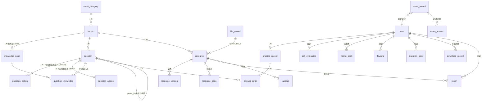

# 数据库设计说明书

> 项目：大学生多考试备考知识库与题库系统 · v1.0
> 数据库：MySQL 8，UTF-8MB4，InnoDB
> 脚本：`sql/schema.sql`（建库建表）、`sql/data.sql`（初始数据）、`sql/migration-*.sql`（增量迁移，可重复执行）

## 1 表清单（40 张）

### 1.1 核心表（P0，21 张）
`user`、`college`、`major`、`teacher`、`semester`、`exam_category`、`subject`、`knowledge_point`、`question`、`question_option`、`question_answer`、`question_knowledge`、`file_record`、`resource`、`resource_version`、`resource_page`、`audit_record`、`report`、`download_record`、`practice_record`、`answer_detail`

其余 P0：`self_evaluation`（主观题自评）、`wrong_book`（错题本）、`notification`（通知）、`announcement`（公告）、`operation_log`（操作日志）

### 1.2 增强与 P1 表（14 张）
`favorite`（收藏：资料/题目/评论通用 + 收藏题）、`question_note`（题目笔记）、`comment`、`comment_like`、`resource_rating`、`resource_like`、`upload_record`、`exam_paper`（试卷）、`exam_paper_question`（试卷题目关联）、`exam_record`（模拟考试记录）、`exam_answer`（考试答题明细）、`appeal`（申诉）、`follow`（课程/科目关注）、`listening_audio`（听力音频）

## 2 ER 关系（核心域）

## 3 关键表结构

### 3.1 题目表 `question`（全题型统一，type 区分）
| 字段 | 类型 | 说明 |
|---|---|---|
| id | BIGINT PK | |
| subject_id | BIGINT | 所属科目 |
| type | VARCHAR(20) | 22 种题型枚举（单选/多选/判断/填空/匹配/排序/完形/阅读/听力/选词/简答/论述/名词解释/计算/应用/编程/案例分析/作文/翻译/改错/证明/组合） |
| stem / material | TEXT | 题干 / 材料正文 |
| difficulty / score / sort | INT | 难度 1-5 / 分值 / 排序 |
| parent_id | BIGINT | 组合题父子关联（父题 0） |
| source / tags | VARCHAR | 来源 / 标签 |
| audit_status | VARCHAR(20) | DRAFT/PENDING/APPROVED/REJECTED/OFFLINE/APPEALING |
| analysis | TEXT | 解析 |
| created_by | BIGINT | 创建人（审核回避依据） |
| created_at / updated_at / is_deleted | | 公共字段 |

索引：`idx_subject`（subject_id）、`idx_type`（type）、`idx_parent`（parent_id）、`idx_audit`（audit_status）

### 3.2 题目选项表 `question_option`
`id, question_id, option_key(A/B/C/D), content, sort, is_answer`——**客观题答案存本表 is_answer 字段**

### 3.3 题目答案表 `question_answer`（JSON 承载，禁止大宽表）
| 字段 | 类型 | 说明 |
|---|---|---|
| question_id | BIGINT | 1:1 |
| answer_content | **JSON** | 按题型不同结构（见下） |
| grading_points | JSON | 评分要点数组 |

JSON 结构示例：
- 填空：`{"blanks": ["答案1","答案2"], "caseSensitive": false}`
- 简答/名词解释：`{"reference": "…", "keywords": ["…"]}`
- 编程：`{"input": "测试输入", "expectedOutput": "期望输出"}`
- 匹配：`{"pairs": {"A":"1","B":"3"}}`；排序：`{"order": ["C","A","B"]}`

### 3.4 资料域
- `resource`：title、exam_category_id、subject_id、type（NOTE/PAPER/…）、tags（逗号分隔）、current_file_id、page_count、download_count、view_count、rating_avg、rating_count、uploader_id、audit_status
- `resource_version`：资料重传版本（版本号 + 文件 + 审核状态）
- `resource_page`：预览页（resource_id + page_no + 图片 file_id）
- `file_record`：文件名、stored_path、original_name、MD5（**唯一索引去重**）、size、mime、uploader

### 3.5 用户与练习域
- `user`：student_no（**唯一索引**）、nickname、password_hash（BCrypt）、role（GUEST/STUDENT/AUDITOR/ADMIN）、status、grade
- `practice_record`：user_id、subject_id、mode、total_count、correct_count、status、started_at
- `answer_detail`：practice_record_id、question_id、user_answer、is_correct、self_eval、answered_at
- `self_evaluation`：user_id、question_id、practice_record_id、result（KNOW/UNSURE/DONT_KNOW）
- `wrong_book`：user_id、question_id（**唯一索引**，重复做错累加 wrong_count）、wrong_count、last_wrong_at、mastered、next_review_at、review_stage（后两者为**间隔重复 SRS** 调度字段，见 `sql/migration-srs.sql`）
- `download_record`：user_id、resource_id（**唯一索引 (user_id, resource_id)**）、file_id、created_at
- `exam_record` / `exam_answer`：模拟考试记录与明细

### 3.6 管理域
- `audit_record`：target_type、target_id、auditor_id、action、reason、created_at
- `report`：target_type、target_id、reporter_id、reason、status（PENDING/VALID/INVALID）、handle_note
- `appeal`：user_id、target_type、target_id、reason、status、handle_note
- `operation_log`：username、module、action、target_type、target_id、detail、ip、user_agent

## 4 索引与约束（大纲 5.6 逐条落实）

| 约束 | 实现 |
|---|---|
| 学号唯一 | `user.student_no` 唯一索引 |
| 资料 MD5 去重 | `file_record.md5` 唯一索引 |
| 下载记录唯一 | `download_record (user_id, resource_id)` 唯一索引 |
| 课程联合索引 | `course (college_id, semester_id)` |
| 题目索引 | 科目 / 题型 / 难度 / 审核状态 / 父题 ID |
| 逻辑删除 | 全部核心表含 `created_at`、`updated_at`、`is_deleted` |
| 外键 | 业务层维护关联（MyBatis-Plus），未用物理外键（便于导入导出与性能） |
