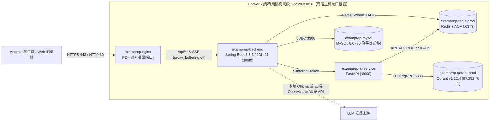

# 大学生多考试备考知识库与题库系统 · 生产部署与运维手册（SOP）

> 文档版本：`v2.0-enterprise` | 更新日期：`2026-11-22`
> 适用范围：生产环境 Docker Compose 全栈部署、混合云/本地双模推理切换、日常灾备演练与告警应急处置。

---

## 一、生产拓扑与安全网络隔离



### 核心安全铁律
1. **单入口暴露**：仅 `examprep-nginx` 发布 `80/443` 端口；`backend`、`ai-service`、`mysql`、`redis`、`qdrant` 均运行在 `172.28.0.0/16` 内部子网，严禁将 `8080` 直接暴露到公网（防止伪造 `X-Forwarded-For` 绕过 IP 限流分桶）。
2. **SSE 流式防截断**：`/api/ai/agent/stream` 在 Nginx 层独立配置 `proxy_buffering off`、`proxy_cache off`、`proxy_read_timeout 300s`，确保多步工具调用与 HITL 审批事件实时推送。
3. **代码执行双重封禁**：后端 `app.code-run.enabled=false` + Nginx `location = /api/run { deny all; }` 双重阻断。

---

## 二、环境变量与密钥配置清单

首次部署前，复制 `.env.prod.example` 为 `.env.prod`（已被 `.gitignore` 排除，严禁提交入库）：

```bash
cp .env.prod.example .env.prod
```

| 变量名 | 必填 | 默认值 / 示例 | 说明 |
|---|---|---|---|
| `MYSQL_ROOT_PASSWORD` | **是** | `openssl rand -hex 24` | MySQL root 强口令（未设置时 Compose 拒绝启动） |
| `JWT_SECRET` | **是** | `openssl rand -hex 32` | JWT 签名密钥（至少 32 字节高熵随机串） |
| `AI_INTERNAL_TOKEN` | **是** | `openssl rand -hex 24` | Java 后端与 Python AI 微服务内部双向鉴权令牌 |
| `LLM_PROVIDER` | 否 | `ollama` | `ollama`（本地） / `openai` / `dashscope` / `zhipu` / `auto` |
| `LLM_API_KEY` | 条件 | 留空 | `LLM_PROVIDER` 为云端 API 时必填 |
| `LLM_BASE_URL` | 否 | `https://api.openai.com/v1` | OpenAI 兼容端点（DeepSeek / SiliconFlow / 百炼等） |
| `LLM_MODEL` | 否 | `gpt-4o-mini` | 目标模型名（如 `qwen-plus`、`deepseek-chat`、`exam-prep-7b`） |
| `AI_QUOTA_ENABLED` | 否 | `true` | 是否启用用户/角色级每日 Token 与请求配额闸门 |
| `AI_QUOTA_STUDENT_DAILY_TOKENS` | 否 | `200000` | 学生每日 Token 上限（超限返回 429，支持管理端单用户覆盖） |
| `AI_QUOTA_STUDENT_DAILY_REQUESTS` | 否 | `200` | 学生每日 AI 请求次数上限 |

---

## 三、三种启动与部署模式

### 1. 全栈 Docker Compose 生产部署（推荐生产环境）
```bash
docker compose --env-file .env.prod -p examprep up -d --build
docker compose --env-file .env.prod -p examprep ps
```

### 2. 宿主机一键启动 —— 本地 Ollama 零成本模式
```powershell
.\start.ps1 -Mode local -Model exam-prep-7b
```

### 3. 宿主机一键启动 —— 云端 API 模式（百炼 / DeepSeek / 智谱 / OpenAI）
```powershell
# 阿里云百炼 DashScope
.\start.ps1 -Mode api -Provider dashscope -ApiKey "<YOUR_API_KEY>" -Model "qwen-plus"

# 任意 OpenAI 兼容端点（如 DeepSeek）
.\start.ps1 -Mode api -Provider openai -BaseUrl "https://api.deepseek.com/v1" -ApiKey "<YOUR_API_KEY>" -Model "deepseek-chat"

# 停止服务
.\stop.ps1
```

---

## 四、Nginx HTTPS / TLS 证书启用步骤

1. 将证书 `fullchain.pem` 与私钥 `privkey.pem` 放入 `./nginx/certs/`；
2. 将 `nginx-https.conf.example` 复制覆盖为 `nginx.conf`；
3. 在 `docker-compose.yml` 的 `nginx` 服务中开放 `"443:443"` 并挂载 `- ./nginx/certs:/etc/nginx/certs:ro`；
4. 执行校验与热重载：
   ```bash
   docker compose -p examprep exec nginx nginx -t
   docker compose -p examprep exec nginx nginx -s reload
   ```
5. Android 学生端可在「我的 → 服务器地址」中直接切换为 `https://你的域名/api/`（无需重新打包 APK）。

---

## 五、向量库全量迁移与定时灾备恢复 SOP

### 5.1 本地 Qdrant 全量 97,252 切片迁移至服务端 Qdrant
```powershell
.\.venv-ai\Scripts\python.exe scripts\migrate_qdrant_local_to_server.py `
    --local-path ai-service\data\qdrant `
    --server-url http://127.0.0.1:6333 `
    --collection exam_chunks `
    --batch-size 1000 `
    --verify-samples 10
```
- 自动幂等创建 `status`、`source_type`、`subject_id`、`knowledge_id` 四类 Payload 索引；
- 自动核验两端 `points_count` 一致并输出过滤检索 P50/P95 延迟对比报告至 `runtime/qdrant_migration_report.md`。

### 5.2 生产定时备份与恢复完整性校验
```powershell
# 1. 执行 MySQL (.sql.gz) + Qdrant Snapshot 全量备份（默认保留 7 天自动轮转）
powershell -ExecutionPolicy Bypass -File .\scripts\backup_prod.ps1 -OutRoot "runtime\backups" -RetainDays 7

# 2. 校验最新备份包的 manifest.json SHA256 完整性与核心表 DDL / INSERT 数据行
powershell -ExecutionPolicy Bypass -File .\scripts\restore_verify.ps1
```

---

## 六、可观测性（Prometheus + Grafana + Jaeger）与告警处置 Runbook

### 6.1 启动可观测性编排包
```bash
docker compose -f deploy/observability/docker-compose.obs.yml -p examprep-obs up -d
```
- **Prometheus**：`http://127.0.0.1:9090`（抓取 Python `:8000/metrics` 与 Java `:8080/api/admin/ai/metrics/prometheus`）
- **Grafana**：`http://127.0.0.1:3000`（已预置 `大学生多考试备考系统 · AI Agent 可观测总览` 看板）
- **Jaeger UI**：`http://127.0.0.1:16686`（接收 OTLP `4317/4318` 链路 Span）

### 6.2 五大 SLA 告警处置 Runbook

| 告警名称 | 触发条件 | 级别 | 应急处置步骤 |
|---|---|---|---|
| `ExamPrepServiceDown` | `up{job=~"examprep-.*"} == 0` 持续 1m | Critical | 1. 检查 `docker compose ps` 或宿主机进程；2. 查看 `runtime/start-*.err.log`；3. 执行 `.\start.ps1` 或 `docker compose restart`。 |
| `ExamPrepAiHighP95Latency` | `examprep_ai_latency_p95_ms > 25000` 持续 5m | Warning | 1. 检查本地 Ollama GPU 显存是否被占满导致退回 CPU；2. 确认 Qdrant 已切服务端模式且 4 个 Payload 索引生效；3. 必要时临时切云端 API 模式。 |
| `ExamPrepAiDegradeRateHigh` | `examprep_ai_degraded_rate > 0.15` 持续 5m | Warning | 1. 访问 `/api/ai/capability` 查看哪一层处于降级；2. 检查大模型网关连通性与 JSON 结构化修复日志。 |
| `ExamPrepRateLimitBurst` | 5m 内 `429` 响应增加 > 20 次 | Warning | 1. 查询 `GET /api/admin/ai/audit-logs` 与访问日志定位高频用户；2. 如为正常教学活动可通过 `PUT /api/admin/ai/quota/{userId}` 临时上调配额。 |
| `ExamPrepCircuitBreakerOpen` | `ai_circuit_breaker_open == 1` 持续 1m | Critical | 1. 上游大模型连续失败已触发熔断保护（系统当前由抽取式兜底保障不中断）；2. 修复上游 LLM 服务或更换有效 API Key 后等待 60s 自动半开恢复。 |

---

## 七、水平扩容路线图

1. **无状态计算层扩容**：`backend` 与 `ai-service` 均为无状态设计（会话与检查点落 MySQL，异步任务走 Redis Stream 消费组 `expert-workers`），可在 Nginx upstream 下直接横向扩展为 2–4 个副本。
2. **有状态存储层托管化**：高并发生产场景下，将 MySQL 迁至云厂商高可用 RDS（主从读写分离）、Redis 迁至托管 Redis 主从版、Qdrant 部署为 3 节点 Raft 集群。
