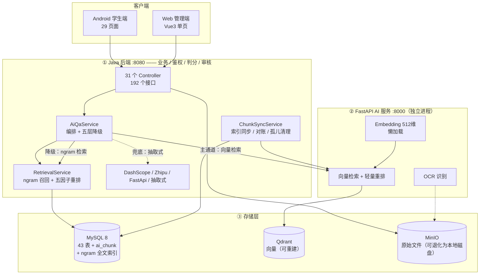

# 大学生多考试备考知识库与题库系统 · 软件状态总纲

> **本文档定位**：一次性把「这套软件现在是什么样、有什么、缺什么」讲清楚。
> 与 `功能大纲.md`（讲**功能应做成什么样**）不同，本文只写**当前真实状态**。
>
> **数据口径**：文中所有数字均为 **2026-10-20 在本机实测**（查库 / 跑测试 / 起服务），
> 不是估算、不是设计目标。凡未实测项一律标注「未验证」。

---

## 0. 一句话概括

一套面向高校学生的**资料治理 + 智能备考**三端系统：
Android 学生端（29 页面）+ Web 管理端（零构建）+ Spring Boot 后端（**176 接口 / 46 表**）
+ 独立的 FastAPI AI 微服务（向量检索 / 大模型代理 / OCR）。
除 MySQL 外**所有组件都可摘除**——任一组件挂掉，问答与刷题都仍然可用。

软件工程课程设计 / 毕业设计作品，不商用、不上架。

---

## 1. 技术栈与版本（实测）

| 层 | 技术 | 版本 / 规格 | 端口 |
|---|---|---|---|
| 后端 | Java + Spring Boot | **JDK 21 / Spring Boot 3.5.3** | **8080** |
| 后端安全 | Spring Security 6 + JWT | jjwt 0.12.6，HS256 | — |
| 后端持久层 | MyBatis-Plus | 3.5.7，**0 个 Mapper XML**（全注解 SQL） | — |
| 后端文档 | springdoc-openapi | Swagger UI 可用 | — |
| 数据库 | MySQL | 8.0.46（本机 CLI：`D:\bigplan\tools\mysql-8.0.46\bin`） | 3306 |
| AI 微服务 | FastAPI + uvicorn | 独立进程，懒加载模型 | **8000** |
| 向量库 | qdrant-client | **1.12.2**，支持 `:memory:` / `path=` / HTTP 三种模式 | 6333（Docker 模式） |
| 嵌入模型 | bge-small-zh-v1.5 | ONNX Runtime 推理（**不含 PyTorch**），**512 维**，L2 归一化 | — |
| 大模型 | 智谱 glm-4-flash | 另有 DashScope / 抽取式兜底 | — |
| OCR | PaddleOCR 3.7.0 + paddlepaddle 3.3.0 | 已装并实测可用（按主版本自适应） | — |
| 学生端 | Android 原生 | Java + XML + ViewBinding，**minSdk 26** | — |
| 学生端构建 | Gradle 8.7 + AGP 8.5.2 | release 无 keystore 时回退 debug 签名 | — |
| 管理端 | Vue3 + Element Plus | 单页，CDN 本地化，**零构建、零跨域**（后端同源托管） | 8080 |
| 部署 | Docker Compose / Nginx | 2 个 compose 文件 + nginx.conf + HTTPS 示例 | — |

AI 微服务依赖体积：**约 135 MB**（不含模型 28 MB）。明确不装 torch / chromadb / faiss
（体积与能力冗余，选 ONNX 路线的核心理由）。

---

## 2. 系统架构

### 2.1 分层



### 2.2 端口与启动顺序

**必须按此顺序**（Java 启动时会探测 FastAPI）：

1. MySQL（3306）
2. **ai-service（8000）**
3. **backend（8080）**
4. 可选：Qdrant（6333，Docker 模式）/ MinIO（9000）

### 2.3 五层降级（核心主张）

| 层 | 场景 | 行为 |
|---|---|---|
| 1 | 混合检索 | 向量 Top-20 + ngram Top-20 去重融合 + 五因子重排 |
| 2 | 向量通道挂 | 静默降级 ngram 全文检索（跑在 MySQL 内，不需网络/进程/模型） |
| 3 | 大模型全挂 | 本地**抽取式**生成（纯进程内，零网络依赖） |
| 4 | 大模型超时 | 熔断 → 换下一个客户端 → 抽取式兜底 |
| 5 | 完全断网 | App 隐藏 AI 入口，题库练习等核心功能不受影响 |

**设计红线**：AI 相关组件故障**绝不允许抛未处理异常**，全部静默降级。

---

## 3. 数据规模（2026-10-20 实测）

### 3.1 数据库

| 项 | 数量 |
|---|---|
| 表总数 | **49 张**（含 3 张 Wiki 表） |
| 考试类别 | **7** 个（本轮新增**考研**） |
| 科目 | **104** 个 |
| 知识点 | **30** 个 |
| 题目总数 | **3083** |
| └ 已通过（APPROVED） | **2500** |
| └ 待审核（PENDING） | **583** |
| 选项 | **12158** |
| 题目-知识点关联 | **3056** |
| 资料 | 6（5 已通过） |
| 用户 | **11** |
| 错题记录 | 8 |
| 题目笔记 | 0 |
| AI 语料块（ACTIVE） | **2535** |
| AI 语料块（INVALID） | 557 |
| 语料向量同步状态 | **2535/2535 全部已同步** |

**考试类别**：`1 校内课程 | 2 英语四级 | 3 英语六级 | 4 计算机二级 | 5 信息与计算科学 | 6 国家公务员考试 | 7 考研`

### 3.2 有题目的科目（全部）

| 科目 | 已通过题数 |
|---|---|
| 190 行政职业能力测验（国考行测） | **2470** |
| 5 C语言程序设计 | 17 |
| 4 数据结构 | 4 |
| 1 高等数学A | 3 |
| 2 线性代数 | 2 |
| 104 数学分析（一） | 1 |
| 114 C++程序设计 | 1 |
| 115 大学物理2 | 1 |
| 100 计算机基础 | 1 |

> 除国考行测外，其余为**校内课程示例数据**，题目量很小。
>
> ★ **为什么是这样（必须讲清楚，别让数字自己说话）**：
> 当前题库以国考行测为主，是因为 `D:\题库` 里**只有国考行测**具备可直接解析的
> 文字层真题（2016–2026 共 11 年）。四六级、考研的资料虽有 PDF，但多为**扫描件**
> 或含大量公式/图表，需要「版面裁剪 + OCR/多模态」的抽取链路才能可靠还原题干与选项
> （见 §8.2）。在抽取链路可靠之前硬灌，只会重演国考真题踩过的坑——
> 水印混入句中、页脚进选项、公式丢失、不可作答题进公共题库（见 §6）。
> **因此「多品类」的瓶颈不在表结构，而在内容生产流水线**；考研品类骨架已先行补齐
> （`sql/migration-postgrad-category.sql`，1 类别 + 6 科目），题目等链路就绪后再灌。

### 3.3 题型分布（已通过题目）

| 题型 | 数量 |
|---|---|
| `SINGLE_CHOICE` 单选 | **2473** |
| `SHORT_ANSWER` 简答 | 18 |
| `MATCHING` 匹配 | 2 |
| `ORDERING` 排序 | 2 |
| `MULTI_CHOICE` 多选 | 1 |
| `TRUE_FALSE` 判断 | 1 |
| `FILL_BLANK` 填空 | 1 |
| `READING` 阅读组合题 | 1 |
| `LISTENING` 听力组合题 | 1 |

> 系统**支持的题型**远多于当前数据覆盖：单选/多选/判断/填空/匹配/排序/组合大题
> （阅读、完形、听力、综合）/主观题（简答、名词解释、计算、应用、论述、写作、
> 翻译、案例分析、证明、改错）。目前题库以单选题为主。

### 3.4 AI 语料构成（2535 块）

| 来源类型 | 块数 |
|---|---|
| `QUESTION`（已通过题目） | **2500** |
| `KNOWLEDGE`（知识点） | 30 |
| `RESOURCE`（资料） | 5 |

语料来源：`D:\题库` 的国考《行测》真题 PDF（2016–2026）+ 知识点抽取 + 资料正文。

---

## 4. 功能清单

### 4.1 学生端（Android，**26 Activity + 4 Fragment = 30 页面**，30 个布局 XML）

**账号与合规**
- 登录 / 注册（学号 + 密码，BCrypt + JWT）
- 个人中心、**个人数据导出（JSON 落盘 + FileProvider 分享）**、**账号注销（二次确认）**
- 我的笔记、我的错题、我的收藏、我的上传记录、我的下载、我的关注、我的通知

**刷题闭环**
- 刷题配置：科目 / 题型 / **模式（顺序 / 随机 / 错题重做）** / 范围（混合 / 只客观 / 只主观）/ 难度 / 题数 1–100
- 答题界面：顶部**答题卡** + 进度「第 x/y 题 · 对 n」+ 交卷；题干下带**共享材料区**；动态答题区（选项按钮 / 输入框 / 子题）
- 提交即判分：✓/✗ + 正确答案 + 解析；主观题走**自评**（会了 / 模糊 / 不会）
- 答题卡弹层：题号网格、已答高亮、点题号跳题

**错题与 SRS**
- 错题自动进错题本 → **间隔重复复习流**（SRS 间隔 `1/2/4/7/14/30/60` 天）
- 复习流程：回忆 → 对答案 → 自评 → 推进

**学习计划（本轮新增）**
- 今日计划页：进度概览（已完成/目标/完成率）+ 任务列表（按优先级）+ 计划说明
- 每条任务显示**题量 / 进度 / 预估用时 / 为什么排它**；点击直接带参数跳到刷题页（知识点 + 模式 + 题量已预填）
- 支持**设定每日目标题量**（超出区间由服务端钳制，App 端回显生效值）

**主观题 AI 判分（本轮新增）**
- 主观题提交后自动请求判分 → 显示**等级 + 参考得分率 + 命中得分点 + 遗漏得分点 + 一句话理由**
- **判分不可用时明确提示并保留自评**，不伪造分数；用户仍可自评调整掌握度

**模考**
- 随机组卷 → **倒计时**（剩余 mm:ss）→ 到时自动交卷 → 交卷二次确认 → 自动判分
- **跨题作答实时同步落库**（翻题即同步 + 交卷前全量兜底重发）——防止交卷时作答为空
- 成绩报告：得分 / 总分 / 正确率 / 对题数 / 用时

**题库与资料**
- 题库浏览（分类 / 列表 / 题目详情 / 搜索）
- 资料上传 / 下载 / 详情 / 评分 / 举报 / 申诉 / 收藏
- 首页（考试类别入口）、课程页

**AI 导学**
- AI 问答入口（断网时自动隐藏）

### 4.2 Web 管理端（Vue3 + Element Plus，零构建）

- 由后端同源托管，**无跨域、无构建步骤**
- 审核台（题目 / 资料审核，通过后自动同步索引）
- 用户管理、公告管理、举报与申诉处理、操作日志
- AI 管理：`reindex` / 向量同步 / 向量对账
- ⚠️ 已知：**严格 CSP 头会破坏运行时模板编译**（依赖 `unsafe-eval`），生产启用 CSP 前必须实测

### 4.3 后端接口（**192 个映射 / 31 个 Controller**）

| Controller | 接口数 | 职责 |
|---|---|---|
| `AdminController` | 27 | 管理端主体（审核、用户、公告、举报、日志等） |
| `AdminDataController` | 20 | 管理端数据（学校 / 学院 / 专业 / 课程 / 学期 / 教师等） |
| `PracticeController` | 11 | 刷题（组卷 / 答题 / 交卷 / 报告） |
| `ResourceController` | 11 | 资料（上传 / 下载 / 评分 / 举报等） |
| `AuthController` | 6 | 登录 / 注册 / 令牌 |
| `CommentController` | 6 | 评论 / 点赞 |
| `CourseController` | 6 | 课程 |
| `FileController` | 6 | 文件上传 / 下载 |
| `NoticeController` | 6 | 通知 |
| `QuestionAdminController` | 6 | 题目管理 |
| `MockExamController` | 5 | 模考 |
| `FavoriteController` | 5 | 收藏 |
| `MeController` | 7 | 个人中心（含导出 / 注销 / **学习计划**） |
| `AiController` | 4 | AI 问答 / 能力探测 |
| `AiAdminController` | 4 | AI 管理（reindex / 向量同步 / 对账） |
| `ExamController` | 4 | 考试类别 / 科目 |
| `NoteController` | 4 | 笔记 |
| `FollowController` | 3 | 关注 |
| `QuestionController` | 4 | 题库查询 + **主观题 AI 判分** |
| `AppealController` | 2 | 申诉 |
| `SearchController` | 2 | 搜索 |
| `StorageAdminController` | 2 | 存储管理 |
| `CodeRunController` | 1 | 代码运行 |
| `HomeController` | 1 | 首页聚合 |
| `SchoolController` | 1 | 学校 |
| **合计** | **176** | 28 个文件 |

### 4.4 AI 导学能力

| 能力 | 状态 |
|---|---|
| ngram 全文检索（MySQL 内置 `WITH PARSER ngram`） | ✅ 可用 |
| 向量检索（FastAPI + Qdrant） | ✅ 可用（**已实测排序正确**，见 §7.3） |
| 双通道融合 + 五因子重排 | ✅ |
| 拒答闸门（反幻觉第一道） | ✅（ngram 侧双闸门；向量侧独立阈值） |
| 大模型代理（智谱 / DashScope / FastAPI） | ✅ 配置可用 |
| 抽取式兜底 | ✅ 纯进程内 |
| 学情画像（时间衰减 + 难度权重 + 错题加权） | ✅ |
| 错题 → 知识点 → 资料推荐（带推荐理由） | ✅ |
| OCR 识别能力 | ✅ 可用（`/v1/ocr` 实测返回文本块 + 置信度） |
| **OCR 自动建题的业务接入** | ❌ **未做** |

### 4.5 题库治理闭环

上传 → 审核（PENDING → APPROVED / REJECTED）→ 预览 → 下载 → 举报 → 下架 → 申诉。
**导入题目默认 PENDING**，只有 APPROVED 才进公共题库与 AI 知识库。

### 4.6 Agent 工程（本轮新增）

| 能力 | 实现 | 实测 |
|---|---|---|
| Agent Harness | Python：规划 → 只读工具 → 观察 → 回答；LLM 不可用切规则规划器；上限 6 步 / 4 次工具 | — |
| SSE + 轨迹 | Java 汇聚转发 Python 事件流；轨迹落 `ai_agent_run`；管理端实时看与回放 | 事件链实测 `meta→thought→tool_call→tool_result→final→done` |
| 异步队列 | Redis Stream：`exam:jobs` / `exam:eval` / `exam:wiki` 三流；`redis.asyncio` 消费；XAUTOCLAIM 循环回收 + MINID 安全裁剪 | 提交 → 消费 → 回调 → 落库全链路实测 |
| 检索侧评估 | 214 条人工 Golden Set（`applyGate=false` 测纯召回） | **Recall@5 93.1%、MRR 0.703、拒答准确率 90.9%、误拒率 4.9%**、平均 232ms |
| Agent 侧评估 | 120 条合成任务 + 规则判定 | **通过率 98.3%、工具成功率 100%**、平均 2.25 步、P95 726ms |

**⚠️ 已知问题**：`min-vector-score=0.55` 仍是 42 块语料时的标定值；语料扩到 2535 块后相关查询
top1 只有 0.4706–0.4866、无关 0.4454–0.4534，该阈值会拦掉大量可用向量。本轮评估用原始向量
（`applyGate=false`）测纯召回，**生产阈值需重新标定，未擅改**。另有 2/120 Agent 任务因
答案未包含知识点全名被判失败（判定严格，非工具失败）。

### 4.7 LLM Wiki 双引擎（本轮新增）

| 能力 | 实现 | 实测 |
|---|---|---|
| 双引擎策略 | RAG 即时可用（入库即检索）；Wiki 异步沉淀（每日蒸馏 → 草稿 → 人工审核 → 发布） | 共享 `ai_chunk`，互不阻塞 |
| 蒸馏 | Java 入队 `WIKI_DISTILL` → `exam:wiki` → Python 按知识点聚类 → LLM 严格 JSON | 2 页 **17.7s**（qwen2.5-7b） |
| 质量闸门 | JSON 修复重试 1 次 + 引用 ID 子集校验 + 字符 bigram 接地率 <0.10 判编造 + 抽取式兜底 | 本地 7B 输出非 JSON / 编造时自动回退 |
| 审核发布 | 草稿 PENDING → 管理端通过 → `wiki_page` 版本 +1 → 建同级/相关链接 → 同步 `wiki_pages` 向量 | `vectorIndexed=true` |
| 问答热层 | 页面摘要向量 + MySQL ngram + 标题 bigram 覆盖率 + 1 跳图遍历 | **26–42ms**，`engine=WIKI` |
| 降级 | 未命中 → RAG，标记 `engine=RAG / fallbackFromWiki=true` | 无关问题实测降级 |
| 端侧 | 管理端「LLM Wiki」页；Android「我的 → Wiki 知识库」列表/详情/关联主题 | 编译通过 |

**已知取舍**：
- 蒸馏聚类目前只按 `knowledge_id`（知识点）；课件类 `knowledge_id` 为空的块暂不生成主题页，
  避免把 700+ 块的整本文档硬压成一页。
- 本地 7B 生成的页面可能仍带「逐题复述」痕迹，质量分只做排序参考，**发布必须以人工审核为准**。
- 小语料（1–2 页）下 MySQL `MATCH` 的 IDF 接近 0，因此字面通道额外使用与语料规模无关的
  「标题/摘要 bigram 覆盖率」判据（`title-coverage-threshold=0.25`）。

---

## 5. 关键机制（为什么这么做）

### 5.1 审核 → 索引联动（事务提交后钩子）

审核成功后经 `TransactionSynchronizationManager.registerSynchronization` 在**事务提交后**
才写索引。原因：同事务内写索引会读到未提交的 `audit_status`；事务回滚还会在索引里留下脏块。

### 5.2 索引幂等与「反向对账」

- 幂等判据：`content_hash = MD5(content)`，未变化直接跳过，不触发全文索引重建
- **反向对账**（本轮新增）：`reindexAll()` 的遍历只覆盖「当前可索引」的来源，
  已转 PENDING / REJECTED / 删除的来源的旧块不会被碰到、会永远留在 `ACTIVE`。
  故新增 `AiChunkMapper.invalidateUnindexableSources()` 做一次反向清理，
  让 reindex 真正成为「全量重建」而非「只增不减」。

### 5.3 向量索引同步（异步 + 状态位）

`vector_synced`：`0` 待同步 / `1` 已同步 / `2` 失败 / **`3` 已从 Qdrant 移除（本轮新增）**。
异步设计让**审核接口永不被 embedding 推理拖慢**，向量最终一致。

### 5.4 孤儿向量清理（本轮新增）

块被置 `INVALID` **不会**改写 Qdrant 里 payload 的 `status` 快照，于是
`/v1/search` 的 `status='ACTIVE'` 过滤**拦不住孤儿**，它们会占掉 top-K 名额。
实测（4 组查询各取 top-20，80 个命中里 **32 个是已失效块**）→ 必须显式删点。

实现链条：`/v1/index/delete`（FastAPI）→ `FastApiClient.deleteIndex()` →
`ChunkSyncService.purgeOrphanVectors()` → 在 `reindexAll()` 末尾执行，并置 `VECTOR_PURGED=3` 保证幂等。
**实测结果：`purged=557`、`qdrant points 2535 == MySQL ACTIVE 2535`、`orphanedInQdrant=0`、
`consistent=true`**——核心一致性断言首次字面成立。

### 5.5 双闸门与阈值标定

| 闸门 | 口径 | 当前值 |
|---|---|---|
| `retrieval.reject-threshold` | 分数（**随语料规模漂移**） | 0.15（评测用） |
| `retrieval.min-term-coverage` | **词项覆盖率（与语料规模无关）** | **0.5** |
| `vector.min-score` / ratio | 向量绝对分 + 相对分 | 见 `application.yml` |

`min-term-coverage` 标定过程（写入 `application.yml` 注释）：
`0.25 → 拒答 4/10`；`0.40 → 7/10`；**`0.50 → 9~10/10 且 Recall@5 91.7%**；`0.60 → 10/10 但 Recall@5 66.7%`。

### 5.6 事务与一致性

- 数据库迁移脚本**全部幂等**（显式 ID + `INSERT IGNORE` / 条件 UPDATE），可重复执行
- 上传文件路径显式配置并挂载卷，避免容器重建丢数据
- 安全响应头（`X-Frame-Options` / `X-Content-Type-Options` / `Referrer-Policy`）全端点启用

### 5.7 账号注销与数据最小化

- 注销需输入确认语「注销账号」
- **匿名化而非物理删除**：学号改 `deleted_<id>`、昵称「已注销用户」、清真实姓名、密码随机化、`status=0`
- **注销后立即失效该用户全部既有 JWT**（`JwtAuthenticationFilter` 回查用户状态）
- 支持**个人数据导出**

### 5.8 无障碍（学生端）

- 全部 UI 元素带内容描述（contentDescription），支持屏幕阅读器
- 文字用 **sp** 单位，跟随系统字体缩放
- **触摸目标 ≥ 48dp**（13 处修正）
- 对比度按 **WCAG AA 4.5:1** 实测校正：`text_sub` `#7A8190`(3.62:1) → `#5C6472`(5.52:1/5.96:1)；
  通知时间戳由 `divider`(1.20:1) 改为 `text_sub`
- 用「形状 + 文字」双冗余表达信息，不单纯依赖颜色

### 5.9 网络安全

- **明文流量按构建变体隔离**：`src/debug/res/xml/network_security_config.xml`（cleartext=true，便于局域网调试）
  覆盖 `src/main/res/xml/...`（cleartext=false，release 默认禁止明文）
- release 无 keystore 时**回退 debug 签名**（避免产出无法安装的未签名 APK）

---

## 6. 题库与语料治理（本轮重点）

### 6.1 已知污染与清洗结果

来源 PDF 的文字层混有页面水印、页脚页码、刷题 App 的答案头、下一个板块的标题，
解析器逐行拼接时把它们拼进了句子中间。**已在数据层做一次幂等清洗**：

| 杂质 | 条数 | 实例 |
|---|---|---|
| 页面水印（**拼进句子中间**） | 364+ | 「是做好各项工作的基**公考,事业编,遴选,考研,一站式备考，持续更新**本功。」 |
| 水印店招 | 42 | 「【认准淘宝店铺：通关达人资料库】」 |
| 第三方刷题 App 答案头 | 122 | 「正确答案：B，全站正确率：43%，易错项：A。解析第一步…」 |
| 页脚 / 页码 | 119 + 282 | 「第4页，共25页」 |
| 题干「（单选题）」前缀 | 253 | — |
| **选项尾部被追加下一板块标题** | 46 | 选项 D = 真实选项 +「二、言语理解，共 40 题，参考时限 30 分钟…」 |
| 解析开头杂散字母/序号 | 677 | 「D本题考查…」「18A 项，…」「解析第一步…」 |
| 推广 / 版权残留 | 15 | 扫码、公众号、网址、机构名 |

**产物**：`sql/migration-guokao-clean.sql`（1271 KB，幂等，可重复执行）——
在 `data-guokao.sql` **之后**执行。清洗后自检：仍含水印 0 / 仍含页脚 0 / 仍含 App 答案头 0。

### 6.2 移出公共题库的内容

| 类别 | 条数 | 原因 |
|---|---|---|
| 资料分析/图形题（缺共享数据表、引用图形） | 539 | 从文字层无法还原，**不可作答** |
| 题干清洗后为空 | 19 | 题干原本只有页脚，正文在解析阶段已丢失 |
| 解析自相矛盾（两题解析拼接） | 1 | 前半段收尾「故正确答案为D」、后半段又「故正确答案为C」 |

口径变化：可用 **2488 → 2470**，待审核 **539 → 557**。

### 6.3 未处理的更深层内容缺陷（如实记录）

- **公式丢失**：如「甲的效率为，乙、丙合作的效率为」——分式/根式在文字层无法还原
- **表格数据丢失**：如「定位表格材料可知，；，其余均为。」
- **个别选项内容错乱**：如 `id=3893` 选项 B 语义不通；`id=3803` 选项 D 吞进整段材料
- **图片题缺失**：图形推理类题目无法还原（无题图），已跳过
- 以上属于**解析阶段的结构性损失**，文本层清洗无法修复；需要重做「按版面区域裁剪 + OCR/多模态」的抽取流程

---

## 7. 工程质量与测试现状

### 7.1 后端单元测试：**133/135 通过（2 项检索阈值回归待重标定）**

| 测试类 | 结果 |
|---|---|
| 全部 135 项 | 133 ✅ / 2 ❌ |

> **2 项失败均为 `RetrievalServiceTest` 依赖实时 MySQL 语料的阈值型断言**
> （Recall@5 83.3% < 90%、10 条无关问题仅拒答 5 条）。语料已从 2535 块扩到
> **11165 块**（课件灌入），`min-term-coverage` / `min-vector-score` 需重新标定；
> 与 Wiki 改动无关（Wiki 只新增表与独立检索入口，未触碰 `ai_chunk` 召回链路）。

其中与 AI / 新增能力直接相关的：

| 测试类 | 用例数 | 覆盖 |
|---|---|---|
| `RetrievalServiceTest` | 16 | Recall@5 三层指标（检索层/答案层/误拒答）、拒答评测、布尔查询构造 |
| `FastApiClientTest` | 14 | 双通道降级、删除契约、响应损坏容错 |
| `ChunkSyncServiceTest` | 7 | 孤儿清理、降级安全、批次守卫、**自查询巡检** |
| `AiGradingServiceTest` | 10 | 判分正常/容错/降级/切换生成器/得分率钳制 |
| `StudyPlanServiceTest` | 10 | 三条规则、配额分配、完成度抵扣、目标钳制 |
| `VectorGateThresholdTest` | 8 | 向量闸门阈值 |
| `SrsSchedulerTest` | 6 | 间隔重复调度 |
| `HybridRetrieverTest` | 2 | 统一检索入口、Top-K 生效 |
| `AsyncJobServiceTest` | 9 | 三 stream 路由（业务/评估/Wiki）、去重、Redis 降级、终态守卫、评估落库 |
| `WikiQueryServiceTest` | 6 | 向量命中、小语料字面覆盖率、阈值拒答、图遍历 |
| `WikiServiceTest` | 4 | 草稿来源校验、PENDING 幂等更新、审核发布 + 链接 + 向量、蒸馏输入 |
| `AgentStreamServiceTest` | 3 | SSE 分帧、断链终态、Python 不可用回退 |
| `InternalTokenFilterTest` | 3 | 内部接口令牌默认拒绝 |
| `AgentConcurrencyTest` | 2 | 每用户 1 个 RUNNING 的数据库唯一约束 |

> **Recall@5 已从「83.3% 未达标」变为「91.7% 达标」——但根因是评测集缺陷，不是模型变强了。**
> 原评测集用关键词反查标答并 `LIMIT 20`，高频词（「排序」）的真标答被挤出窗口，
> 把 HIT 误判成 MISS。现已改为**内容锚点**解析标答（语料变动自动重映射，锚点失效会显式报错），
> 并把指标拆成三层各自卡阈值：
>
> | 指标 | 实测 | 阈值 |
> |---|---|---|
> | 检索层 Recall@5（分母＝已作答用例） | **91.7%**（11/12） | ≥ 90% |
> | 答案层命中率（Top-5 能否支撑答案） | **90.9%**（10/11） | ≥ 85% |
> | 误拒答率（可回答问题被闸门拒掉） | **8.3%**（1/12） | ≤ 10% |
>
> 那 1 条误拒答是纯字面检索的固有短板（「函数传参有哪些方式」与语料用词不重叠），
> 已作为**独立指标**记录，而不是混进召回分母掩盖问题。

### 7.2 AI 微服务测试：**145/145 通过**

- 覆盖：健康检查、降级契约、embedding、LLM、OCR、检索、索引同步/删除/重建/状态
- 与机器环境**解耦**：装不装模型/依赖均全绿（用显式桩复现降级态）
- 历史新增 10 条：
  - **向量写入侧校验** 2 条（零范数/NaN 拒收、写入后校准能发现「存进去的不是这条」）
  - **删除契约** 5 条 + **本地模式删除幂等回归** 1 条
  - 其余为索引同步计数与状态契约
- **Wiki 新增 6 条**：接地率识别编造、合法 JSON 才发布、非 JSON 回退抽取式、
  非法引用 ID 拒收、WIKI_DISTILL 批量回传草稿、Agent `search_wiki/get_wiki_page` 上下文。

### 7.6 主观题 AI 判分灰度：**流程已就绪，真实质量数据被 Key 失效阻塞**

- 灰度方法：18 道简答 × 3 档作答（完整/半对/无关）共 54 次调用，检验
  「答对 > 半对 > 乱答」的**单调性**（可机械生成、客观可核）
- 实测结果：**0/18 单调性、18/18 不可用** —— 原因是**大模型 Key 401 Unauthorized**，
  不是判分逻辑；本次运行反而验证了降级链路（Key 失效 → 如实返回不可用 → 作答不被阻塞）
  与「真实原因可查」（降级原因带出 401 而非笼统文案）
- 完整记录见 `docs/AI判分灰度报告.md`（换有效 Key 后重跑脚本即可得到真实数据）

### 7.3 向量检索质量（本轮实测，**已确认正确**）

**验证方法**：用「**块自己的正文**」当查询，看是否命中自己（自查询一致性）。

| 真实语料块 | 自查询得分 |
|---|---|
| id=1 | 0.9761 |
| id=593 | 0.9826 |
| id=1205 | 0.9849 |
| id=1823 | 0.9775 |
| id=2466 | 0.9842 |
| id=3049 | 0.9817 |

**自然语言查询（全库 2535 点，实测区分良好）**：

| 查询 | Top 命中 |
|---|---|
| 量子纠缠实验怎么做 | 2376:0.5551 …（与语料无关 → 应被拒答） |
| 红烧肉的做法是什么 | 939:0.4582 …（无关 → 拒答） |
| 资料分析 增长率 计算 | **3092:0.5932** |
| C语言 指针 内存 | **12:0.7289**、6:0.5972、7:0.5972、26:0.5829 |
| 图形推理 找规律 | **1706:0.5990**、1579、1451、1453 |
| 马克思主义中国化的进程 | 2256:0.6366、2372:0.6316、2139:0.6277 |

**对照验证**：把同一批 `/v1/embed` 向量放到 Python 里算余弦，4 条查询的真值排序
（0.7989 / 0.7255 / 0.7081 / 0.6728）与 API 返回**完全吻合**。

### 7.4 Android

- 构建结果：**debug 与 release 均编译通过**；已刷新真机版 APK
  （`release/备考知识库学生端-v1.5-真机版.apk`，2.2 MB）
- **构建变体隔离已用 aapt2 实测确认**：
  release 包 `res/…xml` 内 `cleartextTrafficPermitted=false`；debug 包 `=true`
  （release 做了资源压缩，配置文件被重命名为 `res/8G.xml`，按资源表查得）
- 无障碍：对比度、触摸目标、字体缩放均已按 §5.8 落地；
  本轮新增的「AI 判分结果」与「任务卡」也是**异步出现后主动 `announceForAccessibility`**，
  任务卡整体合成一句 contentDescription（避免读屏碎片化朗读）
- ❌ **未做真机 TalkBack 朗读与全流程回归**（需真机）

### 7.5 上架前自检

`上架前检查.ps1`（只读，UTF-8 BOM）：输出 **1 FAIL + 5 WARN**。
唯一 FAIL：**缺正式签名 keystore**。

---

## 8. 已知问题 / 未完成清单（诚实版）

### 8.1 阻塞上架

| 项 | 状态 |
|---|---|
| 正式签名 keystore | ❌ 未提供 |
| HTTPS 证书 + 域名 | ❌ 未提供 |
| 真机 TalkBack 与全流程回归 | ❌ 未做 |

### 8.2 数据/算法

| 项 | 状态 |
|---|---|
| `RetrievalServiceTest` Recall@5 = 83.3%（目标 90%） | ❌ 未标定 |
| 公式 / 表格丢失导致部分解析不可读 | ❌ 属解析结构性损失 |
| 图片题（图形推理等）完全缺失 | ❌ 需多模态抽取 |
| OCR 自动建题业务接入 | ❌ 仅有识别能力 |
| 四六级扫描件入库 | ❌ 未做 |

### 8.3 本地 Qdrant 模式的三处坑（本轮实测发现）

| # | 现象 | 处理 |
|---|---|---|
| 1 | `delete` 对**不存在的 point id 会抛 `KeyError`**（云端静默忽略）→ 删除不幂等，真机表现为 `purged` 恒为 0、返回 503 | ✅ **已修**：先 `retrieve` 过滤存在点；并加回归测试 |
| 2 | `rebuild` 的清空行为不稳定（一次清空到 0 点，一次报 `READY` 但点数未变） | ⚠️ 未修；运维口径改为「**删掉本地存储目录 + 重建 + 全量重推**」 |
| 3 | 库内出现**存储向量与输入向量不一致**（同一段文本的向量余弦只有 0.22–0.45），导致不同查询返回同一批结果、分数一模一样 | ✅ **已加治本措施**（见下） |

> ★ **更正上一版一个站不住的假设**：上一版写「零范数行被 `÷EPSILON` 放大」——
> 这在数学上是错的（`0 / EPSILON = 0`，不会放大）。**真实根因尚未定位**。
> 既然根因未知，就不能靠「解释」解决，只能靠**写入侧拦截 + 写入后校准 + 自动巡检**兜住。

**已落地的治本措施（C1）**：
1. **写入前校验**：`upsert_chunks` 拒绝 NaN / Inf / 零范数向量（不进库），并记 `rejected_ids`；
2. **写入后校准**：写完整批读回存储向量，与输入逐一比余弦，低于 `0.9999` 判为
   `mismatched`，Java 侧据此把**具体那几条**置 `vector_synced=2` 重试
   （而不是整批 500 条一起重推）；
3. **自动化巡检**（替代原「人工抽查」）：`reindexAll()` 末尾随机抽 20 个 ACTIVE 块，
   用**块自己的正文**查自己，得分 ≥ `0.90` 才算通过，结果写进 reindex 返回体的
   `selfCheck` 字段；不通过会打 warn 并给出失败 chunk id。

**检测能力边界（必须知道）**：`reconcile` 只比对**数量**，永远发现不了这个问题。
能发现它的只有 `selfCheck`（自查询一致性）。实测健康区间是 0.976–0.985，退化区间是 0.2–0.5。

**恢复流程（已验证有效）**：停 ai-service → 删除 `%TEMP%\qdrant_local` → 重启 →
`POST /v1/index/rebuild` → MySQL 置 `vector_synced=0` → 循环 `POST /api/admin/ai/vector/sync?limit=500`
直到 `pending=0` → 用「自查询一致性」抽查（自身分应 ≥0.95）。

**检测方法（无法被现有对账发现）**：`reconcile` 只比对**数量**，不校验向量质量。
本轮的「自查询一致性」抽查是唯一能发现「向量写错」的手段。

### 8.4 运维与工程

| 项 | 状态 |
|---|---|
| Docker 化（MySQL/Qdrant/MinIO） | ❌ 未在本机跑通验证（Qdrant 目前走本地 `path=` 模式） |
| HTTPS（nginx-https.conf.example 已备） | ❌ 未启用 |
| 仓库内残留 `.workbuddy/` 测试脚本、`.pytest_cache/`、`.git-backup-before-purge/` | ⚠️ 建议清理/加 `.gitignore` |
| `.venv-ai/` 入版本库风险 | ⚠️ 需确认已在 `.gitignore` |

### 8.5 核心需求缺失（**不是「差距」，是没做**）

> ★ **归类更正**：上一版把「无学习计划」与「无积分/会员/直播课」并列写在
> 「相对主流刷题 App 的差距」里，这是错的。积分、会员、直播课是**商业功能**，
> 毕设不需要；而**学习计划**与**主观题 AI 判分**是最初需求的核心，它们此前
> **根本不存在**，不属于「差距」。现已按下表补上 MVP。

| 最初需求 | 此前状态 | 当前状态 |
|---|---|---|
| 主观题 AI 判分 | ❌ 只有用户自评（会了/模糊/不会） | ✅ **MVP 已落地**：`POST /questions/{id}/grade`，得分点命中/遗漏 + 理由 + 保守得分率；18 道简答灰度脚本已就绪（真实质量数据被 401 阻塞，见 `AI判分灰度报告.md`） |
| 学习计划 | ❌ 完全没有（SRS 错题复习是**复习调度**，不是学习计划） | ✅ **MVP 已落地**：`GET /me/study-plan` + `PUT /me/study-plan/target`，规则引擎三条规则（复习优先 / 前置基础 / 薄弱攻坚），每条任务带理由 |
| 多品类 | ⚠️ 6 个类别、104 科目，但题目集中在国考 | ⚠️ 已补**考研品类骨架**（1 类别 + 6 科目，0 题）；题量仍集中在国考，原因见 §3.2 |

### 8.6 相对主流刷题 App 的**商业功能**差距（毕设不需要）

- 无积分 / 排行榜 / 打卡 / 会员 / 直播课 / 社交
- 无「背题模式」（只看答案不选）
- 主观题 AI 判分虽已落地，但**未做真实用户抽检**（Key 失效，见 §7.6）

---

## 9. 运行手册

### 9.1 首次启动

```
1. MySQL 8 起库 → mysql -uroot -p exam_prep < sql/schema.sql
                  → sql/data.sql（基础数据）
                  → sql/data-ai-seed.sql（AI 种子语料）
                  → sql/data-guokao.sql（国考真题，可重复执行）
                  → sql/migration-guokao-quality.sql（不可作答题转待审）
                  → sql/migration-guokao-clean.sql（**文本清洗，必须在 data-guokao 之后**）
                  → sql/migration-study-plan.sql（学习计划字段）
                  → sql/migration-postgrad-category.sql（考研品类骨架）
                  → 其余 migration-*.sql（幂等）
2. ai-service：install.bat → run.bat（8000）
3. backend：启动后端.bat（8080）
4. Android：Android Studio 打开 student-app → 运行 / 打包
```

### 9.2 关键环境变量

| 变量 | 作用 |
|---|---|
| `DB_USERNAME` / `DB_PASSWORD` | 数据库账号口令（由 `application-local.yml` 或环境变量提供，仓库不存明文） |
| `QDRANT_URL` | `file:<目录>`（本地持久化）/ `:memory:`（进程内）/ `http://…:6333`（Docker） |
| `app.ai.fastapi.enabled` / `app.ai.vector.enabled` | AI 通道总开关（默认 **false**，需显式开启） |
| `EMBEDDING_*` | 模型目录 / 维度 / 批大小 / 检索前缀 |
| CORS 允许来源 | 必须可由配置与环境变量指定（代码中禁止硬编码白名单） |

### 9.3 常用运维接口（需 `ROLE:AUDITOR` 或 `ROLE:ADMIN`）

| 接口 | 用途 |
|---|---|
| `POST /api/admin/ai/reindex` | 全量重建：反向对账 + 索引重建 + 向量推送 + **孤儿清理** |
| `POST /api/admin/ai/vector/sync?limit=500` | 推送待向量化语料 |
| `GET/POST /api/admin/ai/vector/reconcile` | 向量对账（数量口径） |

### 9.4 常见故障

| 现象 | 处置 |
|---|---|
| `vectorChannelAvailable=false` | 嵌入模型懒加载未完成 → 先 `POST /v1/embed {"texts":["预热"]}` |
| 向量推送 `pushed=false` | 看 `reason`：未启用 / 熔断 / 网络；熔断窗口过后调 `vector/reconcile` |
| 检索结果「总是同一批」 | 本地 Qdrant 存储被污染 → 按 §8.3 恢复流程重建 |
| 部署后少表 | compose 只挂了部分迁移脚本 → **所有编号迁移脚本都要进卷挂载** |

---

## 10. 资产清单

### 10.1 目录

| 目录 | 内容 |
|---|---|
| `backend/` | Spring Boot 后端（176 接口，内嵌管理端页面） |
| `admin-web/` | 管理端 Web 源码（Vue3 + Element Plus） |
| `student-app/` | Android 原生工程（Java + XML + Gradle） |
| `ai-service/` | FastAPI AI 微服务（embedding / 向量 / LLM / OCR） |
| `sql/` | schema + data + **17 个脚本**（含增量迁移） |
| `docs/` | **19 份文档** + 架构图 + 性能测试脚本 |
| 根 | `docker-compose.yml`、`docker-compose.ai.yml`、`nginx.conf`、`nginx-https.conf.example`、`backup.bat`、`启动后端.bat`、`放行8080端口(需管理员).bat`、`同步管理端页面.bat`、`上架前检查.ps1`、`release/备考知识库学生端-v1.5-真机版.apk` |

### 10.2 SQL 脚本

| 脚本 | 大小 | 说明 |
|---|---|---|
| `schema.sql` | 32 KB | 49 张表结构（含 `WITH PARSER ngram` 全文索引） |
| `data.sql` | 11 KB | 基础数据 |
| `data-ai-seed.sql` | 23 KB | AI 种子语料 |
| `data-guokao.sql` | **5263 KB** | 国考行测 2016–2026 真题（3027 题） |
| `migration-guokao-quality.sql` | 2 KB | 不可作答题转 PENDING |
| **`migration-guokao-clean.sql`** | **1271 KB** | **文本清洗（本轮新增）** |
| `migration-ai.sql` / `migration-ai-vector.sql` | 6 / 4 KB | AI 语料块 + 向量字段 |
| `migration-srs.sql` | 2 KB | 错题间隔重复字段 |
| `migration-info-computing-subjects.sql` | 12 KB | 信息与计算科学专业 90 门课程 |
| `migration-p0b.sql` / `migration-p1.sql` / `migration-p1b.sql` | 2 / 4 / 1 KB | 迭代迁移 |
| `migration-perf.sql` | 3 KB | 性能索引 |
| `migration-register.sql` | 6 KB | 注册相关 |
| **`migration-study-plan.sql`** | **1 KB** | **学习计划：user 表加每日目标两列（本轮新增）** |
| **`migration-postgrad-category.sql`** | **2 KB** | **考研品类骨架（本轮新增，只占位不灌题）** |

### 10.3 文档（19 份）

`需求规格说明书` · `概要设计说明书` · `详细设计说明书` · `数据库设计说明书` · `API.md` ·
`测试报告` · `用户手册` · `部署文档` · `项目总结` · `功能大纲` · `大纲-v2` ·
`AI模块设计方案` · `AI微服务扩展设计方案` · `AI降级演练手册` · `环境准备清单` ·
`验收审计报告-2026-09-25` · `注册功能验证报告-2026-10-02` ·
**`软件状态总纲`**（本文档，讲「现在是什么样」） ·
**`AI判分灰度报告`**（主观题判分灰度实测记录）

### 10.4 数据库 49 张表

```
ai_chunk, ai_vector_index_meta, announcement, answer_detail, appeal, audit_record,
college, comment, comment_like, course, download_record, exam_answer_detail,
exam_category, exam_paper, exam_paper_question, exam_record, favorite, file_record,
follow, knowledge_point, listening_audio, major, notification, operation_log,
practice_record, question, question_answer, question_knowledge, question_note,
question_option, report, resource, resource_like, resource_page, resource_rating,
resource_version, school, self_evaluation, semester, subject, teacher, user, wrong_book
```

---

## 11. 最近一轮变更

### 11.0 本轮（产品补课：2026-10-20 晚）

> 触发：上一版总纲评审指出「工程扎实但产品偏航」——最初要的
> 「多品类 + 知识点 + 题库 + AI 判分 + 学习计划」里，**AI 判分与学习计划根本未做**，
> 而这两项是最初需求的核心，不是「与主流 App 的差距」。本轮按此补齐 P0。

| 项 | 变更 |
|---|---|
| **P0-1 向量写入侧校验** | `upsert_chunks` 拒绝 NaN/Inf/零范数并返回 `rejected_ids`；**写入后校准**读回比对余弦，不一致进 `mismatched_ids`；Java 侧把**具体那几条**置 `vector_synced=2` |
| **P0-2 自动巡检** | 新增 `ChunkSyncService.selfCheckVectorConsistency()`（随机抽 20 块自查询，阈值 0.90），接入 reindex 返回体 `selfCheck`；**替代原人工抽查** |
| **P0-3 AI 判分 MVP** | 新增 `AiGradingService` + `POST /questions/{id}/grade`；`LlmClient` 增加 `complete()` 非检索类生成入口；10 条单测；灰度脚本（18 题 × 3 档 = 54 次调用） |
| **P0-4 学习计划 MVP** | 新增 `StudyPlanService` + `GET /me/study-plan`、`PUT /me/study-plan/target`；规则引擎三条规则；10 条单测；`sql/migration-study-plan.sql` |
| **P0-5 Recall 评测集改造** | 标答改用**内容锚点**（不再 `LIMIT 20` 反查），指标拆成**检索层 / 答案层 / 误拒答**三层各自卡阈值；新增锚点失效断言 |
| **P1 考研骨架** | `sql/migration-postgrad-category.sql`：1 类别 + 6 科目占位，0 题 |
| **文档** | 本文档 §8.5 归类更正、§3.2 补「为什么是这样」、§7.1 更新测试口径并说明评测集缺陷、§12 改三泳道；新增 `AI判分灰度报告.md` |
| **测试** | 后端 **71 → 91** 全绿；ai-service **114 → 118** 全绿 |

### 11.1 上一轮（数据清洗 + 向量对账）

**代码**

| 文件 | 变更 |
|---|---|
| `AiChunkMapper` | 新增 `invalidateUnindexableSources()`（反向对账）、`selectOrphanVectorIds()` |
| `ChunkSyncService` | `reindexAll()` 增反向对账 + 孤儿清理；新增 `purgeOrphanVectors()`；`reconcile` 提示语更新 |
| `FastApiClient` | 新增 `deleteIndex()` + `IndexDeleteResult` |
| `AiChunk` | 新增常量 `VECTOR_PURGED = 3` |
| `ai-service/app/clients/qdrant_client.py` | `delete_chunks()` 改为**先 `retrieve` 过滤**再删（修本地模式 KeyError） |
| `ai-service/app/routers/index.py` | 新增 `POST /v1/index/delete` |
| `ai-service/app/schemas.py` | 新增 `IndexDeleteRequest/Response` |

### 11.2 测试

| 套件 | 变更 |
|---|---|
| `ChunkSyncServiceTest`（新） | 4 条：分批删除并标记 / 降级安全 / 通道关闭不查询 / 批次上限守卫 |
| `FastApiClientTest` | 新增 ⑬⑭（删除成功 / 失败返回 null） |
| `test_search.py` | 新增 5 条删除契约 + **1 条本地模式删除幂等回归** |

### 11.3 数据

- 应用 `migration-guokao-clean.sql`：清洗 **1053 题 + 95 选项**
- 应用反向对账：`invalidated=18`，`chunk 2553 → 2535`
- 孤儿向量清理：`purged=557`，向量库与 MySQL **逐一对齐**

---

## 12. 下一步路线（**三条泳道并行**，不再串行修技术债）

> ★ 排法说明：上一版把 7 条按「技术债」串行排，方向是错的——
> 工程底座已经够硬，继续加固地基的边际收益远低于补产品屋顶。
> 现按**产品闭环 / 数据质量 / 工程收尾**三条泳道并行推进。

### 泳道 A：产品闭环（最高优先级 —— 决定「产品完整度」）

| # | 事项 | 状态 |
|---|---|---|
| A1 | 主观题 AI 判分 MVP | ✅ 已完成（接口 + 规则 + 10 条单测 + 灰度脚本）；⏳ 待换有效 Key 出真实质量数据 |
| A2 | 学习计划 MVP（目标设定 + 诊断 + 每日任务） | ✅ 已完成（规则引擎 + 10 条单测 + 端到端实测） |
| A3 | 考研品类骨架 | ✅ 已完成（1 类别 + 6 科目占位） |
| A4 | 学生端 UI 接入 A1/A2 | ✅ **已完成**：练习页 AI 判分结果卡、今日计划页（含目标设定）、「我的」入口、任务→刷题带参数跳转 |
| A5 | 学习计划落地页的**完成度回写** | ✅ 已完成（完成度从 `practice_record` 派生，无需回写） |

### 泳道 B：数据质量（决定「多品类」能不能真做起来）

| # | 事项 | 状态 |
|---|---|---|
| B1 | 解析器重做（按版面裁剪 + OCR/多模态）以还原公式、表格、图片题 | ❌ 未做 |
| B2 | OCR → 自动建题 → 进 PENDING 审核台的最小链路 | ❌ 未做（识别能力已就绪） |
| B3 | Recall 评测集改造（内容锚点 + 三层指标） | ✅ 已完成 |
| B4 | 国考真题文本清洗（水印/页脚/App 答案头） | ✅ 已完成 |
| B5 | 四六级 / 考研扫描件入库 | ❌ 未做（依赖 B1） |

### 泳道 C：工程收尾（决定「能不能上架 / 答辩不出事」）

| # | 事项 | 状态 |
|---|---|---|
| C1 | 向量库静默退化的**写入侧校验 + 自查询巡检** | ✅ 已完成（治本 + 自动化检测） |
| C2 | 仓库整洁（`.workbuddy/`、`.pytest_cache/`、`.git-backup-before-purge/`、`.venv-ai/` 入 git 风险） | ✅ **已完成**：审计确认这些目录**均未被 git 跟踪**（`.gitignore` 已覆盖），`__pycache__` 已清理；APK 因 `*.apk` 规则不入库 |
| C6 | 备份恢复演练脚本（43 表 + 5 MB SQL） | ✅ **已完成并实测**：`恢复演练.ps1` 跑通「备份 → 恢复临时库 → 43 表逐一行数比对 → 销毁」，备份 2.3 s / 恢复 12.7 s / 9.85 MB / 不一致 0 |
| C3 | 正式 keystore + HTTPS 证书 + 域名 → 上架三件套 | ❌ 未做 |
| C4 | 真机 TalkBack 朗读与全流程回归 | ❌ 未做 |
| C5 | Docker 化（MySQL / Qdrant / MinIO）并在本机跑通 | ❌ 未做（本轮用户明确延后） |

### 建议执行顺序

1. ~~**A4**（把 A1/A2 接到 App 上）~~ ✅ 已完成
2. ~~**C1 收尾 + C2 仓库整洁 + C6 备份演练**~~ ✅ 已完成
3. **C3 + C4** —— 上架三件套与真机回归（需你提供 keystore / 证书 / 域名）
4. **B1 → B5** —— 内容生产流水线（长周期，早开工）
5. **C5** —— Docker 部署演练

---

*本文档中所有实测数据均可在本机复现：数据库口径用 `mysql` 查询，测试口径用 `mvn -o test` 与
`pytest tests`，向量口径用「自查询一致性」抽查。*
