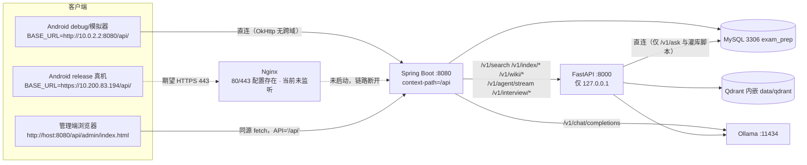
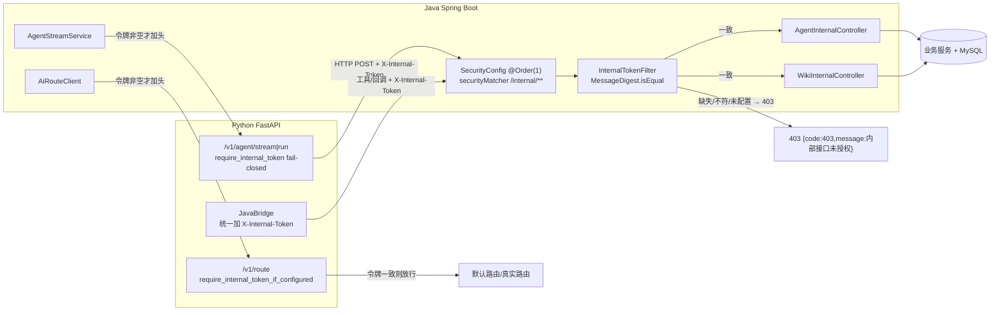
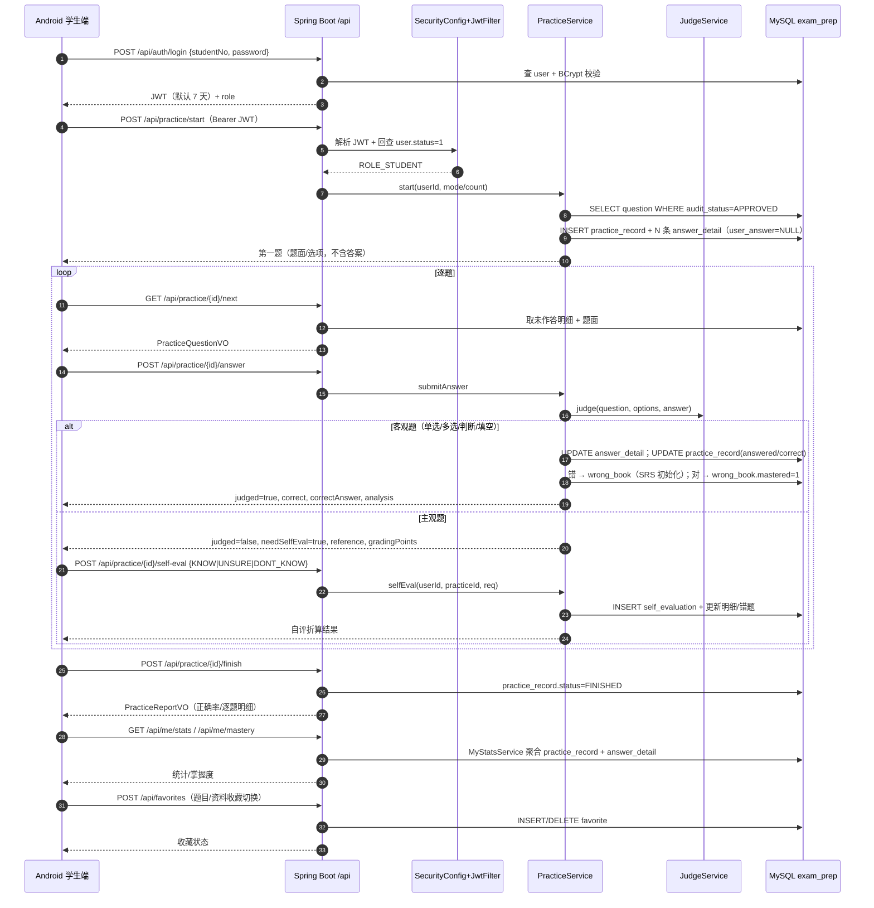
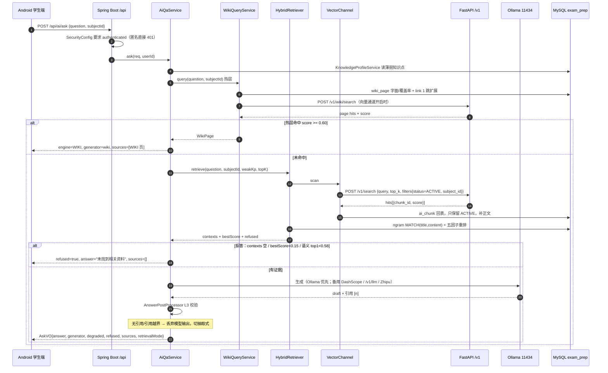
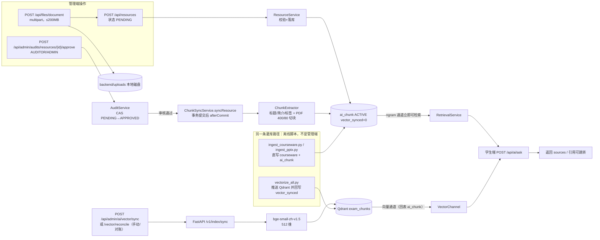

# 第8周 W8-1｜接口与数据流（2026-11-08）

> 本文只描述**当前代码的真实调用关系**，不写规划愿景。核查方式全部为只读：
> 读代码/配置、`GET /api/v3/api-docs`、`GET /api/ai/capability`、`GET /v1/health`、
> `GET /v1/index/status`、`Get-NetTCPConnection` 端口探测。
> 未调用任何写接口、未写数据库、未重启/停止服务、未跑 `mvn`/`pytest`。
>
> 运行时实测时间：2026-11-08。对外口径：196 个对外接口（全量 210，含 14 个 `/internal/**`）
> / 33 Controller / 56 表 / 36 Android 页面 / 13,306 块（12,647 ACTIVE）/ 3,080 题（2,500 可作答）。
> 其中 **210 operations、14 个 internal、33 个 Controller、12,647 ACTIVE 块、56 表、
> 2,500 可作答** 已在本次只读核查中复核；题目口径 3,080 = `is_deleted=0 AND parent_id=0`
> 的主题数，`COUNT(*)` 为 3,085（含 2 条逻辑删除 + 3 条子题）。
> 36 Android 页面为团队既有口径，本次未逐一复算。

---

## 0. 实测基线（先给结论）

| 观测项 | 实测结果 | 证据 |
|---|---|---|
| Spring Boot | `GET http://127.0.0.1:8080/api/actuator/health` → **200 / UP** | 运行实例 PID 28584 |
| FastAPI | `GET http://127.0.0.1:8000/v1/health` → **200 / ok**，embedding ready、qdrant ready、llm ready | 运行实例 PID 12400（uvicorn，`--host 127.0.0.1 --limit-concurrency 4`） |
| 向量索引 | `GET /v1/index/status` → `collection=exam_chunks`、`chunk_synced=12647`、`status=READY` | 与 `chunkCount=12647` 对齐 |
| AI 能力 | `GET /api/ai/capability` → `generator=ollama`、`degraded=false`、`vectorIndexReady=true`、`chunkCount=12647` | 向量通道已开启 |
| 接口文档 | `/api/v3/api-docs` 共 **210 operations**，其中 `/internal/**` **14 个** → 对外 **196** | 与对外口径一致 |
| Nginx | 80 / 443 **均未监听** | 配置存在，未部署/未启动 |
| Redis | 6379 **未监听** | 见 §3.2 |
| Qdrant | 6333 **未监听**（Python 用内嵌本地模式 `./data/qdrant`） | `/v1/health` 的 qdrant detail |
| MinIO | 9000 **未监听** | 存储走本地 `storageProvider=local` |

---

## 1. 入口链路

### 1.1 链路图

### 1.2 入口组件说明

| 入口 | 实际地址/方式 | 代码依据 | 认证方式 | 当前实测 |
|---|---|---|---|---|
| Android 学生端（debug/模拟器） | `http://10.0.2.2:8080/api/` | `student-app/app/build.gradle:28`；Retrofit 基址 `ApiClient.java:77` | JWT `Authorization: Bearer`，`ApiClient.java:84-98`；401 自动清 token 并跳登录 | 8080 监听，可直连 |
| Android 学生端（release 真机） | `https://10.200.83.194/api/` | `student-app/app/build.gradle:54`；证书锚点 `res/xml/network_security_config.xml:16-30` | 同上 + 自签证书信任 | **443 未监听，当前 release 包直连会失败** |
| 管理端 | `http://host:8080/api/admin/index.html`（同源） | 静态文件 `backend/src/main/resources/static/admin/index.html`；`admin-web/index.html:956` `const API='/api'` | 登录 `POST /api/auth/login`（`admin-web/index.html:1370`），token 存 localStorage；角色在服务端校验 | 实测 `GET /api/admin/index.html` → **200**（110,364 字节，与 `admin-web/index.html` 同尺寸） |
| Nginx | 80 → `backend:8080`（`nginx.conf:8-9`）；443 → `127.0.0.1:8080`（`nginx-https.conf:73-82`） | `nginx.conf`、`nginx-https.conf`、`docker-compose.yml:68-78`（只映射 80） | 透传 `Host/X-Real-IP/X-Forwarded-For`，TLS 在 443 终结 | **配置存在/未实测部署**：80/443 均未监听 |
| FastAPI | `http://127.0.0.1:8000`，前缀 `/v1` | `application.yml:301-317`；Python 路由 `ai-service/app/routers/*` | 仅 `/v1/agent/*` 强制内部令牌；其余无鉴权 | 只绑回环，客户端不可直连 |

**关键事实（联调风险）**

1. `nginx/` 目录里只有 `certs/`（自签证书），实际配置在仓库根：`nginx.conf`（80 明文）、`nginx-https.conf`（443 TLS）、`nginx-https.conf.example`；`docker-compose.yml` 只映射 80。
2. `nginx.conf` 的 `proxy_pass http://backend:8080` 用的是 Docker Compose 服务名；**本机 Windows 直接启动 nginx 时该主机名不可解析**，本地只能用 `nginx-https.conf`（127.0.0.1）。
3. 本机 80/443 未监听，而 release APK 基址写死 `https://10.200.83.194/api/` → **真机 release 包在当前环境下无法完成 W8 E2E**；debug/模拟器包走 8080 可以。
4. 管理端页面与后端同源，不经过 Nginx 也能访问；但 `/api/` 根路径为 404，正确入口是 `/api/admin/index.html`。
5. 管理端静态页允许匿名浏览（`SecurityConfig.java:204-205`），页面里的 `/admin/**` API 仍强制 `AUDITOR/ADMIN`。

---

## 2. Java ↔ Python 内部调用

### 2.1 Java 侧 14 个 `/internal/**` 端点（不含 context-path `/api`）

| # | 方法 | 路径 | 实现位置 | 调用方（Python） | 用途 |
|---|---|---|---|---|---|
| 1 | POST | `/internal/agent/tools/search` | `AgentInternalController.java:71` | `agent/tools.py:188` | Agent 检索工具：走 `HybridRetriever`，返回 contexts/score/refused |
| 2 | GET | `/internal/agent/tools/weak-knowledge` | `AgentInternalController.java:117` | `agent/tools.py:301` | 薄弱知识点 Top-N |
| 3 | GET | `/internal/agent/tools/wrong-book` | `AgentInternalController.java:136` | `agent/tools.py:326` | 未掌握错题 Top-N |
| 4 | GET | `/internal/agent/tools/study-plan` | `AgentInternalController.java:144` | `agent/tools.py:347` | 今日学习计划 |
| 5 | GET | `/internal/agent/tools/question/{id}` | `AgentInternalController.java:164` | `agent/tools.py:371` | 题目详情；默认 `includeAnswer=false`（A11 防泄答案） |
| 6 | POST | `/internal/agent/llm` | `AgentInternalController.java:184` | `clients/java_bridge.py:143` | Agent 规划/最终生成的 LLM 代理（Key 只在 Java 侧） |
| 7 | POST | `/internal/agent/answer` | `AgentInternalController.java:211` | `clients/java_bridge.py:178` | L3 校验 draft / 基于 contexts 生成 / 完整 RAG 兜底 |
| 8 | POST | `/internal/jobs/{id}/progress` | `AgentInternalController.java:275` | `java_bridge.py:126` | 异步任务进度回调 |
| 9 | POST | `/internal/jobs/{id}/complete` | `AgentInternalController.java:282` | `java_bridge.py:129` | 异步任务完成回调（终态守卫） |
| 10 | POST | `/internal/jobs/{id}/fail` | `AgentInternalController.java:295` | `java_bridge.py:132` | 异步任务失败回调 |
| 11 | GET | `/internal/wiki/input` | `WikiInternalController.java:46` | `java_bridge.py:155` | Wiki 蒸馏输入导出（Python 不直连 MySQL 取业务数据） |
| 12 | POST | `/internal/wiki/revisions` | `WikiInternalController.java:56` | `java_bridge.py:173` | 蒸馏草稿回传，只写 `PENDING` 修订 |
| 13 | POST | `/internal/agent/tools/wiki-search` | `WikiInternalController.java:65` | `agent/tools.py:216` | Agent 的 Wiki 搜索工具（带 `hit-threshold` 闸门） |
| 14 | GET | `/internal/agent/tools/wiki-page/{id}` | `WikiInternalController.java:91` | `agent/tools.py:255` | Agent 的 Wiki 页面详情工具 |

> **口径核对**：`/api/v3/api-docs` 实测包含这 14 条路径，210 − 14 = 196 对外。
> 但 `AgentInternalController.java:47` 注释写「不在 Swagger 对外文档中」，与实测不符（见 §8 风险 2）。

### 2.2 `X-Internal-Token` 鉴权链

关键代码：

1. Java 独立安全链：`SecurityConfig.java:147-161`，`securityMatcher("/internal/**")`，在 `UsernamePasswordAuthenticationFilter` 之前手工加入 `InternalTokenFilter`；该 Filter **不注册为 Bean**，避免被全局 Servlet 链误挂（`InternalTokenFilter.java:21-23`）。
2. 校验逻辑：`InternalTokenFilter.java:34-50`。令牌未配置、缺失或不一致一律 **403**，返回 `{"code":403,"message":"内部接口未授权","data":null}`；比较用 `MessageDigest.isEqual` 防时序侧信道。
3. Python 侧：`/v1/agent/stream`、`/v1/agent/run` 用 `require_internal_token`（`agent.py:100-137`），**fail-closed**：`AI_INTERNAL_TOKEN` 为空时一律 401（`code=5231`），唯一例外是显式 `AGENT_ALLOW_ANONYMOUS=1`。`/v1/route` 用「配置了才校验」（`route.py:104`）。
4. Python→Java：`JavaBridge._headers()` 恒定注入 `X-Internal-Token`，有 trace 时再带 `X-Trace-Id`（`java_bridge.py:41-48`）。
5. Java→Python：`AgentStreamService.java:317-322` 仅在 Java 侧令牌非空时加头；`AiRouteClient.java:133-138` 同理。
6. 令牌来源：Java `app.ai.internal-token: ${AI_INTERNAL_TOKEN:}`（`application.yml:139-142`）；Python `AgentSettings.internal_token`（`ai-service/app/config.py:220,372`）。`/v1/health` 显示 `security.internalTokenConfigured=true`（只暴露布尔值，未输出令牌）。
7. 注意「**两端必须同值**」：Java 配了、Python 没配 → `/v1/agent/*` 401；Python 配了、Java 没配 → Python 工具回调 403 → Agent 工具降级。

### 2.3 FastAPI `/v1/*` 端点清单（实测 openapi.json 共 18 个）

| 端点 | 方法 | 是否被 Java 调用 | Java 调用方/用途 | Python 侧鉴权 | 依赖不可用时 |
|---|---|---|---|---|---|
| `/v1/health` | GET | 是 | `FastApiClient.java:226`，10s 缓存（`health-cache-millis:10000`） | 无 | 返回各能力 ready 状态 |
| `/v1/embed` | POST | 否（Java 不调；Python 内部/脚本用） | — | 无 | 503 `degraded=true` |
| `/v1/search` | POST | 是 | `FastApiClient.java:153`，向量召回；请求 `{query,top_k,filters}`，强制 `status=ACTIVE` | 无 | 空 list，Java 静默降级 ngram |
| `/v1/index/sync` | POST | 是 | `FastApiClient.java:425`，块向量化；`ChunkSyncService.pushVectorIndex` | 无 | 返回 null → `vector_synced=0` 待对账 |
| `/v1/index/delete` | POST | 是 | `FastApiClient.java:323,546`，删孤儿向量 | 无 | 失败只告警 |
| `/v1/index/rebuild` | POST | 是 | `FastApiClient.java:482` | 无 | 重建失败 |
| `/v1/index/status` | GET | 是 | `FastApiClient.java:507`，对账/状态 | 无 | 对账失败 |
| `/v1/ocr` | POST | 否 | — | 无 | 503（懒加载 PaddleOCR） |
| `/v1/llm` | POST | 是（条件） | `FastApiLlmClient.java` → `FastApiClient.java:365`；仅在 Ollama/DashScope 都不可用时参与降级链 | 无 | 抛 `AiUnavailableException` → 下一个客户端 |
| `/v1/agent/stream` | POST | 是 | `AgentStreamService.java:295`，SSE 透传 `meta→thought→tool_call→tool_result→final→done` | `X-Internal-Token`（fail-closed） | Java 回退本地 `AiQaService.ask`，`final.degraded=true` |
| `/v1/agent/run` | POST | **否**（Java 只用 stream；供评估/脚本） | — | `X-Internal-Token`（fail-closed） | 401/503 |
| `/v1/ask` | POST | **否**（Java 不调用） | 这是 Python 侧另一套完整 RAG 实现，直连 MySQL/Qdrant | 无 | 503 |
| `/v1/wiki/index/sync` | POST | 是 | `FastApiClient.java:655`，Wiki 发布自动索引（`WikiService.java:519-524`） | 无 | 发布仍成功，ngram 仍可命中 |
| `/v1/wiki/index/delete` | POST | 是 | `FastApiClient.java:684`，Wiki 下架删向量 | 无 | 下架仍成功 |
| `/v1/wiki/search` | POST | 是 | `FastApiClient.java:607`，Java 热层向量召回（`WikiQueryService.java:95-99`） | 无 | 热层退回 ngram |
| `/v1/interview/start` | POST | 是 | `AiInterviewService.java:171` | **无** | Java 503「面试服务暂不可用」 |
| `/v1/interview/answer` | POST | 是 | `AiInterviewService.java:214` | **无** | 同上 |
| `/v1/route` | POST | 是（条件） | `AiRouteClient.java:131`；`app.ai.route.enabled=false` 默认不调用 | 配置了才校验 | 永不抛异常，返回默认 `COURSE_QA` |

**契约注意**

- Java 的 `FastApiClient`（search/index/wiki/llm）**不带** `X-Internal-Token`，而 Agent/Route 两条链路带；当前 Python 这些端点不校验，所以能用，但一旦 Python 收紧鉴权就会集体 401（见 §8 风险 5）。
- Java 问答主链路**不调用** `/v1/ask`；`/v1/ask` 是第二套 RAG（含自己的 Wiki 热层与 MySQL 回表校验，`ai-service/app/routers/ask.py:157-198`）。
- `/v1/interview/*` 无鉴权但会话状态在 Python 进程内 `_SESSIONS` 字典中（`interview.py:183-217`），TTL 30 分钟。

---

## 3. 数据归属

### 3.1 MySQL `exam_prep` 域表归属

> 表数口径 56：52 张 Entity 映射表 + 4 张仅 SQL/脚本使用的表
> （`question_knowledge`、`resource_version`、`ai_vector_index_meta`、`rsi_run`）。
> 下表只列主要域，不逐表展开；写方/读方均以代码为准。

| 数据域 | 主要表 | 主写方（Java/Python） | 主要读方 | 说明 |
|---|---|---|---|---|
| 用户与组织 | `user`、`school`、`college`、`major`、`teacher`、`semester` | `AuthService`（注册/改密）、`AdminService`（角色/状态）、`AdminDataController` | `JwtAuthenticationFilter` 回查用户有效性（`JwtAuthenticationFilter.java:68-75`）、`AdminController` | 角色仅 `STUDENT/AUDITOR/ADMIN`（`AdminService.java:110-112`） |
| 考试/科目/知识点/课程 | `exam_category`、`subject`、`knowledge_point`、`course` | `AdminDataController`（ADMIN）、`sql/data-*.sql`、Python 灌库脚本 | 学生端 `/exams`、`/subjects`、`/courses` | 知识点增删改**不触发** chunk 同步，只有 `/admin/ai/reindex` 会重建（`AdminDataController.java:179-219`） |
| 题库 | `question`、`question_option`、`question_answer`、`question_knowledge`、`listening_audio`、`exam_paper`、`exam_paper_question`、`exam_record`、`exam_answer_detail` | `QuestionAdminService`（新建即 `PENDING`，`QuestionAdminService.java:72-78`）、`MockExamService`/`ExamService`（作答记录）、`sql/data-guokao.sql` | `QuestionService`、`PracticeService`、`MockExamService`、`QuestionAdminController` | 只有 `audit_status=APPROVED` 的题可被组卷/刷题 |
| 刷题与错题 | `practice_record`、`answer_detail`、`self_evaluation`、`wrong_book` | `PracticeService`（`start`→`submitAnswer`→`selfEval`→`finish`）、`WrongBookReviewService`（SRS） | `PracticeService`、`MyStatsService`、`KnowledgeProfileService` | 错题由 `PracticeService.addToWrongBook`（`:642-668`）写；答对 `markMastered`（`:671-679`） |
| 收藏/笔记/互动 | `favorite`、`question_note`、`comment`、`comment_like`、`resource_rating`、`resource_like`、`report`、`appeal`、`follow`、`notification`、`announcement` | `FavoriteService`、`NoteService`、`CommentService`、`ResourceService`、`AppealService`、`FollowService`、`NoticeService` | 学生端列表/通知、管理端举报与公告 | 管理端公告走 `AdminController` |
| 资料/课件 | `resource`、`resource_version`、`resource_page`、`file_record`、`download_record`、`courseware` | `ResourceService`（提交置 `PENDING`，`:272-297`）、`FileStorageService`；`courseware` 由 **Python 灌库脚本**直写 | `ResourceService`、`CoursewareController`、`ChunkExtractor` | `resource_page` 为预览页；`courseware` Java 只读 |
| 审核/审计 | `audit_record`、`operation_log` | `AuditService`（CAS 状态流转 + `audit_record`）、`OperationLogService` | `AdminController`、`AiOpsController` | 审核员不能审自己上传/创建的条目（`AuditService.java:164-167`） |
| Wiki | `wiki_page`、`wiki_page_revision`、`wiki_page_link` | `WikiService`（草稿→审核→发布）、`WikiDistillScheduler`（入队）；**另** `ai-service/tools/distill_wiki_batch.py` 可离线直写 | `WikiQueryService`（热层）、`WikiController`、`WikiAdminController` | 发布即 `PUBLISHED` + 自动推 `wiki_pages` 向量（`WikiService.java:173-227`） |
| AI 语料/向量元数据 | `ai_chunk`、`ai_vector_index_meta` | `ChunkSyncService`（题目/资料/知识点）；**另** `ai-service/tools/ingest_courseware.py`、`ingest_pptx.py` 直写 `courseware + ai_chunk`，`vectorize_all.py` 回写 `vector_synced` | `RetrievalService`（ngram）、`VectorChannel`（回表补正文）、`CoursewareController` | `ai_chunk` 是派生数据，只置 `ACTIVE/INVALID`，不物理删（`AiChunk.java:18-21`）；课件块不走 Java 分块器（`AiChunk.java:33-41`） |
| Agent 运行 | `ai_agent_run`、`ai_agent_session`、`ai_agent_memory`、`ai_agent_checkpoint` | `AgentRunService`、`AgentSessionService`、`AgentMemoryService`、`AgentCheckpointService` | `AiOpsController`（轨迹/指标/保留期清理）、`AgentStreamService` | 保留期清理：`app.observability.retention-days=90`（`application.yml:129-133`） |
| 异步任务/评估 | `async_task`、`ai_eval_run` | `AsyncJobService`（提交）；Python worker 通过 `/internal/jobs/*` 回调更新；`AsyncJobRecovery` 启动时把残留 RUNNING 置 FAILED | `AiOpsController` | Redis Stream 是队列，MySQL 是任务状态权威 |
| AI 面试 | `ai_interview_session`、`ai_interview_qa` | `AiInterviewService`（Java 落库题面/作答/评分） | `AiInterviewController` | Python 只保存 30 分钟会话状态，不落库 |
| 实验 | `rsi_run` | `ai-service/tools/rsi_tune.py` | 脚本 | 调参记录表，不参与业务链路 |

### 3.2 Qdrant / Redis 的职责

| 组件 | 存什么 | 写方 | 读方 | 备注 |
|---|---|---|---|---|
| Qdrant `exam_chunks` | 向量 + payload（不存正文；正文唯一来源是 MySQL `ai_chunk`） | Python `/v1/index/sync`；离线 `vectorize_all.py` | Python `/v1/search` | 当前内嵌本地模式 `./data/qdrant`，6333 未监听 |
| Qdrant `wiki_pages` | Wiki 页面摘要向量 | Java→Python `/v1/wiki/index/sync`；离线蒸馏脚本 | Python `/v1/wiki/search`（Java 热层） | 与 RAG 集合隔离（`application.yml:402-406`） |
| Redis 6379 | **仅** Redis Stream 异步任务队列：`exam:jobs`、`exam:eval`、`exam:wiki` | Java `AsyncJobService.submit` 同步 `XADD`（`AsyncJobService.java:110`）；`WikiDistillScheduler` | Python 三个独立 worker（`job_worker.py:302+`，各自独立连接池） | **不是缓存、不是 session、不是限流** |

**Redis 的排除项（容易误判）**

- 健康检查缓存：Java 进程内 `FastApiClient.healthCache`（`FastApiClient.java:61`），不依赖 Redis。
- 登录限流：`RateLimitFilter` 进程内 `ConcurrentHashMap`（`RateLimitFilter.java:36`），不依赖 Redis。
- 会话：Spring Security `STATELESS`（`SecurityConfig.java:183`）；AI 面试会话在 Python 内存字典（`interview.py:183`）。
- 路由缓存：`AiRouteClient` 进程内缓存（`application.yml:349-351`）。

### 3.3 Redis 未启动的影响面

| 功能 | 代码路径 | 未启动时表现 |
|---|---|---|
| `POST /api/admin/ai/jobs`（提交任务） | `AiOpsController.java:225` → `AsyncJobService.submit` | `app.ai.jobs.enabled=false`（默认）→ **503「任务队列未启用」**；若开启但 Redis 不通 → **503「任务队列不可用，请检查 Redis 是否已启动」**（`AsyncJobService.java:112-119`） |
| `POST /api/admin/ai/eval/retrieval`、`/eval/agent` | `AiOpsController.java:251,258` | 同上，提交即失败 |
| `POST /api/admin/wiki/distill` | `WikiAdminController.java:99-110` → `WikiService.enqueueDistill` → `AsyncJobService` | 同上 503 |
| 每日 03:30 Wiki 蒸馏 | `WikiDistillScheduler.java:31-46` | 只打 WARN「今天跳过」，不影响启动与其余功能 |
| `GET /api/admin/ai/jobs`、`/jobs/{id}`、`/eval/runs` | 直接查 MySQL | **正常**（不走 Redis） |
| `/api/ai/ask`、`/api/ai/agent/stream` | Java 检索 + Ollama / Python | **正常**（不依赖 Redis；Agent 另受 `app.ai.agent.enabled` 开关约束，默认 false → 503） |
| 应用启动 / 健康检查 | `application.yml:422-425` 关闭 Redis health | **正常**，`/actuator/health` 仍 UP |

> 两道闸门：`app.ai.jobs.enabled` 默认 `false`（`application.yml:157-163`），Python 三个 worker 开关也默认 `false`（`config.py:269-274`）。所以即使 Redis 起来，还需显式开启 `AI_JOBS_ENABLED=true` 与对应 worker 才会真正消费。

---

## 4. 三条关键业务流

### 4.1 流 a：刷题（登录 → 取题 → 练习 → 判分 → 错题/收藏 → 统计）

代码锚点：

- 登录与 JWT：`AuthService.java:44-69`；`JwtUtil.java:31-62`（密钥为空/不足 32 字节启动失败）；`JwtAuthenticationFilter.java:45-64`。
- 开始练习：`PracticeController.java:44-48` → `PracticeService.java:85-127`（预插 N 条 `answer_detail`）。
- 判分：`PracticeService.java:253-329`（客观题即时判分、重复提交幂等返回 `buildExistingResult`；主观题等自评）。
- 自评：`PracticeService.java:369-440`（`KNOW` 满分、`UNSURE` 半分、`DONT_KNOW` 0 分且入错题本）。
- 结束/报告：`PracticeService.java:446-457`；错题本 `:642-679`；SRS `WrongBookReviewService`。
- 收藏：`FavoriteController.java:33-45`。

### 4.2 流 b：AI 答疑（JWT → AiQaService → Wiki 热层/混合检索 → FastAPI/LLM → L3 → 引用）

代码锚点与口径：

1. 入口鉴权：`SecurityConfig.java:202`（`POST /ai/ask` 必须认证）；`AiController.java:60-67`。
2. Wiki 热层：`AiQaService.java:124-155`；命中阈值 `app.wiki.hit-threshold=0.60`（`application.yml:377-381`）；Java 侧检索 `WikiQueryService.java:70-99`（向量 + ngram/覆盖率 + 图扩展）。异常一律降级 RAG（`AiQaService.java:125-129`）。
3. 语义路由：`AiQaService.java:163-167`；`AiRouteClient` 失败永不抛异常；默认 `app.ai.route.enabled=false`（`application.yml:340-351`，当前 profile 未覆盖，环境变量覆盖未实测），因此默认不向 Python 发 `/v1/route`。
4. 混合检索：`AiQaService.java:171-172` → `HybridRetriever.java:99-176`：向量通道 `VectorChannel.java:61-97` + `FastApiClient.java:126-160`；ngram 通道 `AiChunkMapper.java:42-46`（`MATCH ... AGAINST IN BOOLEAN MODE`，`status='ACTIVE'`）；融合/语义拒答 `HybridRetriever.java:130-176`。
5. 向量回表：`VectorChannel.java:190-250`，按 `chunk_id` 回 `ai_chunk` 取正文并只保留 `ACTIVE`；Qdrant payload 刻意不存正文。
6. 拒答三重闸门：`AiQaService.java:187-203`（空/低于 0.15/语义拒答 `SEMANTIC_LOW_SIMILARITY`）；语义阈值 0.58（`application.yml:255`）。
7. 生成降级链（`@Order` 决定优先级）：Ollama(5) → DashScope(10) → FastApiLlm(15) → Zhipu(20) → Extractive(30)；`AiQaService.java:266-297`。运行时实测 `generator=ollama`、未降级。
8. L3 校验：`AnswerPostProcessor.java:44-97` 四条规则（引用但无 sources / 引用越界 / 完全无引用 / sources 虚高裁剪），不通过则切抽取式；拒答归一 `:128-137`。
9. 输出：`AskVO` 带 `sources[]`（强制溯源）、`generator`、`degraded`、`refused`、`retrievalMode`、`engine`。

### 4.3 流 c：知识库导入（管理端上传 → 解析/切分 → `ai_chunk` → 向量同步 → 发布 → 学生端命中）

代码锚点与关键事实：

> **顺序与规划口径不同**：实际是「上传 → 提交（PENDING）→ 审核通过（发布）→ afterCommit 切分写 `ai_chunk` → 手动/对账推向量」。
> 切分发生在发布之后，而不是发布之前；「发布」本身不直接写 chunk。

1. 上传：`FileController.java:70-78`（`POST /files/document`，200MB 上限见 `application.yml:56-61`）。
2. 提交资料：`ResourceService.java:272-297`，新建即 `audit_status=PENDING`。
3. 发布（审核通过）：`AdminController.java:108-115` → `AuditService.java:100-115`，CAS `PENDING→APPROVED` + 写 `audit_record` + 通知，再挂 `runAfterCommit` 调 `ChunkSyncService.syncResource`（`AuditService.java:113-114`）。
4. 切分：`ChunkExtractor.java:216-253`。**只有 PDF 会追加正文并按 400/80 切块并保留 `page_no`**；非 PDF（docx 等）只有「标题+简介+标签」单块。课件正文由 Python 脚本解析（`AiChunk.java:33-41`）。
5. 写块：`ChunkSyncService.java:206-253`，按 `(source_type, source_id, chunk_no)` + `content_hash` 幂等；新增/变更才写，并在 `:271-285` 标记 `vector_synced=0`。
6. **向量同步不是发布自动触发**：`pushVectorIndex` 只在手动接口 `/admin/ai/vector/sync`（`AiAdminController.java:57-64`）、对账 `/vector/reconcile`（`:74-96`）、或全量 `reindex`（`ChunkSyncService.java:625-631`）时执行；发布后仅标记待同步。**因此「审核通过 → ngram 立即可检索；向量命中需再推一次」**。
7. 推送：`ChunkSyncService.java:307-372` → `FastApiClient.java:425` `/v1/index/sync` → Python bge 512 维 → Qdrant。失败保持 `vector_synced=0` 待对账；被拒收/校准失败置 2。
8. 学生端命中：`POST /api/ai/ask`（§4.2），或资料列表 `/api/resources`、搜索 `/api/search/resources`、课件 `/api/courseware/{id}`。
9. Wiki 发布旁路：`POST /api/admin/wiki/revisions/{id}/approve`（`WikiAdminController.java:68-75`）→ `WikiService.approve`（`:173-227`）：`PUBLISHED` + 重建链接 + `syncPageVector` 自动推 `wiki_pages`（`WikiService.java:519-524`）。蒸馏本身需 Redis + jobs 开启（`WikiAdminController.java:99-110`）。
10. 知识点旁路：`POST /api/admin/data/knowledge`（`AdminDataController.java:180-202`）只写表，不触发 chunk；需 `/api/admin/ai/reindex` 才进 `ai_chunk`。

---

## 5. 权限边界

### 5.1 权限边界表

| 通道 | 凭据 | 覆盖范围 | 拒绝表现 | 代码依据 |
|---|---|---|---|---|
| 匿名（PUBLIC_ALL） | 无 | `POST /auth/login`、`POST /auth/register`、`POST /auth/guest`、`/v3/api-docs/**`、`/swagger-ui/**`、`/actuator/health/**` | 不拒绝 | `SecurityConfig.java:104-118` |
| 匿名只读（PUBLIC_GET） | 无 | `GET /exams/**`、`/subjects/**`、`/knowledge/**`、`/questions/**`、`/resources/**`、`/files/preview/**`、`/colleges/**`、`/schools/**`、`/majors/**`、`/teachers/**`、`/semesters/**`、`/courses/**`、`/ai/capability`、`/wiki/**`、`/announcements/**`、`/search/**`、`/home` | 不拒绝 | `SecurityConfig.java:63-88` |
| 登录用户（JWT） | `Authorization: Bearer <jwt>` | 上述前缀中**例外项**：`/resources/mine`、`/favorites/**`、`/me/**`、`/ai/knowledge-profile`、`/ai/recommendations`；以及 `POST /ai/ask`、`/ai/agent/**`、`/practice/**`、`/wrong-book/**`、`POST /resources`、`/files/*` 上传、`/auth/me`、`/auth/password` | 未带/失效 → **401**；权限不足 → **403** | `SecurityConfig.java:94-101,195-213`；`JwtAuthenticationFilter.java:45-64` |
| 游客（Guest） | 无令牌 | 仅 PUBLIC_GET；`POST /auth/guest` 返回能力边界（可浏览/可预览前 3 页/可搜索；不可下载、上传、刷题、评论、收藏） | 访受限接口 401 | `AuthController.java:48-61`；`application.yml:106-108` |
| 管理端 AUDITOR/ADMIN | JWT（role=AUDITOR/ADMIN） | `/admin/**`；`/admin/logs/audit` 允许 AUDITOR | 无 token 401；STUDENT 403 | `SecurityConfig.java:206-211`；`AdminService.java:110-112` |
| 管理端 ADMIN | JWT（role=ADMIN） | `/admin/users/**`、`/admin/logs/**`、`/admin/roles/**` | 非 ADMIN → 403 | `SecurityConfig.java:207-209` |
| 内部接口 Token | `X-Internal-Token` | 14 个 `/internal/**`，独立安全链，不认 JWT | 缺失/错误/未配置 → **403** `{code:403}` | `SecurityConfig.java:147-161`；`InternalTokenFilter.java:34-50` |
| Python Agent 内部 | `X-Internal-Token` | `/v1/agent/stream`、`/v1/agent/run` | 缺失/错误/未配置 → **401** `code=5231` | `agent.py:100-137` |
| Python 其他内部 | 无（仅回环） | `/v1/search`、`/v1/index/*`、`/v1/wiki/*`、`/v1/llm`、`/v1/ask`、`/v1/ocr`、`/v1/interview/*`、`/v1/embed` | 不拒绝；8000 只绑 `127.0.0.1` | 端口实测；`config.py` 路由无 `Depends` |

### 5.2 14 个 internal 端点「不对外」的口径

- 对外接口数 196 = 全量 210 − 14 个 `/internal/**`。
- **但它们确实出现在 `/api/v3/api-docs`**，且 `Swagger UI` 匿名可访问（`SecurityConfig.java:108-109`），所以「不对外」只在**调用权限**层面成立（需要 `X-Internal-Token`），在**接口文档可见性**层面不成立。
- 经 8080 / 若 Nginx 启动后的 443，`/api/internal/**` 同样会被路由到后端；Nginx 没有额外拒绝规则（`nginx.conf:8-14`、`nginx-https.conf:73-82`）。

---

## 6. 端口 / 组件状态表

| 端口 | 组件 | 实测状态（2026-11-08） | 绑定地址 | PID | 职责 | 缺失/异常影响 |
|---|---|---|---|---|---|---|
| 80 | Nginx（HTTP） | **未监听** | — | — | 80 → `backend:8080` 反代（Compose 场景） | release APK 若走 80/443 均不可用；本地 nginx 未部署 |
| 443 | Nginx（HTTPS） | **未监听** | — | — | TLS 终结 + 反代 `127.0.0.1:8080`；证书 `nginx/certs/server.crt` | **release APK（`https://10.200.83.194/api/`）直连失败** |
| 8080 | Spring Boot | **LISTEN / UP** | `::`（全接口） | 28584 | 全部业务 API（context `/api`）、管理端静态页、Swagger | 核心；缺失则整站不可用 |
| 8000 | FastAPI | **LISTEN / ok** | `127.0.0.1` | 12400 | `/v1/*` 检索/embedding/LLM 代理/route/wiki/agent/interview | 向量通道降级 ngram；Agent 回退 Java；面试 503 |
| 3306 | MySQL | **LISTEN / UP** | `0.0.0.0` | 7508 | `exam_prep` 业务权威数据 | 全站不可用 |
| 11434 | Ollama | **LISTEN / UP** | `127.0.0.1` | 17056 | 本地 7B 生成（`qwen2.5-7b-instruct-baseline`） | 生成降级到 DashScope/FastApiLlm/Zhipu，最终抽取式 |
| 6379 | Redis | **未监听** | — | — | 仅异步任务 Stream（jobs/eval/wiki） | 任务提交 503；Wiki 蒸馏跳过；其余不受影响 |
| 6333 | Qdrant HTTP | **未监听** | — | — | 独立向量库服务（当前未用） | 当前 Python 用内嵌 `./data/qdrant`，不影响 |
| 9000 | MinIO | **未监听** | — | — | 对象存储（`app.ai.storage.enabled=false`） | 上传落本地磁盘，`storageProvider=local` |

---

## 7. 第8周 E2E 联调检查清单

> 按数据流排序；每条给出「入口 → 期望结果」，用于 W8 端到端验收。
> 只读约束下本文不执行，留给联调子任务逐条打勾。

### A. 入口与鉴权（先通链路，再验业务）

| # | 检查点 | 操作 | 期望 |
|---|---|---|---|
| A1 | Android debug 直连 | `GET http://10.0.2.2:8080/api/home` | 200，返回首页数据 |
| A2 | 登录 | `POST /api/auth/login`（正确/错误口令） | 正确 200 + JWT；错误统一 `code=1001`（学号或密码错误），不暴露学号是否存在 |
| A3 | token 过期/失效 | 用过期或伪造 token 调 `/api/practice/start` | **401**；App 清 token 并跳登录（`ApiClient.java:91-97`） |
| A4 | 游客边界 | 匿名 `GET /api/questions` → 200；匿名 `POST /api/practice/start` → 401 | 与 `AuthController.java:48-61` 能力边界一致 |
| A5 | 管理端页面 | 匿名 `GET /api/admin/index.html` | 200；`/api/` 根路径 404（不是页面入口） |
| A6 | 管理端角色 | STUDENT token 调 `/api/admin/dashboard` | 403；AUDITOR/ADMIN 200 |
| A7 | 内部接口 | 无 token `GET /api/internal/agent/tools/wrong-book?userId=1` | **403**；带正确 token 200 |
| A8 | release 真机 | 安装 release APK 后登录 | 当前预期失败（443 未监听）；先启 Nginx 或改用 debug 包 |
| A9 | Nginx（若启用） | `curl -k -I https://<IP>/api/home` | 200/401 且证书 SAN 与 IP 匹配；`nginx-https.conf` 证书路径相对项目根 |

### B. 刷题闭环

| # | 检查点 | 操作 | 期望 |
|---|---|---|---|
| B1 | 开始练习 | `POST /api/practice/start {subjectId,count}` | 200；返回第一题；**响应不含 correctAnswer/analysis** |
| B2 | 取下一题 | `GET /api/practice/{id}/next` | 未答题逐个返回；答完 `finished=true` |
| B3 | 客观题判分 | `POST /api/practice/{id}/answer` | `judged=true`、`correct`、`correctAnswer`、`analysis` |
| B4 | 重复提交 | 同一 `(practiceId,questionId)` 再提交 | **幂等**返回首次结果，`answeredCount` 不重复累加（`PracticeService.java:275-279`） |
| B5 | 主观题 | 提交简答 | `judged=false`、`needSelfEval=true`、参考答案/评分要点 |
| B6 | 自评 | `POST /api/practice/{id}/self-eval` | KNOW 满分 / UNSURE 半分 / DONT_KNOW 0 分且入错题本 |
| B7 | 错题本 | `GET /api/wrong-book` | 只含未掌握错题；SRS 字段 `nextReviewAt` 有值 |
| B8 | 结束报告 | `POST /api/practice/{id}/finish` | 200；报告正确率 = `correct/answered`；已结束不可再自评 |
| B9 | 统计 | `GET /api/me/stats`、`/me/mastery`、`/me/practice-trend` | 与 `practice_record`/`answer_detail` 一致 |
| B10 | 收藏 | `POST /api/favorites`、`GET /api/favorites/questions` | 切换成功、列表可见 |

### C. AI 答疑

| # | 检查点 | 操作 | 期望 |
|---|---|---|---|
| C1 | 能力探测 | 匿名 `GET /api/ai/capability` | 200；当前 `generator=ollama`、`chunkCount=12647`、`vectorIndexReady=true` |
| C2 | 未登录问答 | 匿名 `POST /api/ai/ask` | **401**（不是游客可问） |
| C3 | 域内问题 | 登录后提问语料内问题 | 200；`sources` 非空；正文 `[n]` 与 `sources` 顺序可对应 |
| C4 | 域外问题 | 提问语料外问题 | `refused=true`、`answer="未找到相关资料"`、`sources=[]` |
| C5 | L3 校验 | 观察 `generator`/`degraded` | 模型无引用/引用越界 → 切 `extractive` 且 `degraded=true` |
| C6 | 向量通道 | 看 `retrievalMode` 与日志 | `VECTOR_HYBRID` / `VECTOR_ONLY`；`POST /v1/search` 返回 `chunk_id` 能在 `ai_chunk` 回表 |
| C7 | ngram 降级 | 临时停 FastAPI（联调窗口允许时） | `/ai/ask` 仍 200，`retrievalMode=FULLTEXT_*`/`LIKE` |
| C8 | Ollama 降级 | 停 Ollama | `generator=extractive` 或云端，`degraded=true`；接口不 5xx |
| C9 | Wiki 热层 | 提问已发布 Wiki 主题 | `engine=WIKI`、`generator=wiki`、`wikiPageId/slug` 有值 |
| C10 | TraceId | 请求带 `X-Trace-Id`（16 位 hex） | Java 日志/Python 日志/响应头同值；`ai_agent_run.trace_id` 同步 |
| C11 | Agent SSE | `POST /api/ai/agent/stream`（登录；需 `AI_AGENT_ENABLED=true`，默认 false 时 503） | 事件序 `meta→thought→tool_call→tool_result→final→done`；Python 不可用时收到 `final.degraded=true` |
| C12 | Agent 工具回调 | 观察 Python→Java `/internal/**` | 带 `X-Internal-Token` 成功；token 不一致时 403 且 Agent 降级而非整轮失败 |

### D. 知识库导入 / 发布 / 检索可见

| # | 检查点 | 操作 | 期望 |
|---|---|---|---|
| D1 | 上传 | `POST /api/files/document` | 200 返回 fileId；≤200MB；落 `backend/uploads/documents/` |
| D2 | 提交资料 | `POST /api/resources` | 200；`auditStatus=PENDING` |
| D3 | 自审拦截 | 上传者用 AUDITOR 身份审自己 | `4001 AUDIT_SELF_FORBIDDEN` |
| D4 | 审核发布 | `POST /api/admin/audits/resources/{id}/approve` | 200；`resource.audit_status=APPROVED`；`audit_record` 新增 |
| D5 | 切块 | 审核后查 `ai_chunk` | 新增 `ACTIVE` 块，`vector_synced=0`；PDF 按 400/80、`page_no` 保留 |
| D6 | ngram 立即可见 | 审核后立刻 `/api/ai/ask` 问文中内容 | 可命中（`FULLTEXT_*`）；**不需要等向量** |
| D7 | 向量同步 | `POST /api/admin/ai/vector/sync?limit=200` | `pushed=true`、`synced>0`；`vector_synced` 置 1 |
| D8 | 对账 | `GET /api/admin/ai/vector/reconcile` | `mySqlSynced == Qdrant points`；当前基线 12647 |
| D9 | 向量命中 | 同步后问语义相近但字面不同的问法 | 命中且 `retrievalMode` 含 VECTOR |
| D10 | 非 PDF 资料 | 上传 docx 并审核 | 只生成元数据单块；**正文不参与检索**（当前实现的预期，不是 bug） |
| D11 | 下架 | `POST /api/admin/audits/resources/{id}/offline` | 块置 `INVALID`；孤儿向量删除；检索不再命中 |
| D12 | Wiki 发布 | `POST /api/admin/wiki/revisions/{id}/approve` | `PUBLISHED`；`/api/wiki/pages/{id}` 可见；`wiki_pages` 向量同步失败也不影响页面可读 |
| D13 | Wiki 蒸馏 | `POST /api/admin/wiki/distill` | Redis/jobs 开启时 200 入队；否则 503（见 §3.3） |
| D14 | 课件 | 只走 `ai-service/tools/ingest_courseware.py` | Java 管理端无课件导入入口；脚本直写 `courseware+ai_chunk`（`vector_synced=0`），再由 `vectorize_all.py` 或 `/v1/index/sync` 推 Qdrant |

### E. 数据一致性与降级

| # | 检查点 | 操作 | 期望 |
|---|---|---|---|
| E1 | 块数一致 | `GET /api/ai/capability` + `GET /v1/index/status` | `chunkCount` = `chunk_synced` = 12647（当前基线） |
| E2 | 向量状态位 | 抽查 `ai_chunk.vector_synced` | 0=待推 / 1=已同步 / 2=失败待重试；无「假 1」 |
| E3 | Redis 缺失 | 停 Redis（当前即未启动） | `/admin/ai/jobs` 503；`/ai/ask` 200；`/actuator/health` UP |
| E4 | FastAPI 缺失 | 停 8000 | `/ai/ask` 200（ngram+抽取式）；`vectorIndexReady=false` |
| E5 | MySQL 缺失 | 不做破坏性验证 | 预期全站 5xx/启动失败，不作为联调项 |

---

## 8. 契约不一致 / 风险清单（按影响排序）

1. **Nginx 未部署，release APK 不可用**：`student-app/app/build.gradle:54` 写死 `https://10.200.83.194/api/`，但 80/443 未监听（实测）；`nginx.conf:9` 的 `backend:8080` 仅 Compose 内可解析。W8 真机 E2E 必须二选一：启动 `nginx-https.conf`（127.0.0.1:8080）或改回 debug/8080 直连。
2. **14 个 internal 端点出现在 Swagger**：`AgentInternalController.java:47` 声称「不在 Swagger 对外文档中」，但 `/api/v3/api-docs` 实测列出全部 14 条，且 Swagger UI 匿名可访问（`SecurityConfig.java:108-109`）。调用仍被 403 拦住，但接口面/字段结构对外可见。
3. **Python 存在第二套 RAG `/v1/ask`**：`ask.py` 直连 MySQL/Qdrant（`ask.py:88`、`:157-198`），自带 Wiki 热层；Java 从不调用。它与 Java `AiQaService` 是两套实现，且 Wiki 阈值不同：Java `0.60`（`application.yml:380`）vs Python 默认 `0.62`（`ai-service/app/config.py:259,403`），长期易漂移。
4. **Python 鉴权口径不统一**：`/v1/agent/*` fail-closed 401；`/v1/route` 配置才校验；`/v1/search`、`/v1/index/*`、`/v1/wiki/*`、`/v1/llm`、`/v1/ask`、`/v1/interview/*` 无鉴权。当前 8000 仅回环尚可接受，一旦改为 `0.0.0.0` 或经代理暴露，面试/索引/问答可被本机任意进程调用（Agent 端点还能伪造 `userId` 读私有数据，故必须保留 token）。
5. **Java 客户端令牌口径分裂**：`AgentStreamService`/`AiRouteClient` 带 `X-Internal-Token`，`FastApiClient`（search/index/wiki/llm）不带。Python 目前不校验这些端点，所以能跑；若后续给 `/v1/*` 统一加鉴权，`FastApiClient` 会集体 401。
6. **发布不自动向量化**：资源/题目审核通过只 `markVectorPending(vector_synced=0)`（`ChunkSyncService.java:271-285`），不调用 `pushVectorIndex`；需手动 `/admin/ai/vector/sync` 或对账。结果：**ngram 检索立即生效，向量检索滞后**。与「发布即可检索」的直觉不一致，联调需按 D6/D7 分两步验。
7. **docx 正文不进 Java 索引**：`ChunkExtractor` 仅对 PDF 追加正文（`ChunkExtractor.java:237-253`）；docx 资料只生成元数据单块。若管理端宣传「上传 docx 后可被 AI 检索正文」，会与实现不符（课件 docx 目前靠 Python 灌库脚本旁路）。
8. **Redis 与 jobs 双闸门**：`app.ai.jobs.enabled` 默认 false（`application.yml:157-163`），Python 三个 worker 默认 false（`config.py:269-274`）。即便启动 Redis，未显式开开关时 `/admin/ai/jobs` 仍 503；文档只写「Redis 未启动 → 仅 jobs 503」（`docker-compose.redis.yml:7-8`），实际还影响 eval 与 Wiki 蒸馏。
9. **网络暴露面**：8080 绑 `::`（全接口）、3306 绑 `0.0.0.0`（实测），8000/11434 仅回环；`/auth/login` 限流是进程内固定窗口（`RateLimitFilter.java:29-36`），Nginx 未启用时无额外限流；JWT 默认 7 天（`application.yml:97-100`）。
10. **管理端页面双副本**：`admin-web/index.html` 与 `backend/src/main/resources/static/admin/index.html` 当前同为 110,364 字节，但同步靠 `同步管理端页面.bat` 手工执行；忘记同步会出现「改了源码不生效」，联调前建议先跑一次同步脚本。

---

## 9. 证据与未实测项

**已实测（只读）**

- `/api/actuator/health` → UP；`/v1/health` → ok（embedding/qdrant/llm ready）。
- `/api/ai/capability` → `generator=ollama`、`chunkCount=12647`、`vectorEnabled=true`、`vectorIndexReady=true`、`storageProvider=local`。
- `/v1/index/status` → `exam_chunks`、`chunk_synced=12647`、`READY`。
- `/api/v3/api-docs` → 210 operations；`/internal/**` 14 条。
- `/api/admin/index.html` → 200；`/api/` → 404。
- 端口：80/443/6379/6333/9000 未监听；8080/3306/11434/8000 监听（绑定见 §6）。

**配置存在但未实测**

- Nginx 实际部署与 TLS 握手（80/443 未监听，未启动）。
- Redis 启动后的任务全链路（6379 未监听，且 jobs/worker 开关默认关闭）。
- 独立 Qdrant 服务模式（6333 未监听，当前为内嵌本地模式）。

**口径核对（只读 SQL / 接口实测）**

- 36 Android 页面为团队既有口径，本次未逐一复算。
- 题目：`COUNT(*)` 实测 **3,085**（含 2 条 `is_deleted=1`、3 条子题）；`is_deleted=0 AND parent_id=0` 实测 **3,080**，与对外口径一致；`audit_status='APPROVED'` 实测 **2,500**，与「可作答」口径一致。
- 表数：`information_schema.tables WHERE table_schema='exam_prep'` 实测 **56**，与 §3.1 的 52+4 拆分一致。
- 块数：`ai_chunk` 实测 **13,306**，`status='ACTIVE'` 实测 **12,647**，与运行时 `chunkCount`/`chunk_synced` 一致。

**本次未执行（按约束）**

- 未调用任何写接口、未写数据库、未重启/停止服务、未跑 `mvn`/`pytest`、未训练。
